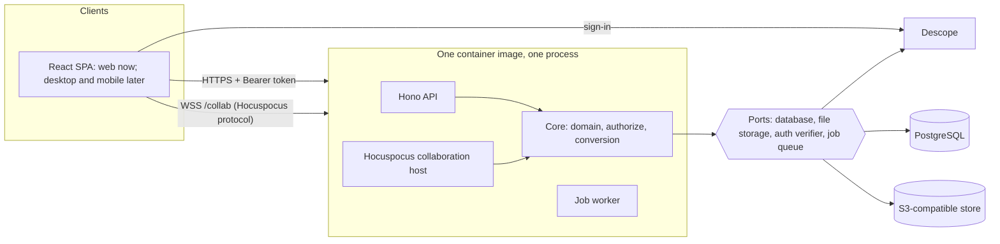

# Grimoire specification (v1)

Status: specification for version 1, with an honest status on every requirement (see below). Decisions and their history are in [decisions.md](decisions.md).

This specification builds on the [brief](brief.md) and the [design direction](design.md). Every requirement states Grimoire's own behaviour and the reason for it.

## How to read this

Every requirement has an id (R4.12 means section 4, item 12) and exactly one status. Ids are stable: a removed requirement keeps its id and is marked Withdrawn.

| Status | Meaning |
|---|---|
| **Built** | Exists in the code and a named test file or code path proves it. The cell names it, for example `Built (test: apps/server/test/collab/limits.int.test.ts)`. |
| **Built, not covered by a test** | The code exists, but no automated test would fail if it were removed. These are test gaps. The cell names the code path. |
| **Partly built** | Some of it exists. The cell says what exists and what is still planned. |
| **Planned** | A decided or proposed design. Nothing of it exists in code yet. |
| **Rule** | A scope statement, policy or standing project rule that needs no code of its own, or whose enforcement is a review practice. |
| **Withdrawn** | A requirement removed by a later decision. Its number stays so references do not break. |

Tests are run locally, in continuous integration (`.github/workflows/ci.yml`) and, for the container, with Docker Compose. A test that ran only against a local emulator or an in-process fake is described as such; nothing in this document has been run on a real cloud host. Where sources conflicted, the later decision wins (see [decisions.md](decisions.md)). Open questions are in section 15.

Terms used throughout:

- **Yjs**: a library that keeps a shared document as a set of small changes ("updates") that can be applied in any order and any number of times and still give the same result. A Yjs document is called a **ydoc**.
- **Collaboration host**: Grimoire's server for live editing: Hocuspocus running inside the application. It keeps the pages being edited in memory, forwards updates between people and saves pages to PostgreSQL.
- **Awareness / presence**: who is on the page and where their cursor is. Sent through the collaboration host, never stored.
- **Compaction**: merging many stored updates into one.
- **Ports and adapters**: a port is an interface owned by the core; an adapter implements it for one host or product (section 2.2).
- **Collection**: a top-level group of pages.

## 1. Scope and non-goals; users and scale

| Id | Requirement | Status | Basis |
|---|---|---|---|
| R1.1 | Grimoire is an internal documentation tool for one organisation. Pages are written in a WYSIWYG editor and stored as Markdown. People edit a page together in real time. | Partly built (live editing, Markdown conversion and saving exist in the server; the web client does not, `apps/web` is a placeholder) | [brief](brief.md) |
| R1.2 | In v1: nested page tree, rename, move, delete to trash; WYSIWYG editing; live co-editing with visible cursors; page history; full-text search; semantic search; image and file attachments; a one-off importer for Markdown and CSV exports; Descope sign-in. | Partly built (live co-editing, token verification and access rules exist; the page tree, history, search, attachments, import and the client are planned) | [brief](brief.md) |
| R1.3 | Not in scope: AI product features, database features (tables as data, boards, kanban, relations, formulas), calendar, mail. The application may still use a database server internally. | Rule | |
| R1.4 | Scale target: 100 to 1,000 people, one organisation. Design for tens of simultaneous editors in total and at most 100 on one page. | Partly built (the 100-connections-per-page cap is a configurable limit, default 100: test `apps/server/test/collab/limits.int.test.ts`; the scale target itself is untested) | The 100-editor cap is R4.15 |
| R1.5 | Also out of v1: external guests, public pages and share links, canvases and whiteboards, native apps, PDF or DOCX export, end-user scripts or plugins, comments, page templates, drafts. The first four are assumptions of the brief that have not been confirmed. | Rule | |
| R1.6 | Deployment runs on AWS, built by SST: the application container on Fargate behind an application load balancer, managed PostgreSQL on RDS (moving to Aurora Serverless v2) and S3 for files (decision 174). The core stays independent of the host (R2.17, R2.47). | Planned (the Compose setup for local use exists, R1.7) | [decisions.md](decisions.md) |
| R1.7 | Everything that is built runs fully locally in Docker Compose, with no call to a cloud provider. | Built (test: `apps/server/test/server/compose.int.test.ts` (renders the files with `docker compose config --format json`, merged offline override included): no cloud provider, registry or endpoint in the resolved stack; code path: `compose.yaml`; the no-route-out check is `compose.offline.yaml`, R2.14) | |
| R1.8 | **Withdrawn.** Open design questions are settled by a recorded decision, not by following another project. | Withdrawn | |
| R1.9 | Package and repository naming: the repository is `tektum/grimoire`; npm packages use the scope `@tektum` with a `grimoire-` prefix (for example `@tektum/grimoire-web`), because the name `grimoire` is taken on npm. | Built (test: `packages/core/test/boundaries/layout.test.ts`, "names every package with the @tektum/grimoire- scope"; code path: `name` fields in the `package.json` files) | Section 15.2 |
| R1.10 | The first version is the web client only. Desktop and mobile clients are planned for and not built (section 11.4). | Planned | |

## 2. Architecture

Live editing runs in one always-on container running Hocuspocus, inside the application. The design is hosting-agnostic: a backend and a front end that are split, nothing rendered on the server, so that web, desktop and mobile clients can share one app. The backend is one codebase whose core depends on no hosting provider and talks to the outside world through a small set of named interfaces ("ports"). The planned deployment runs on AWS, built by SST (R1.6, decision 174). Flavours for other hosts may come later. See [decisions.md](decisions.md) and [research 11](research/11-frameworks.md).

### 2.1 The stack

| Part | Choice |
|---|---|
| HTTP API | Hono |
| API contract | OpenAPI document with a generated typed client |
| Client | React and Vite single-page app, no server-side rendering |
| Database | PostgreSQL |
| Files | The S3 API (any S3-compatible store) |
| Background jobs | A small job interface; a PostgreSQL-backed implementation first |
| Live editing | Hocuspocus |
| Editor | Milkdown |
| Sign-in | Descope |

### 2.2 Ports

A **port** is an interface owned by the core. An **adapter** implements a port for one host or product. The core contains the domain: pages, collections, permissions (`authorize`), revisions, search queries, attachments, imports, Markdown conversion. It never imports a provider SDK and never reads a provider-specific environment variable. Ratings for other hosts come from [research 11](research/11-frameworks.md) ("Proposed interfaces") and are estimates: nothing was run on Lambda or Workers. Built today: the database, auth verifier, collaboration host, clock, config, logger, user store, access store and Markdown converter ports (`packages/core/src/ports/`). The HTTP runtime is a Hono app served by `@hono/node-server` without a separate port interface. The file storage and job queue ports are planned.

| Port | Contract (short) | v1 implementation (container flavour) | Lambda flavour | Cloudflare Workers flavour |
|---|---|---|---|---|
| **HTTP runtime** | The API is a Hono app: a function from a web `Request` to a `Response`. The port starts it and gives it a shutdown hook. | `@hono/node-server` | Hono Lambda adapter. Easy. | Native. Easy. |
| **Database** | A typed query interface plus `transaction(fn)` and a migration runner, over PostgreSQL only. No abstraction beyond PostgreSQL. | Kysely over `pg`, `GRIMOIRE_DATABASE_URL` | Same code; needs a connection pooler. Moderate. | Hyperdrive plus `pg`. Moderate. |
| **File storage** | A full contract in R2.35: `head`, `get` (stream and byte range), `put`, `delete`, `list`, `signUpload`, `signDownload`, the multipart calls, typed errors. Two endpoint settings (R2.36). No S3 operation name outside the adapter (R2.38). | S3-API adapter (AWS SDK for JavaScript v3, Apache-2.0) against a configured endpoint; SeaweedFS locally | S3. Easy. | R2 through its S3 API. Easy. |
| **Auth verifier** | `verify(token)` returns the minimum: user id and expiry, or "invalid token", or "service unavailable" (R4.9). Email and name come from a separate method (R8.18). | Descope adapter: the official Descope Node SDK on the server, with Grimoire's own token policy on top (R8.5). Token verification calls the SDK's `validateJwt` (R8.5) | Same. Easy. | Workers compatibility of the Descope Node SDK not confirmed. Moderate. |
| **Job queue** | `enqueue(name, payload, options, tx?)` (can join the caller's transaction, R5.20), `schedule(name, cron)`, `work(name, handler)`; at-least-once; handlers are idempotent. Contract and conformance suite: R2.40. | pg-boss over PostgreSQL, with its tables created only by `grimoire migrate` (R2.24, R5.18); fallback: our own `jobs` table (R5.19) | SQS. Moderate. | Cloudflare Queues. Moderate. |
| **Collaboration host** | `start(deps)` where deps are `authorize`, the page store, the auth verifier and the limits; `closeConnections(filter)`; `shutdown()`. The client protocol is the Hocuspocus protocol. | Hocuspocus 4.x | **Separate implementation**, not an adapter: a custom server with its own wire protocol. | **Separate implementation**: Durable Objects (y-partyserver or y-durableobjects), or Hocuspocus if it proves out. |
| **Clock, Config, Logger** | `now()`; typed configuration validated at start; structured JSON log lines. | System clock; `GRIMOIRE_*` environment values read in one place; JSON to stdout | Same | Same |

| Id | Requirement | Status | Basis |
|---|---|---|---|
| R2.1 | The stack is: Hono for the HTTP API; an OpenAPI contract with a generated typed client; a React and Vite single-page app with no server-side rendering; PostgreSQL; files through the S3 API; background jobs behind a small job interface with a PostgreSQL-backed implementation first; Hocuspocus for live editing; Milkdown; Descope. | Partly built (Hono in `apps/server/src/app.ts`, PostgreSQL through Kysely, Hocuspocus, Milkdown packages and Descope token verification exist; the generated client, the React app, the S3 adapter and jobs are planned) | |
| R2.2 | Live editing is one always-on container running Hocuspocus 4.x. | Built (test: `apps/server/test/collab/collab.int.test.ts`; `@hocuspocus/server` 4.8.0 is pinned in `packages/adapters/collab-hocuspocus/package.json`) | |
| R2.3 | **Withdrawn.** An earlier design with a custom serverless live-editing server (its own tables, a managed WebSocket gateway and a custom wire protocol) was dropped in favour of R2.2. Lessons that do not depend on the transport are carried into section 4. | Withdrawn | |
| R2.4 | Reason for R2.2: a single container removes custom synchronisation code. | Rule | |
| R2.5 | The API and the collaboration server use the same permission rules, one shared function (R8.8, R4.10). | Partly built (the collaboration host calls the core `authorize`: tests `apps/server/test/wiring/collapsed-authorizer.test.ts` (no code outside the authoriser module decides access), `packages/adapters/collab-hocuspocus/test/host/auth.test.ts`; the API routes do not exist yet) | |
| R2.6 | The collaboration server is Hocuspocus with small separate extensions for authentication, persistence, connection limits, presence, the periodic access re-check and lifecycle, plus an upgrade guard that admits or refuses WebSocket upgrades (origin, per-address rate, unauthenticated sockets). | Built (code path: `packages/adapters/collab-hocuspocus/src/extensions/`, `src/upgrade-guard.ts`; tests `packages/adapters/collab-hocuspocus/test/host/host.int.test.ts`, `packages/adapters/collab-hocuspocus/test/upgrade/upgrade.int.test.ts`) | |
| R2.7 | Persistence: the page row in PostgreSQL holds the Yjs state next to canonical Markdown and search text. | Built (migrations `db/migrations/0001_pages.ts` and `0002_page_markdown.ts`; test `apps/server/test/collab/save-columns.int.test.ts`) | |
| R2.8 | **Withdrawn.** A requirement specific to one managed database service was removed. | Withdrawn | |
| R2.9 | **Withdrawn.** The VPC, public-subnet and security-group layout is removed from the body; see Deployment (2.4). | Withdrawn | |
| R2.10 | **Withdrawn.** The serverless authorizer and NAT design is removed; the API validates tokens itself through the auth verifier port (R8.16). | Withdrawn | |
| R2.11 | There is one container. A deploy or restart drops every live connection and clients reconnect (R4.30). One container is a single point of failure (R14.2). | Planned (the server side of a restart is tested, R4.30; the reconnecting client is planned) | |
| R2.12 | Local environment: Docker Compose runs the app container (API and collaboration server), PostgreSQL and an S3-compatible store (SeaweedFS, R13.4). Everything that is built runs fully locally. No cloud emulator and no infrastructure-as-code tool is part of v1. | Built (test: `apps/server/test/server/compose.int.test.ts` (renders the files with `docker compose config --format json`, merged offline override included): the four services, pinned images, loopback ports; code path: `compose.yaml`, `Dockerfile`, `Makefile`) | [decisions.md](decisions.md) |
| R2.13 | **Withdrawn.** Earlier infrastructure and test scripts for the custom serverless design are not part of the product. | Withdrawn | |
| R2.14 | The local environment makes no call to any cloud provider: dummy credentials, local endpoints, no cloud profile. | Built (test: `apps/server/test/server/compose.int.test.ts` (renders the files with `docker compose config --format json`, merged offline override included): the override makes the only network internal and leaves no service a way out, and the local stack has dummy credentials and local endpoints only; code path: `compose.offline.yaml` puts every service on a network with no route out; used with `COMPOSE_FILE=compose.yaml:compose.offline.yaml make up`) | |
| R2.15 | The client is a set of static files that any static host or CDN can serve. The container does not have to serve them. | Planned | Split front end, no server-side rendering |
| R2.16 | Hocuspocus is pinned to an exact 4.x version (4.8.0). | Built (test: `packages/core/test/boundaries/layout.test.ts`, "pins every dependency of every package.json to an exact version"; code path: `packages/adapters/collab-hocuspocus/package.json`; exercised by the collaboration integration tests, for example `apps/server/test/collab/collab.int.test.ts`) | |
| R2.17 | Backend and front end are split and nothing is rendered on the server, so that web, desktop and mobile clients can share one app. The design is hosting-agnostic: simple code, clean interfaces, flavours for other hosts later. | Rule | |
| R2.18 | The ports are those in the table above: HTTP runtime, database, file storage, auth verifier, job queue, collaboration host, and clock, config and logger. Each has an interface in the core, one v1 adapter, and an in-memory fake used by unit tests. | Partly built (interfaces in `packages/core/src/ports/` and fakes in `packages/core/src/testing/` exist for database, clock, config, logger, user store, access store, page store and Markdown converter, and the auth verifier fake is `FakeAuthVerifier` in `packages/adapters/auth-fake/src/index.ts`; there is no in-memory collaboration host fake; file storage, job queue and an HTTP runtime port are planned) | [research 11](research/11-frameworks.md) "Proposed interfaces" |
| R2.19 | **Rule:** nothing outside an adapter may import a provider SDK or read a provider-specific environment variable. A lint rule (import restrictions) and a test that scans the core for forbidden imports and environment names enforce it in CI. | Built (test: `packages/core/test/boundaries/adapter-imports.test.ts`; `apps/server/test/server/source-rules.test.ts` for the server) | |
| R2.20 | Live editing is not portable by adapter. v1 builds the container flavour only (Hocuspocus). A Lambda or Cloudflare flavour would be a separate implementation behind the collaboration port, and clients would need a provider switch if its wire protocol differs. | Rule | [research 11](research/11-frameworks.md) section 3 |
| R2.21 | One container image runs the API and the collaboration server **in one process**, sharing one HTTP port (WebSocket upgrades on `/collab`), one `authorize`, one health endpoint and one shutdown path. The processes share the application's database settings but use separate connection pools: the API pool (10 connections, the library default), the page store's pool (at most 4, with a database timeout of its own) and the sign-in lookup pool (at most 4); the last two exist only in a process that serves collaboration (`GRIMOIRE_ROLE` `all` or `collab`). Reasons: the simplest deployment; the conversion step that costs CPU already runs in a worker thread (R7.6); two processes in one image would need a process supervisor and a more complicated graceful shutdown. Risk: heavy API load can slow the sockets; see R13.23. | Built (test: `apps/server/test/collab/collab.int.test.ts` ("one process, one port"); code path: `apps/server/src/collab/index.ts`, `apps/server/src/composition.ts`) | |
| R2.22 | A `GRIMOIRE_ROLE` setting (`all` by default, `api` or `collab`) selects what starts, so the same image can later run as two containers without code changes. The duties of each role are in R2.41. | Partly built (setting and the rule that `api` does not attach the collaboration host: `packages/adapters/config-env/src/schema.ts`, `apps/server/src/composition.ts`; the job side of the roles is planned) | |
| R2.23 | Database library: **Kysely** (MIT) over `pg`, with TypeScript migrations run by Kysely's Migrator (R5.13). Reason: the data model uses a trigger-maintained `tsvector` column, partial GIN and B-tree indexes, a deferrable composite foreign key, `citext` and recursive queries, which are easiest to write as SQL; Kysely types the queries without hiding the SQL. | Partly built (Kysely, `pg` and migrations 0001 to 0004 exist: `packages/adapters/db-kysely/`, `db/migrations/`; the search column, trigger and most indexes are planned) | [research 11](research/11-frameworks.md) section 4 |
| R2.24 | Background jobs: pg-boss 12.x (MIT) behind the job port in v1, pinned to an exact version. Its tables are created and upgraded only by the `grimoire migrate` deploy step (R5.18). At runtime the app starts it with `migrate: false` and its database user has no schema-change rights. Jobs: import, trash purge, expired-upload cleanup, revision catch-up. Handlers are idempotent. | Planned | |
| R2.25 | OpenAPI tooling: `@hono/zod-openapi` to describe routes and emit the document; `openapi-typescript` to generate the client types and `openapi-fetch` as the typed client at runtime (all MIT). The contract and generated client are decided. | Planned (`@tektum/grimoire-api-client` exists as a package name only) | [research 11](research/11-frameworks.md) section 2 |
| R2.26 | Desktop (Tauri 2 or Electron) and mobile (Tauri 2 or Capacitor) clients are planned for, wrapping the same app. They are not in the first version. | Planned | |

### 2.3 Diagram

### 2.4 Deployment

What the container needs from any host. Nothing here names a provider.

| Id | Requirement | Status | Basis |
|---|---|---|---|
| R2.27 | The container is configured only by environment values with the `GRIMOIRE_` prefix, read in one place and validated at start (the app refuses to start on a missing or malformed value): a PostgreSQL URL; the S3-compatible file store: the internal endpoint, the browser-reachable public endpoint (R2.36), bucket, access key, secret key, region and addressing style; the Descope project id; the public base URLs of the API and the collaboration endpoint; the allowed browser origins (R12.32); the first-admin email list (R5.16); the trusted proxy setting `GRIMOIRE_TRUSTED_PROXY` (which proxy hops may supply the forwarded client address, R4.19, R12.28); limits. Secrets arrive as environment values. | Built (test: `packages/adapters/config-env/test/config.test.ts`; schema in `packages/adapters/config-env/src/schema.ts`; the S3 values are parsed and validated but not yet used) |  |
| R2.28 | A public HTTPS endpoint and a public secure WebSocket endpoint reach the container: TLS ends at the host's proxy or load balancer; the container speaks plain HTTP and WebSocket on one port. | Planned (the container serves plain HTTP and WebSocket on one port, `GRIMOIRE_PORT`; TLS termination belongs to the host) |  |
| R2.29 | Health endpoints on the same port: `/healthz` (liveness: the process is up) and `/readyz` (readiness: PostgreSQL answers, the schema is at the migration version the code expects, and the server is not draining, R2.42). A readiness probe never waits longer than 2 seconds, concurrent probes share one database check, and the answer is remembered for 2 seconds when ready and 1 second when not. For the roles that run background jobs (`api` and `all`) a `/readyz` answer of 200 also carries the header `X-Grimoire-Jobs` with the state of the job queue: `starting` (not registered yet, or trying again), `up` or `down` (it could not start after every try; one error event `jobs.unavailable` is logged). During shutdown `/readyz` answers 503 (draining) and carries no header; the queue's own state is `stopped` by then, which is internal and never seen there. `/readyz` stays 200 when jobs are `down`: the API still serves, and replacing the container would not bring the jobs back and would take the API down with it; an alarm keys on the event or the header, not on readiness. They reveal nothing else. | Built (test: `apps/server/test/server/server.int.test.ts`, "readiness against PostgreSQL") |  |
| R2.30 | Graceful shutdown on `SIGTERM`: stop accepting connections, save every open page, close the Markdown conversion pool and the database pools, exit (R4.25). The host must give a stop grace period of at least the server's overall shutdown backstop plus 5 seconds (64 seconds for the default 45-second save deadline: the save phase keeps its full configured time, the other phases together are allowed 12 seconds, the backstop adds 2 seconds, and the grace period 5 more); `apps/server/src/lifecycle/budget.ts` derives all of them. Finishing or releasing jobs is planned with the job queue. | Built (test: `apps/server/test/server/server.int.test.ts`, "shutdown of the real entry point"; `compose.yaml` sets `stop_grace_period: 64s` and `make check-compose` checks it against the budget; the save deadline is `GRIMOIRE_SHUTDOWN_SAVE_DEADLINE_MS`, default 45000) |  |
| R2.31 | The container is stateless apart from open pages in memory: no local disk is needed, and a restart loses nothing a client still holds (R4.30). | Partly built (the server keeps state only in PostgreSQL and open pages in memory: test `apps/server/test/collab/collab.int.test.ts`, "persistence"; `compose.yaml` runs the app container with a read-only root filesystem) |  |
| R2.32 | Logs go to standard output as one JSON line per event, with no tokens or query strings (R4.41). Every line has `ts`, `level` and `event`; `message`, which repeats the event text (after the same scrubbing) because a log pipeline shows `message` as the line and does not read `event`; `service` (`grimoire`); and, when the process has one, `env`, the stage it runs in (the setting `GRIMOIRE_ENV`, `local` unless the host sets it). The logger writes those itself and callers cannot set them, nor `host` or `version`, which such a pipeline also reads as the line's own (the address the server binds is logged as `bindHost`). Loggers created before the settings are read (the one-off commands, and a configuration that could not be read) carry `service` but no `env`; once the settings are read, every logger of the server carries both. The logger is `pino` plus a small hand-written secret scrubber applied to every value before it reaches pino, because pino's path-based redaction alone misses nested keys, URL query strings and connection strings in messages and stacks. The scrubber is a best-effort safety net: code never logs a secret and named fields are redacted by name; it recognises URLs with credentials, query strings and fragments, secret-looking `key=value` and `"key":"value"` pairs, bearer and basic credentials and tokens, and it fails closed. Known limits, pinned by tests named "known limit" (`packages/adapters/logger-json/test/redaction.test.ts`): an unquoted value ends at a semicolon, and credentials without a scheme are not recognised. | Built (code path: `packages/adapters/logger-json/`; tests in `packages/adapters/logger-json/test/`) |  |
| R2.33 | Migrations are a separate command in the same image, run as an explicit deploy step before the new version starts (R5.14). | Built (code path: `apps/server/src/cli.ts` `migrate` command and the `migrate` service in `compose.yaml`; test: `apps/server/test/migrations/migration-0004.int.test.ts`) |  |
| R2.34 | **Withdrawn.** An optional deployment note was removed. | Withdrawn | |
| R2.35 | **File storage port contract.** Inputs, outputs and errors: `head(key)` returns size, content type, entity tag and modified time, or `NotFound`. `get(key, {range?})` returns a readable stream plus size and content type; `range` is `{start, end}` in bytes (end inclusive); errors `NotFound`, `RangeNotSatisfiable`. The caller never has to hold a whole object in memory (imports read zips of hundreds of MB, R12.30). `put(key, body, {contentType, size})` takes a stream or bytes and returns the entity tag. `delete(key)` never fails when the key is absent. `list(prefix, {cursor, limit})` returns keys with size and modified time and a `nextCursor`. `signUpload(key, {size, contentType, ttlSeconds})` returns everything the browser needs: `{method, url, headers, fields?, expiresAt}`, where `headers` and `fields` are exactly those the browser must send; the store must reject an upload whose size or content type differs from what was signed (a signed length and type for a PUT; a policy for a form POST). An adapter whose store cannot enforce both fails the conformance suite. `signDownload(key, {ttlSeconds, disposition, fileName?, contentType?})` returns `{url, expiresAt}`; the URL makes the store answer with the given `Content-Disposition` and `Content-Type`. Common errors: `Unavailable` (transient, retryable), `InvalidKey`, `Unsupported`. A valid key is 1 to 512 bytes, has no leading slash, no `..` segment and no control characters. A multipart upload writes one object in parts that the client sends straight to the store (R6.39): `createMultipart(key, {contentType})` returns an `uploadId` and the object does not exist yet; `signPart(key, {uploadId, partNumber, size, ttlSeconds})` signs one part for exactly that size, upload and part number (1 to 10000); `listParts(key, uploadId)` returns the parts the store holds as `{partNumber, size}`, for a client that resumes; `completeMultipart(key, uploadId)` joins the parts the store holds, which must be numbered 1 to n without a gap and all but the last at least 5 MiB, and returns the entity tag and size, or `InvalidParts`; `abortMultipart` never fails for an unknown upload. An unknown upload is `NotFound`. The entity tags of the parts never leave the adapter. | Planned |  |
| R2.36 | Two file-store endpoint settings: an **internal** one the backend uses, and a **public** one the browser can reach. Every signed URL uses the public endpoint, so the signature matches the host the browser calls. If only one is set, both are the same. In Compose the internal endpoint is `http://seaweedfs:8333` (the service name) and the public one is empty by default, so both are the same until `GRIMOIRE_S3_PUBLIC_ENDPOINT` is set (for example to `http://localhost:8333`). | Partly built (the settings `GRIMOIRE_S3_ENDPOINT` and `GRIMOIRE_S3_PUBLIC_ENDPOINT` are parsed and validated in `packages/adapters/config-env/src/schema.ts`; signing is planned) |  |
| R2.37 | **Conformance suite.** One suite of tests, `file-storage-conformance`, is run against the in-memory fake and every adapter, and all must pass. Cases: put, head, get; range read of the first 512 bytes and of a middle range; streaming read of a 200 MB object without buffering it (memory stays flat); delete of an absent key; list paging; `signUpload` accepts the exact size and type and the store rejects a different size and a different type; an expired upload URL is rejected; `signDownload` sets disposition and content type; signed URLs contain the public host; a browser preflight from an allowed origin passes and from another origin fails (R2.39); multipart: a part is refused for another size or part number or after its expiry, a part sent again with the same bytes is listed once, a resumed upload lists its parts, a listing of more than 1000 parts is whole, completion refuses a gap or a short part, abort leaves no object; key validation. | Planned |  |
| R2.38 | No S3 operation name (such as `HeadObject`) appears outside the adapter, in the API, the core or this spec's requirements. Requirements say `head`, `get`, `signUpload`. | Planned |  |
| R2.39 | The file store is configured to allow the allowed browser origins (R12.32) to `PUT`, `POST` and `GET` signed URLs from a browser (CORS). The deployment checks it; the conformance suite tests it where the store supports it. | Planned |  |
| R2.40 | **Job port contract and conformance.** `enqueue(name, payload, {delaySeconds?, singletonKey?, retryLimit?}, tx?)` returns a job id, or the existing id when `singletonKey` matches a queued job; `work(name, handler, {concurrency})`; `schedule(name, cron)`; a handler that throws is retried up to `retryLimit` with backoff and then marked failed; jobs run at least once. A `job-queue-conformance` suite runs against the in-memory fake and the adapter: enqueue, delay, retry, singleton, scheduling, a crash mid-job (the job runs again), and enqueue inside a transaction that rolls back (no job exists). | Planned |  |
| R2.41 | **Duties by role.** `GRIMOIRE_ROLE=all`: everything below. `api`: HTTP routes, `/healthz`, `/readyz`, job workers, scheduled jobs (purge, cleanup), the import worker. `collab`: the `/collab` socket host, the one-minute re-check (R4.48), the save and revision timers (R4.20, R9.2), the Markdown conversion worker thread. `api` never opens sockets; `collab` never runs jobs. If the collaboration host cannot share the API's HTTP server (R2.21), it listens on a second port in the same process (`GRIMOIRE_COLLAB_PORT`). | Partly built (roles, `/collab` on the shared port or on `GRIMOIRE_COLLAB_PORT`, the one-minute re-check and the conversion worker thread exist: test `apps/server/test/collab/collab.int.test.ts`; jobs, imports and revision timers are planned) |  |
| R2.42 | Draining: on `SIGTERM` `/readyz` fails immediately, so the proxy stops sending new connections, before the shutdown order of R4.25 starts. | Built (test: `apps/server/test/server/server.int.test.ts`: `/readyz` is 503 within 1 s of `SIGTERM`) |  |
| R2.43 | Startup refuses to run in two unsafe combinations: local mode (development tokens) together with a Descope project id; and non-local mode without a Descope project id. The message says which. In local mode the development token secret must be set (16 to 128 letters, digits, `_` or `-`), and the server binds a loopback address unless `GRIMOIRE_LOCAL_ALLOW_NON_LOOPBACK=1`. A Descope project id that is not 1 to 128 letters and digits is refused at startup, and the message never repeats the value. | Built (test: `packages/adapters/config-env/test/config.test.ts`, "startup refusals (R2.43)") | R12.22 |
| R2.44 | Hocuspocus 4.x stays the collaboration host. If it ever fails the proof, the fallbacks are, in order: the `y-websocket` server (MIT; it "can't be scaled easily", which is acceptable for one container), or our own server on the Yjs protocol libraries (`y-protocols`, MIT). The collaboration port (R2.18) is why this stays possible; the Hocuspocus-specific requirements in section 4 would change. | Rule | [research 11](research/11-frameworks.md) section 3 |
| R2.45 | **Embedding ports.** `Embedder` (text to vectors, with its model name, version and dimension) and `EmbeddingStore` (chunk rows and the permission-filtered similarity query) are ports in the core; the model runtime (`onnxruntime-node`, `@huggingface/tokenizers`) lives only in the adapter `embedder-onnx` and the SQL only in the database adapter, so the core stays free of runtime libraries and of hosting. An in-memory fake of each backs the unit tests. | Planned | [research 13](research/13-semantic-search.md); R2.18 |
| R2.46 | **The database image includes pgvector.** The Compose database service is `pgvector/pgvector:pg17` pinned by digest (pgvector 0.8.x on PostgreSQL 17), and the production database must offer pgvector 0.8 or later; the extension is created in `db/init` by the database owner, as `citext` and `pg_trgm` are. | Planned (the Compose database service is `postgres:17` today; `db/init/02-extensions.sql` creates the extensions it needs) | [research 13](research/13-semantic-search.md); R12.25 |
| R2.47 | **Provider neutrality**: the core and the adapters name no hosting provider. Anything specific to Google Cloud (or any other host) is a setting or lives in the `deploy/` directory (for example `deploy/gcp/`). The files adapter's create-only precondition header is a setting, not a provider switch. | Rule |  |
| R2.48 | **Storage keys.** A key is 1 to 512 UTF-8 bytes; it has no leading or trailing slash, no empty segment (`a//b`), no `.` or `..` segment, no backslash, no control character (C0, DEL or C1) and no lone surrogate; and no segment (the text between slashes) is longer than 255 UTF-8 bytes, because the store we ship cannot hold a longer one. A longer key is made of several segments; the keys the product builds are short. Every method that takes a key refuses a bad one with `invalid-key` before it sends a request; the `list` prefix is not checked against these rules (a prefix may end with a slash). | Built (tests: `packages/core/test/file-storage/key.test.ts`, case `key-validation` of `packages/core/src/testing/file-storage-conformance.ts`) | |

## 3. Document model

### 3.1 Stored form

| Where | Field | Content | Role |
|---|---|---|---|
| PostgreSQL `pages` | `markdown` | Canonical Markdown | Durable readable form. Export, history and import use it. |
| PostgreSQL `pages` | `text_content` | Plain text of the page | Source of the search index |
| PostgreSQL `pages` | `ydoc` | Yjs state of the whole page (binary) | Live-editing state, loaded by the collaboration server. 1.1 to 13.6 times the Markdown size depending on shape (R3.3). |

| Id | Requirement | Status | Basis |
|---|---|---|---|
| R3.1 | Markdown is the durable, portable form of a page. | Built (test: `apps/server/test/collab/save-columns.int.test.ts`) | [decisions.md](decisions.md); [brief](brief.md) success test: an exported page reads correctly in any Markdown tool |
| R3.2 | Editing state is a Yjs document made with Milkdown's collab plugin. The content lives in one named Y.XmlFragment, `prosemirror`; its name is fixed once and shared by client and server. | Built (test: `packages/editor-schema/test/fragment-name.test.ts`) |  |
| R3.3 | The Yjs state is 1.1 to 13.6 times the Markdown size depending on shape (prose 1.6x, code 1.1x, mixed about 5x, lists 10.5x, tables 13.6x; [proof note](proof/m2-schema-fixes.md), "State size against Markdown size") and how it grows with edit history is not measured (R3.19). | Built (test: `packages/editor-schema/test/benchmark/size-ratio.test.ts` checks the ratios against the recorded values) |  |
| R3.4 | When a page is opened and its `ydoc` is empty (new, imported or reset), the collaboration server reads the row, converts its Markdown to a Yjs document with no transaction open (a heavy page must not hold the row lock while it waits for the converter), and then takes a short row lock, re-checks that the row still has no state, the same Markdown and the same epoch, and writes the state; if the row changed meanwhile the result is discarded and the row read again (up to 3 attempts). Only one opener can seed it. | Built (test: `apps/server/test/collab/seed.int.test.ts`; code path: `packages/adapters/db-kysely/src/page-store.ts`) | Markdown to Yjs under Milkdown: R7.3 |
| R3.5 | A page's `markdown` and `text_content` can lag the live document by the save delay (about 3 s, at most 10 s apart while editing continues). Search, history and export use the saved Markdown. | Partly built (built and tested: saved after the 3 s debounce, at most 10 s apart while typing continues, `apps/server/test/collab/collab.int.test.ts`, "persistence"; not built: search, history and export, which do not exist yet, so none of them reads the saved Markdown yet) | Follows from R4.20 |

### 3.2 Canonical Markdown

The editor owns the formatting style. A file is rewritten into that style on first save and is stable afterwards.

| Id | Requirement | Status | Basis |
|---|---|---|---|
| R3.6 | Stored Markdown is exactly what Milkdown 7.23.0 (commonmark and gfm presets, plus the heading change in R3.12) serialises. Character-for-character preservation of imported files is not a goal. | Built (tests: `packages/adapters/markdown-milkdown/test/convert/round-trip.test.ts`, `packages/adapters/markdown-milkdown/test/corpus/corpus.test.ts`) | Milkdown 7.23.0 is pinned in `packages/editor-schema/package.json` |
| R3.7 | The canonical style includes: `*` for bullets, `***` for a horizontal rule, a backslash for a hard line break, tables re-padded, reference links turned into inline links, `**[x](url)**` written as `[**x**](url)` (a link is always the outermost mark). | Built (tests: `packages/adapters/markdown-milkdown/test/golden/golden.test.ts`; the corpus entry `cm-28-link-marks` in `packages/adapters/markdown-milkdown/test/corpus/corpus.test.ts` for the link order) |  |
| R3.8 | Milkdown and plugin versions are pinned to exact versions (`@milkdown/*` and `@milkdown/plugin-collab` 7.23.0, `yjs` 13.6.33). A version change needs a round-trip regression run first, because it can change the canonical output. | Built (code path: exact versions in `packages/editor-schema/package.json` and `packages/adapters/markdown-milkdown/package.json`; test: `packages/adapters/markdown-milkdown/test/versions.test.ts` (fails on any other `@milkdown/core` version or yjs version), `packages/editor-schema/test/preset-tripwire.test.ts` (checks the schema against the preset)) |  |
| R3.9 | A regression corpus (GFM documents and our own CommonMark-style cases; the official CommonMark examples are not used, because their licence is not allowed) runs as a test: every supported construct keeps its meaning and is stable on a second save, except the accepted exceptions the corpus records by name (for example nested emphasis such as `*a **b *c* d** e*`, whose inner italics are lost; see the known limitations, R14.4). | Built (test: `packages/adapters/markdown-milkdown/test/corpus/corpus.test.ts`) |  |

### 3.3 Supported constructs

| Construct | v1 | Status | Basis |
|---|---|---|---|
| Headings, paragraphs, bold, italic, strikethrough, inline code, links | Yes | Built (tests: `packages/adapters/markdown-milkdown/test/golden/golden.test.ts`, `packages/adapters/markdown-milkdown/test/corpus/corpus.test.ts`) | |
| Bullet, numbered and task lists, nested | Yes | Built (tests: `packages/adapters/markdown-milkdown/test/golden/golden.test.ts`, `packages/adapters/markdown-milkdown/test/corpus/corpus.test.ts`) | |
| Tables with alignment | Yes | Built (tests: `packages/adapters/markdown-milkdown/test/golden/golden.test.ts`, `packages/adapters/markdown-milkdown/test/corpus/corpus.test.ts`) | See R14.4 |
| Code blocks with language, quotes, horizontal rules, line breaks | Yes | Built (tests: `packages/adapters/markdown-milkdown/test/golden/golden.test.ts`, `packages/adapters/markdown-milkdown/test/corpus/corpus.test.ts`) | |
| Images and file attachments | Yes | Planned (the editor UI and storage are not built) | |
| Raw HTML in Markdown | Kept, shown as a non-editable block with an "edit source" action; rendering is sanitised (R12.9, planned with the web client) | Partly built (the verbatim round trip of raw HTML is tested: `packages/editor-schema/test/html-blocks.test.ts`; `packages/adapters/markdown-milkdown/test/convert/sanitise.test.ts` covers only the removal of NUL characters and lone surrogates; the rendering sanitisation and the block UI are planned, see [design](design.md)) | |
| Callouts | Not a block of its own (decision 110): an imported callout becomes a quote block with a bold first line, and no callout block is added to the shared schema. | Planned | The source tool writes callouts as HTML ([brief](brief.md)) |
| Footnotes | Not supported in v1; the text survives | Built (test: `packages/adapters/markdown-milkdown/test/convert/known-limits.test.ts`) | |
| Front matter, maths, diagrams | Not supported in v1. Front matter is mangled by the default presets, so import must strip or convert it. | Planned (import-time handling; maths and footnotes staying plain text is tested in `packages/adapters/markdown-milkdown/test/convert/known-limits.test.ts`) | |

### 3.4 Headings as paragraphs

| Id | Requirement | Status | Basis |
|---|---|---|---|
| R3.10 | A heading is a paragraph block with a `level` attribute (0 = plain paragraph), not a separate block type. | Built (test: `packages/editor-schema/test/headings.test.ts`) |  |
| R3.11 | Changing a paragraph to a heading, or a heading's level, never recreates the block, so another person's typing in it is kept. Cause: the Yjs binding matches blocks by type name, and an attribute change does not recreate the element. | Built (tests: `packages/editor-schema/test/heading-interleavings.test.ts`, `packages/editor-schema/test/two-editors.test.ts`) |  |
| R3.12 | The heading commands, keyboard shortcuts and the `#` typing shortcut are rewritten to set the `level` attribute. | Partly built (built and tested: the heading commands and the `#` typing shortcut set the `level` attribute, `packages/editor-schema/test/commands.test.ts`; the keyboard shortcuts (Mod-Alt-1 to 6, Mod-Alt-0, Backspace) are in the code but no test covers them) |  |
| R3.13 | Markdown output writes a paragraph with level 1 to 6 as `#` to `######` and level 0 as plain text; reading Markdown does the reverse. | Built (tests: `packages/editor-schema/test/headings.test.ts`, `packages/editor-schema/test/round-trip-property.test.ts`) | Known exceptions: R14.4 |

### 3.5 Soft lock for other conversions

Turning a paragraph into a bullet, quote or code block recreates the block, and concurrent typing in it is lost. Grimoire protects against this with a soft lock.

| Id | Requirement | Status | Basis |
|---|---|---|---|
| R3.14 | Each client publishes the block its cursor is in through awareness. A client refuses to convert a block that another person's cursor is in, and shows who is there. | Planned (clients do not exist yet) |  |
| R3.15 | The soft lock protects only connected people. Two people editing offline, or a sub-second race between connected clients, can still lose typing. This is a stated limitation (R3.26, R3.27); the structure lock (R3.25) narrows it for connected people. | Rule |  |
| R3.16 | The lock depends on presence being correct, so the collaboration server must stop one user forging or clearing another connection's presence (R4.12). It cannot stop a user putting a false display name or colour in their own record. Presence shows the server-verified user of each connection; a collaborator with write access can already create document operations under any client id (inherent in the editing protocol), so a client id is not an identity: the server guarantees the user label, not the client id. | Built (tests: `apps/server/test/collab/limits-abuse.int.test.ts`, "presence replay goes through the presence checks"; `packages/adapters/collab-hocuspocus/test/presence/presence.int.test.ts`; `packages/adapters/collab-hocuspocus/test/presence-squat.test.ts`) |  |
| R3.17 | Awareness state for the lock is `{ user: { id, name, color }, cursor, blockId }`. The block id is a stable id of the Yjs element the cursor is in. | Planned | The collaboration host only requires `user.id` |

### 3.6 Size caps

| Id | Requirement | Status | Basis |
|---|---|---|---|
| R3.18 | The Yjs state of one page is capped at 1,000,000 bytes, the default of `GRIMOIRE_COLLAB_MAX_STATE_BYTES` (decision 162). Over the cap the collaboration server refuses further updates with a clear message; the page stays readable (R4.16). At the measured ratios this is about 73 KB of table-heavy, about 94 KB of list-heavy, and several hundred KB of prose or code Markdown ([proof note](proof/m2-schema-fixes.md)). The cap is to be confirmed against real pages. | Built (test: `apps/server/test/collab/limits.int.test.ts`; code path: `packages/adapters/collab-hocuspocus/src/extensions/limits.ts`) |  |
| R3.19 | Whether the saved state shrinks after deletions (Yjs keeps markers for deleted content) is not measured. A page can reach the cap with little visible text. | Planned (not measured) |  |
| R3.20 | A page whose real state is over the cap cannot be fixed by editing. The recovery is an admin action "reset state from Markdown" (R6.21). | Planned |  |
| R3.21 | Title: 1 to 255 characters, with no NUL character (422 `invalid`). Markdown that a person or the importer supplies for a page (a seed: creating a page from Markdown, R6.22; replacing it, R6.21; the import, R10): at most 131,072 bytes (128 KiB, `GRIMOIRE_SEED_MAX_MARKDOWN_BYTES`), 8,000 lines, 50 quote or list markers on one line, and 10 seconds of conversion (`GRIMOIRE_SEED_TIMEOUT_MS`) (decision 163); a text over a limit is refused with a message that names the limit and its value. A conversion that had its full time allowance and still ran out is refused 422 `invalid` as too complex, because the same text will run out again; time spent waiting for a free converter, or a run cut short by that wait, is 503 `unavailable` (busy) with `Retry-After`, because it says nothing about the text and a retry may succeed; one conversion at a time per user, and a second is 429 `rate_limited`. Markdown that editing stores (the converter's output) may be up to 1 MiB (1,048,576 bytes); a save whose Markdown would be larger is refused as too large, so that anything stored can be rebuilt by the system (R7.3). The Markdown converter also refuses documents nested deeper than 100 levels or with more than 50,000 blocks. | Partly built (the 255-character title limit is a check constraint in `db/migrations/0004_permissions.ts`; the seed limits, the stored-Markdown cap and the converter limits are in `packages/adapters/markdown-milkdown/src/limits.ts`, test `packages/adapters/markdown-milkdown/test/convert/seed-limits.test.ts`; the tree-depth limit and the lower bound of one character are planned) |  |
| R3.22 | Attachment upload size limit: 25 MiB per file by default, set by configuration. | Planned |  |
| R3.23 | **Remote cursors are always visible**: every other connected person's caret and selection are drawn in that person's colour with their directory name label, shown on arrival and for 3 seconds after each move, and the caret has at least a 3:1 contrast against the page background. Concurrent structural edits are the one case where the editor library can lose or duplicate text (R3.26); seeing where others are is the first defence. | Planned | Evidence in R3.26 |
| R3.24 | **A reconnect after offline work does not merge blindly into a restructured block**: when a client reconnects after making edits offline and the server's changes since it left include a structural change (a block split, joined, deleted or wrapped) in the same document, the client first keeps a Markdown copy of its own document as the user last saw it and, after the merge, offers it. The check is conservative: it may offer a copy when nothing was lost. | Planned (after the first version, decision 147) | The same mechanism as R4.33 |
| R3.25 | **Structure lock**: while another person's cursor is in the same block (their awareness `blockId`, R3.17), the editor holds back Enter that splits the block, Backspace or Delete that joins it with a neighbour, and list wrapping, lifting and sinking, and shows a brief hint ("<name> is in this paragraph"); the action works as soon as that person leaves or disconnects. It extends the soft lock of R3.14. The gap that remains is one network round trip: two people who act within the time the other's cursor takes to arrive can still produce the cases of R3.26. | Planned (after the first version, decision 147) | |
| R3.26 | **The limit is documented to users**: the help text states that two people changing the structure of the same paragraph at the same moment (splitting it, joining it with its neighbour, wrapping it in a list) can still lose or duplicate a few words, that those two guard rails and the known-limit pin tests are planned after the first version (decision 147); in the first version users are told to keep a separate copy of offline edits before reconnecting to a document that was restructured meanwhile. The collaboration library (`y-prosemirror` 1.3.7, the latest) loses or duplicates text in these cases and does not diverge: with two real editors and 500 seeded runs per case, typing in a block while the other user joins it with the block above lost the typing in 500 of 500, wrapping it in a list lost it in 500 of 500, and splitting it moved the typed character in 218 to 346 of 500; two splits or a split and a join duplicated text in 417 to 500 of 500. | Planned (the help text; the measurements are recorded in [proof/m2-live-save.md](proof/m2-live-save.md)) | |
| R3.27 | **Known limit: simultaneous typing at the same spot can scramble words**: when two people type several characters at exactly the same position at the same moment (before each sees the other's text), their letters can end up mixed together, for example `iXYttte` instead of `iXtYtte`; nothing is lost or repeated and both screens end identical, but the words may need retyping. Single characters, typing at different places and typing in different paragraphs are not affected. The known-limit pin test is planned after the first version (decision 147); the plain-words limit itself is stated in the first version. The cause is in `y-prosemirror` 1.3.7, which derives the insert position from a text difference. Measured with two real editors and 500 pairs per case: runs of 2 to 8 characters at the same spot interleaved in 141 of 500 (206 of 500 with a marker prefix); single characters, different spots and different paragraphs were clean (500 of 500). Only single-keystroke transactions were tested: paste and input-method composition are untested. No patch is planned. | Planned (the plain-words statement in the help text; no patch) | |

## 4. Live editing

Live editing runs in one Hocuspocus server in one container (R2.2). Hocuspocus is a Node WebSocket server for Yjs. It keeps each open page in memory, applies and echoes every update, and calls hooks (small functions an extension can register) at each step: connect, authenticate, load, change, store, disconnect.

**How statuses are used in this section.** The collaboration host is built and is exercised by integration tests that start the real server and connect real Hocuspocus provider clients (`apps/server/test/collab/`), by unit and integration tests of the adapter (`packages/adapters/collab-hocuspocus/test/`) and by end-to-end scenarios run with `make test-m1` and the other `make test-*` targets (`apps/server/test-e2e/`). The client side of the protocol (the web client) is not built, so requirements about browser behaviour are Planned.

Hooks and defaults changed between Hocuspocus major versions; the behaviour in this section is the behaviour of Hocuspocus 4.8.0, as exercised by the tests named in each row.

For every requirement the table below says whether Hocuspocus provides the mechanism or Grimoire writes an extension.

### 4.1 Server and protocol

| Id | Requirement | Status | Basis |
|---|---|---|---|
| R4.1 | The collaboration server is Hocuspocus 4.x run with `@hocuspocus/server` in one Node process, started in a container image built from the repository. A page is one Hocuspocus "document"; its name is the page id in lowercase canonical UUID form. A name that is not a valid lowercase UUID is refused before any database call. This also stops a differently written copy of a page id escaping the re-check. | Built (tests: `packages/adapters/collab-hocuspocus/test/host/auth.test.ts`, "a canonical lowercase UUID passes onConnect"; `apps/server/test/collab/auth.int.test.ts`; code path: `packages/adapters/collab-hocuspocus/src/extensions/auth.ts`, `DOCUMENT_NAME`) | Canonical document name check |
| R4.2 | The wire protocol is Hocuspocus's own: binary WebSocket messages (Yjs sync, awareness, authentication, stateless). The client uses the Hocuspocus provider. Grimoire defines no frame format of its own. | Partly built (built: the server side: every integration test in `apps/server/test/collab/` connects with `@hocuspocus/provider`, for example `collab.int.test.ts`; the web client is planned and not built) |  |
| R4.3 | The session token travels in Hocuspocus's authentication message after the socket opens, not in the URL. | Built (code path: `packages/adapters/collab-hocuspocus/src/extensions/auth.ts` reads the token only from the authentication message; every test in `apps/server/test/collab/auth.int.test.ts` sends it that way; no test asserts that a token in the URL is ignored) | The Hocuspocus `token` option and the `onAuthenticate` hook |
| R4.4 | The server is built from extensions, one concern each: authentication and permission; persistence; connection and rate limits; presence identity; access re-check (closing connections); upgrade admission (origin, rate); logging. An editor-version gate is planned (R4.32). | Built (test: `packages/adapters/collab-hocuspocus/test/registry/structure.test.ts`, one named extension per concern in the documented priority order; each concern is tested under its own requirement; code path: `packages/adapters/collab-hocuspocus/src/extensions/` (`auth.ts`, `persistence.ts`, `limits.ts`, `presence.ts`, `recheck.ts`, `lifecycle.ts`) and `src/upgrade-guard.ts`; metrics are not a separate extension, R4.41) |  |
| R4.5 | TLS ends at the host's proxy or load balancer (R2.28). The container listens on plain HTTP and WebSocket on one port, reachable only through that proxy. | Rule | R2.28 |
| R4.6 | Hocuspocus and the extension packages are pinned to exact versions, with a lockfile. | Built (tests: `packages/core/test/boundaries/layout.test.ts`, "pins every dependency of every package.json to an exact version" and "locks with bun.lock only"; code path: exact versions in `packages/adapters/collab-hocuspocus/package.json` and the lockfile) | Same rule as R3.8 |

### 4.2 What Hocuspocus provides and what we write

| Concern | Hocuspocus provides | Grimoire writes |
|---|---|---|
| Authenticate and set read-only | `onAuthenticate` hook; a connection can be marked read-only (`connectionConfig.readOnly`, `server/src/Connection.ts`, `ClientConnection.ts`) | The token check, the permission lookup, the read-only decision |
| Reject an inbound message | `beforeHandleMessage`: a rejection stops the message (`server/src/types.ts` comment on `afterHandleMessage`) | Size, rate and validity rules |
| Check presence | `beforeHandleAwareness` hook with the decoded states; throwing rejects | Identity and client-id ownership rules |
| Close connections | `closeConnections(documentName)` closes all connections of one document with the reset close event (`server/src/Hocuspocus.ts`) | Closing for one user and for expired sessions, driven by the one-minute re-check (R4.14, R4.48) |
| Frame size cap | `websocketOptions` pass to the `ws` library, e.g. `maxPayload`; a `MessageTooBig` close event exists (`server/src/Server.ts`, `common/src/CloseEvents.ts`) | Choosing the number (R4.16) |
| Save timing | `debounce` and `maxDebounce` options; defaults in 4.8.0 are 2,000 and 10,000 ms (`server/src/Hocuspocus.ts`) | Setting 3,000 and 10,000 |
| Store and load | `onLoadDocument` and `onStoreDocument` hooks; a `Database` extension (`extension-database`) | The PostgreSQL code (R4.23) |
| Per-IP connect limit | The `extension-throttle` package exists (attempts per period, then a ban in minutes; defaults 15 attempts, 5-minute ban) but is **not used**: it trusts client-supplied forwarding headers and puts every client without a header in one bucket (R4.19) | `rate-limiter-flexible` keyed by the real client address our upgrade handler takes from the trusted-proxy setting (R4.19) |
| Connection limit | Document connection counts are available in memory | The limit itself |
| Editor version | A hook point at connect | The extension |
| Many servers | `Redis` extension (`extension-redis`) | Out of v1 (R14.3) |
| Logging | `Logger` extension (`extension-logger`) | Structured JSON to stdout |

### 4.3 Identity and access

| Id | Requirement | Status | Basis |
|---|---|---|---|
| R4.7 | At connect the token is validated with the Descope Node SDK (`validateJwt`). The user, their mode and the session expiry are kept in the connection's in-memory context. | Built (the adapter in `packages/adapters/auth-descope/` calls the official Descope Node SDK's `validateJwt` with Grimoire's own token policy on top; tests `packages/adapters/auth-descope/test/verify.test.ts`, `packages/adapters/auth-descope/test/keyset.test.ts`, `packages/adapters/auth-descope/test/contract.test.ts`, `packages/adapters/auth-descope/test/sdk.test.ts` and `apps/server/test/collab/descope-host.int.test.ts`) |  |
| R4.8 | A session token is never stored: not in PostgreSQL, in logs, in S3, or in any file. Memory holds user id, mode and expiry only. A test scans stored data and logs for the token. | Built (test: `apps/server/test/collab/auth.int.test.ts`, "token scan (R4.8, R12.6)": a canary token is in no log line, no database dump and no temporary file) |  |
| R4.9 | A failure to reach or start the Descope validator is reported to the client as "try again" and logged as an error, never as "invalid token". Existing connections are never closed because of a validator failure. A key-service outage is never counted against the client's address. | Built (test: `apps/server/test/collab/descope-host.int.test.ts`, "key service down (keys never fetched): try-again, more often than the attempt limit, and never a ban") | [decisions.md](decisions.md) |
| R4.10 | One function `authorize(user, page)` decides access, in the core, used by every HTTP route and by the collaboration host at connect and at each re-check. No other code decides permission. | Partly built (built and tested: `packages/core/test/authorize/decide.test.ts`, `apps/server/test/collab/auth.int.test.ts`; code path: `packages/core/src/authorize/`); not built: the HTTP routes that will call it (none exist yet) |  |
| R4.11 | A user without write access gets a read-only connection and the server drops their updates. A suspended user is refused at connect. | Built (tests: `packages/adapters/collab-hocuspocus/test/host/read-only.test.ts`, `packages/adapters/collab-hocuspocus/test/host/suspended.test.ts`; `apps/server/test/collab/descope-host.int.test.ts`: "read entry -> read-only and its writes are dropped") |  |
| R4.12 | Presence identity: each presence state must carry `user.id` equal to the signed-in user, and a connection may publish only for the Yjs client id it owns: the one of its first document update, which wins over an earlier presence claim of another socket (the squatter's claim is voided), or, while it has made no update, the first one it publishes. A presence state over 4,096 bytes is dropped, and an unauthenticated socket publishes nothing, and a read-only socket can never bind a client id through a document update, but its presence claim for an id nobody has bound stands until an editor writes with that id (pinned by `presence-squat.test.ts`). A state for another client id, a removal of another client's state, or a client id owned by another connection is dropped, and the sender is told. A display name or colour is not checked. | Built (tests: `packages/adapters/collab-hocuspocus/test/presence/presence.int.test.ts`, `packages/adapters/collab-hocuspocus/test/presence-squat.test.ts`, `apps/server/test/collab/limits-abuse.int.test.ts`, "presence replay goes through the presence checks"; code path: `packages/adapters/collab-hocuspocus/src/extensions/presence.ts`) | Hook: `beforeHandleAwareness` |
| R4.13 | Connections close when access ends. The collaboration server re-checks every open connection against PostgreSQL once a minute (R4.48). A connection whose user is suspended, or who no longer has the page's permission (removed from a collection or group, role changed, page or collection moved out of reach, or deleted; archiving is planned with the page lifecycle and is not checked yet), is closed. The closed client reconnects and is re-authorised or refused. **Consequence: access removal takes effect on live connections within about one minute, not at once.** A sign-out is not detectable by the server, because the token is not kept: that connection ends at session expiry (R8.7). Closing at once on every kind of change is deliberately not built; a once-a-minute query is simpler for 100 to 1,000 users (section 14). | Built (tests: `packages/adapters/collab-hocuspocus/test/recheck/recheck.int.test.ts`, `packages/adapters/collab-hocuspocus/test/recheck/recheck.test.ts`) |  |
| R4.14 | A sweep once a minute closes connections whose session expired. The client then reconnects with a fresh token. The maximum session length is set short (see R8.7). The same sweep carries the re-check of R4.48. A token presented on an open connection that fails verification after the connection's own expiry has passed (typically the client answering the server's token request with the token it already holds) closes the connection `session-expired`, not `invalid-token`: the session is over and the client signs in again. Before the expiry, a token that fails verification still closes it `invalid-token`; a valid token of another person closes it `invalid-token` at any time. | Built (tests: `apps/server/test/collab/expiry.int.test.ts`, `packages/adapters/collab-hocuspocus/test/recheck/recheck.int.test.ts`, `packages/adapters/collab-hocuspocus/test/recheck/recheck.test.ts` (session-expired after the expiry, invalid-token just before it)) |  |

### 4.4 Limits

| Id | Requirement | Status | Basis |
|---|---|---|---|
| R4.15 | A page accepts at most 100 live connections (default; configurable). The count is kept in memory and raised when the document arrives (the end of the auth extension's `onAuthenticate`, before the client is told it is authenticated and before the page loads), where it is decided again, so clients connecting at the same instant cannot exceed it; the same holds for the container-wide cap (R4.45) and the per-user caps on sockets and documents, and the document that is over a cap is the one that arrived last, never an older one that was already told it was in. The per-user caps are 20 sockets and 50 documents by default (`GRIMOIRE_COLLAB_MAX_SOCKETS_PER_USER`, `GRIMOIRE_COLLAB_MAX_DOCUMENTS_PER_USER`), refused with the reason `full-for-you` (close code 4503). A refusal closes only the refused document's connection; the socket is closed 250 ms later only when it holds no connected document and no document still opening, and that check repeats every 250 ms. An open that reaches `connected` without a live reservation (it was slower than the expiry below) is checked against the same caps there and refused with the usual reason if over them. An expired reservation is logged as `collab.admission_expired`. A place is held for a document from its arrival until its connection ends; if the library drops an open without telling the server (two sockets opening one page that is not loaded yet, and the load fails), the place is held for at most 44 seconds by default (the conversion gate's wait, the larger conversion limit and two store timeouts) and is freed the next time the counts are consulted. The refused client sees a clear message (permission denied with the reason `page-full`). | Built (test: `apps/server/test/collab/limits.int.test.ts`; setting `GRIMOIRE_COLLAB_MAX_CONNECTIONS_PER_PAGE`, default 100) |  |
| R4.16 | Size: a page's stored Yjs state is capped at 1,000,000 bytes, the default of `GRIMOIRE_COLLAB_MAX_STATE_BYTES` (decision 162). `maxPayload` (the largest WebSocket message, so the largest single update) is set separately to 1,048,576 bytes (`GRIMOIRE_COLLAB_MAX_PAYLOAD_BYTES`). A message over `maxPayload` closes the connection with the message-too-big code (1009). An update that would take the state over the cap is refused (R4.47). | Built (tests: `apps/server/test/collab/limits.int.test.ts`, `apps/server/test/collab/limits-config.int.test.ts`, `apps/server/test/collab/byte-budget.int.test.ts`; code path: `packages/adapters/collab-hocuspocus/src/extensions/limits.ts`) |  |
| R4.17 | Every update is checked before it can be stored: bytes that are not a well-formed Yjs update never reach the document. A malformed update is caught, the message is refused and the connection is closed with code 4422. | Built (tests: `apps/server/test/collab/limits.int.test.ts`, "malformed updates (R4.17)"; `packages/adapters/collab-hocuspocus/test/limits/limits.test.ts` (close code 4422); code path: `packages/adapters/collab-hocuspocus/src/extensions/limits.ts`, `SESSION_CLOSE_CODES`) |  |
| R4.18 | Per-connection message limit: at most 300 messages per 10 seconds (`GRIMOIRE_COLLAB_MESSAGES_PER_WINDOW`, `GRIMOIRE_COLLAB_RATE_WINDOW_SECONDS`), counted in memory in a `beforeHandleMessage` extension with `rate-limiter-flexible`. Over the limit the message is refused, the client is told, and the client backs off (close code 4429). **The 300 apply to document messages (everything that is not awareness)**: presence (awareness) messages have their own budget of 3 updates per 100 ms, about 30 a second, per socket; over it an update is dropped, not relayed, and never closes the connection, and the newest dropped update is replayed when the window ends ([proof note](proof/m1-limits-findings.md), "Two budgets"). Counting every frame closed a client typing 15 characters a second about every 10 seconds. The document budget is keyed by user and page, so reconnecting does not renew it, and in the first 6 seconds of a connection a reconnecting client may draw 5,000 messages once per 60 seconds (a provider sends every offline edit as its own message); the allowance is for those updates only, so a sync request or an awareness query is held to the normal budget. A user also has a byte budget across all their connections (`GRIMOIRE_COLLAB_BYTES_PER_SECOND_PER_USER`, 2,097,152 by default); over it the client is told with a stateless message before the connection is closed (4429). Hocuspocus's stock `Throttle` limits connection attempts, not messages. | Built (tests: `apps/server/test/collab/limits.int.test.ts`, "message rate (R4.18)"; `apps/server/test/collab/limits-rates.int.test.ts`; `apps/server/test/collab/limits-abuse.int.test.ts`, "the reconnect allowance cannot be farmed") | The numbers are settings and starting points to be tuned from measurement |
| R4.19 | Per-IP connect limit: 50 attempts per 60 seconds, then a 5-minute ban (`GRIMOIRE_COLLAB_CONNECT_ATTEMPTS_PER_WINDOW`, `GRIMOIRE_COLLAB_CONNECT_WINDOW_SECONDS`, `GRIMOIRE_COLLAB_BAN_SECONDS`). **Only attempts that do not authenticate count**: a socket that ends without authenticating costs its address one point, taken when the attempt fails and not refunded; a signed-in user is never counted, so many users behind one office address are not locked out ([proof note](proof/m1-presence-findings.md), "Final rule"; measured: 300 sockets from 100 users behind one address all synced, where counting every upgrade locked out 250 of them). A refused Origin (R12.15) is a 403 and is not counted; at most 10 sockets per address may be unauthenticated at once (`GRIMOIRE_COLLAB_MAX_UNAUTH_SOCKETS_PER_ADDRESS`; R12.28, 429 with `Retry-After: 2`, not counted), so an office of 100 behind one address is admitted in waves of 10 as the clients retry, and at most 500 in total (`GRIMOIRE_COLLAB_MAX_UNAUTH_SOCKETS`, 503 with `Retry-After: 5`); an unauthenticated socket is closed after 5 seconds by default (`GRIMOIRE_COLLAB_PREAUTH_TIMEOUT_SECONDS`, 1 to 60). Behind a proxy every connection appears to come from the proxy unless the client address is read from a forwarded-address header, trusted only from the configured proxy. The limit is `rate-limiter-flexible` keyed by the address our own upgrade handler takes from the trusted-proxy setting (R2.27); the stock `@hocuspocus/extension-throttle` is not used, because it trusts client-supplied forwarding headers and puts every client without a header in one bucket. | Built (tests: `apps/server/test/collab/upgrade.int.test.ts` ("per-address attempts that do not authenticate"), `apps/server/test/collab/preauth-slots.int.test.ts`, `packages/adapters/collab-hocuspocus/test/upgrade/upgrade-guard.test.ts`; the trusted-proxy handling is `GRIMOIRE_TRUSTED_PROXY` in `packages/adapters/config-env/src/schema.ts`) |  |

### 4.5 Loading and saving

| Id | Requirement | Status | Basis |
|---|---|---|---|
| R4.20 | A page is saved about 3 seconds after the last change, and at most 10 seconds apart while editing continues. | Built (test: `apps/server/test/collab/collab.int.test.ts`, "persistence": a page edited once is stored within 10 s; continuous typing is saved before second 11; settings `GRIMOIRE_COLLAB_DEBOUNCE_MS` 3000 and `GRIMOIRE_COLLAB_MAX_DEBOUNCE_MS` 10000) | Hocuspocus options `debounce` and `maxDebounce` |
| R4.21 | An unchanged save writes nothing: the new title, Markdown and state are compared with the stored ones (the Markdown hash is the SHA-256 of the title, a NUL byte and the Markdown) and equal content skips the write. When only the state differs (an edit the Markdown cannot show, such as text typed and deleted again), the state is written and the Markdown columns are kept. | Built (tests: `apps/server/test/collab/page-store-title.int.test.ts`, `packages/adapters/collab-hocuspocus/test/persistence/save.test.ts`, `packages/adapters/collab-hocuspocus/test/persistence/fixes.test.ts`) |  |
| R4.22 | The editor is recorded when the change arrives, not when it is saved: the server keeps, per open page, the set of users who changed it and the latest one, taken from the connection that sent each update. A later edit cannot rename an earlier save. | Built (tests: `packages/adapters/collab-hocuspocus/test/persistence/save.test.ts`, "editors (R4.22)"; `apps/server/test/collab/save-columns.int.test.ts`) | The in-memory record is lost if the server crashes before a save; the change itself is not lost if a client still has it |
| R4.23 | Loading: if the page row has `ydoc`, apply it. If not, build the Yjs document from the Markdown as R3.4 describes (convert first, then a short row lock with a 15 s lock timeout and a re-check). A stored Markdown that the converter refuses (too large, or invalid) refuses the page with `seed-failed` (close 4501, which the client does not retry) and is remembered by its hash; any other conversion failure (a crashed or timed-out worker, a closing pool, the database) answers `try-again` (4503) and is not remembered. Saving: in one transaction with a row lock, write `ydoc`, `markdown`, `text_content`, `markdown_hash`, `last_edited_by`, `last_edited_at`. A copy of the live document is taken first so edits during the write go to the next save. Creating a revision when R9.2 says so is planned. | Partly built (loading, seeding and saving: tests `apps/server/test/collab/seed.int.test.ts`, `apps/server/test/collab/save-columns.int.test.ts`, code path `packages/adapters/db-kysely/src/page-store.ts`; revisions are planned) | Conversions: section 7 |
| R4.24 | The "changed" flag is cleared before writing and restored on failure, so edits that arrive during a write schedule another save. After 5 failed saves in a row the server raises an alarm (`collab.store_alarm`) instead of stopping silently. | Built (tests: `packages/adapters/collab-hocuspocus/test/host/persistence.test.ts` ("the alarm is logged exactly once, after 5 failures"; "an edit arriving during an in-flight store keeps the page unsaved"), `packages/adapters/collab-hocuspocus/test/persistence/save.test.ts`, `apps/server/test/collab/limits-log.int.test.ts`; code path: `packages/adapters/collab-hocuspocus/src/extensions/persistence.ts`, `STORE_ALARM_AFTER`) |  |
| R4.25 | On `SIGTERM` the server runs this order: stop accepting connections; stop the re-check loop; save every open page (in parallel, within a 45-second deadline, `GRIMOIRE_SHUTDOWN_SAVE_DEADLINE_MS`); release jobs (a phase with no jobs registered yet); close the Markdown conversion pool and the database pools; exit. Every connected socket is sent close 1001 "going away", and a socket whose client does not answer is terminated after 1 second. The host must give a stop grace period of at least the overall shutdown backstop plus 5 seconds: 64 seconds for the default save deadline (R2.30). | Built (tests: `apps/server/test/collab/pool-shutdown.int.test.ts`, `apps/server/test/server/shutdown.test.ts`, `apps/server/test-e2e/scenarios/sigterm-flush.ts`; code path: `apps/server/src/lifecycle/shutdown.ts`) |  |

### 4.6 Client behaviour

| Id | Requirement | Status | Basis |
|---|---|---|---|
| R4.26 | The client uses the Hocuspocus provider (`@hocuspocus/provider`) with the Milkdown collab plugin. The initial load and the sync go through the provider: it connects, authenticates, and exchanges state with the server. There is no separate HTTP state load. While the provider connects, the client shows the saved Markdown read-only from `GET /v1/pages/{id}/markdown`. | Planned (the server accepts the provider: `@hocuspocus/provider` 4.8.0 is used by the integration tests; the web client is planned) |  |
| R4.27 | The client keeps the unsent edits of an open page in the open tab only, and counts the page ready when the server has synced; edits made while offline are sent on reconnect (decision 105). A local copy that survives closing the tab (IndexedDB) is not in version 1. | Planned |  |
| R4.28 | Reconnect after any close is automatic, with growing delay and jitter. The provider has options for delay, factor, jitter, minimum and maximum delay and attempts. After an auth failure the client fetches a fresh session token and retries. | Planned |  |
| R4.29 | There is no periodic resync and no large-paste splitting: a long-lived server echoes every update. Large pastes are limited only by `maxPayload` (R4.16); a paste larger than that is refused with a clear message. If measurement shows missed updates, the provider's `forceSyncInterval` option (default off) is the tool. | Planned (the refusal of an oversized frame is built, R4.16; the client behaviour is planned) |  |
| R4.30 | A server restart or deploy closes every connection. Clients reconnect, re-sync, and resend anything the server missed; local edits are kept in the open tab meanwhile. The status shows "Offline: changes kept in this tab" (design). | Partly built (the server side is tested: `apps/server/test/collab/collab.int.test.ts` "after all clients leave the row holds the state, and a restarted server serves it"; scenario `apps/server/test-e2e/scenarios/restart.ts`; the client behaviour is planned) | Follows from R2.11 and the Yjs sync |
| R4.31 | A hidden tab disconnects after 10 minutes and reconnects when shown. | Planned |  |
| R4.32 | A client older than the minimum editor version is refused at connect. It stops reconnecting and asks the user to reload. | Planned |  |
| R4.33 | Each page has an integer `state_epoch`, bumped by "reset state" (R6.21). The client's in-tab copy of the page is held under page id and epoch (decision 120). The client sends the epoch with its token, and the server refuses a connect with an old epoch: the refusal carries the reason `stale-epoch`, and shortly after (about 250 ms, unless a document on the same socket has connected, or is still opening) the socket is closed with code 4409; the client offers the user a copy of its unsent edits (a Markdown download and a copy to the clipboard, decision 120), then drops its copy and reloads. This stops stale offline history merging back into a reset page. | Partly built (the `state_epoch` column, the epoch recorded when a page is loaded and the conditional save that refuses a stale epoch are built: tests `packages/adapters/collab-hocuspocus/test/epoch/epoch.test.ts`, `apps/server/test/collab/epoch.int.test.ts`; the refusal of a connect with an old epoch and the 4409 close that follows it are built too: `packages/adapters/collab-hocuspocus/src/extensions/auth.ts`, `packages/adapters/collab-hocuspocus/src/peers.ts`, test `packages/adapters/collab-hocuspocus/test/handshake/handshake.int.test.ts`, and the reset action is R6.21; not built: the client sending its epoch and the client's local copy) |  |
| R4.34 | Presence is throttled on the client to 4 updates per second, plus Yjs's own heartbeat. | Planned |  |

### 4.7 Running one container

| Id | Requirement | Status | Basis |
|---|---|---|---|
| R4.35 | One container instance. Start with about 1 GB of memory (the default `GRIMOIRE_COLLAB_MEMORY_LIMIT_BYTES` is 1 GiB) and about half a CPU; hundreds of sockets plus the API on less is doubtful. Size is set from load measurement (R13.23). | Planned |  |
| R4.36 | WebSocket upgrades work through the host's proxy. The proxy's idle timeout (commonly 60 seconds by default) must be longer than the server's ping interval, and the server and provider must exchange traffic (WebSocket ping or sync messages) more often than that. Hocuspocus's default `timeout` is 60,000 ms and its connection check runs at the lower of `timeout` and `authenticationTimeout`. | Planned (the deployment host is not yet set up; Hocuspocus's default `timeout` is 60,000 ms) | Set the proxy timeout explicitly and test |
| R4.37 | The health endpoints of R2.29 are served on the shared port. A host that supports health checks calls `/readyz`; a failing container is replaced. | Partly built (built and tested: the health endpoints are served on the shared port; test: `apps/server/test/server/server.int.test.ts`, "readiness against PostgreSQL"; the `compose.yaml` container healthcheck calls `/healthz`; not built: a host that calls `/readyz` and replaces a failing container, nothing in the repository does that) |  |
| R4.38 | Deploys: a short maintenance window of at most 5 minutes, announced and outside working hours: the operator confirms a recent database backup exists (backups are the operator's, not a feature of the product), stops the old container with the stop grace period that lets it finish saving (R4.25), migrates, starts the new container and waits for `/readyz`. Two containers never run against the database at once, because two collaboration servers would each hold the same page. Connections are closed at the stop; clients reconnect to the new container. A rolling replacement (start the new container, wait, then stop the old) is not used. | Planned |  |
| R4.39 | **Withdrawn.** A requirement for a cloud task role was removed. Least-privilege credentials are stated host-neutrally in R12.19. | Withdrawn | |
| R4.40 | Scaling beyond one container is out of v1. It needs Hocuspocus's Redis extension (a managed Redis, a new fixed service); sticky behaviour is not required once Redis is in. | Rule | Stated as a limitation, R14.3 |
| R4.41 | The container logs one JSON line per event to standard output: connects, refusals with reason, saves with size and duration, errors. The token and the query string are never logged. Events that a client without credentials or a flooder can trigger again and again are throttled: the first of each kind in a 10-second window is logged at once and one `collab.log_suppressed` line gives the count at the end of the window (the first 10 `collab.connected` lines per window are logged; save failures and alarms are never throttled). Counters (connections, open pages, save duration, refusals) are logged periodically and exposed through the logger port, so any host can collect them. | Partly built (one JSON line per event with no token or query string: tests in `packages/adapters/logger-json/test/`, `apps/server/test/collab/limits-log.int.test.ts`; periodic counters are planned) |  |
| R4.42 | Alerts: container not running, `/readyz` failing, save failures in a row (R4.24), memory over 80%, connections near the ceiling of R4.45. | Planned |  |
| R4.43 | **Withdrawn.** The PostgreSQL `LISTEN`/`NOTIFY` control channel was removed. Replaced by the one-minute re-check, R4.13, R4.14 and R4.48. | Withdrawn | |
| R4.44 | Any API path that changes page content other than the editor (reset state, restore, import seeding) must not leave the server holding a stale document. Reset bumps `state_epoch`. The collaboration server saves only with a conditional update (`WHERE state_epoch = <the epoch it loaded>`), refuses a save that fails the condition, and closes the page's connections at its next re-check (R4.48); clients then reload and drop their local copy (R4.33). Import seeding happens only while `ydoc` is null and nobody has the page open. | Partly built (the epoch column, the conditional save and the re-check that closes a page's connections after an epoch change are built: tests `packages/adapters/collab-hocuspocus/test/epoch/epoch.test.ts`, `apps/server/test/collab/epoch.int.test.ts`, `packages/adapters/collab-hocuspocus/test/recheck/recheck.int.test.ts`; the reset, restore and import paths that need it are planned) | Simpler than pushing API writes into live sessions; it may take up to a minute |
| R4.45 | A container-wide cap on open connections (default 500, `GRIMOIRE_COLLAB_MAX_CONNECTIONS`) protects a container of about 1 GB. Over it, a connect is refused with a clear message. The number is a starting point to be set from the load measurement (R13.23). The per-page cap stays 100 (R4.15). | Built (test: `apps/server/test/collab/limits.int.test.ts`) |  |
| R4.46 | **Withdrawn.** A permanent-connection rule written for a database that pauses when idle is not a requirement now. | Withdrawn | |
| R4.47 | An update that would take a page's state over the cap is refused with a message to the user, the page stays readable, and the edit is not silently lost into a failed save. At 80% of the cap (800,000 bytes at the default) the editors get a warning. | Built (tests: `apps/server/test/collab/limits.int.test.ts`, "state cap and warning (R4.16, R4.47, R3.18)"; `apps/server/test/collab/limits-config.int.test.ts`; warning at `GRIMOIRE_COLLAB_STATE_WARN_PERCENT`, default 80) |  |
| R4.48 | **Re-check.** Once a minute, and only while a connection is open, one query per up to 1,000 open documents reads for all open connections (2,500 documents take three queries): user suspended or deleted; the user's permission on the page (same `authorize` rules, R8.15); the page deleted or moved; the page's `state_epoch` against the epoch the connection loaded. A failing connection is closed with the reset close event (4205). If PostgreSQL cannot be reached, or does not answer within 5 seconds, the round is skipped and nobody whose session is still valid is closed; after `max(3, 120 / interval)` such rounds in a row (about 3 minutes at the default interval of 60 seconds) the server fails closed (known limit: with a query that hangs and never settles only the first failed round waits for the 5 second query timeout, so the time to close is about 5 seconds plus the remaining rounds times the interval; when every query times out and then settles, each round can cost the longer of the interval and 5 seconds): every remaining connection is closed with `try-again` (4503) and its client reconnects; a round still running when the next one is due is skipped, never stacked. A token presented on an open connection has 3 seconds to be verified, at most 5 are accepted per connection per 60 seconds, and one over 16 KiB counts as an invalid token and closes the connection (`invalid-token`). Expired sessions are closed first, before the database is asked, so an outage does not keep an expired session open. | Built (tests: `packages/adapters/collab-hocuspocus/test/recheck/recheck.int.test.ts`, `packages/adapters/collab-hocuspocus/test/recheck/recheck.test.ts`, `packages/adapters/collab-hocuspocus/test/recheck/peers.test.ts`; setting `GRIMOIRE_COLLAB_RECHECK_SECONDS`, default 60; code path: `packages/adapters/collab-hocuspocus/src/extensions/recheck.ts`) |  |
| R4.49 | Memory guard, beside the connection cap of R4.45: at most 200 open documents per process (`GRIMOIRE_COLLAB_MAX_OPEN_DOCUMENTS`). A connect to a page that is not open is refused with a clear message while 200 are open or while the V8 heap in use (not the whole process: native buffers and the conversion workers are not counted) is above 80% (`GRIMOIRE_COLLAB_MEMORY_GUARD_PERCENT`) of the configured limit (`GRIMOIRE_COLLAB_MEMORY_LIMIT_BYTES`, 1 GiB). Open documents with no connection are unloaded after 60 seconds (`GRIMOIRE_COLLAB_IDLE_UNLOAD_SECONDS`, after their save). | Built (tests: `apps/server/test/collab/limits.int.test.ts`, `apps/server/test/collab/limits-config.int.test.ts` (open-document cap and memory guard), `packages/adapters/collab-hocuspocus/test/limits/limits.int.test.ts` (idle unload)) | The numbers are starting points for the load measurement |
| R4.50 | **Sizing with semantic search on.** The embedding model's memory (0.4 to 0.9 GB, measured) counts toward the process memory guard of R4.49. The starting size with semantic search on is 1 vCPU and 3 GiB for `multilingual-e5-base` and 2 GiB for `multilingual-e5-small`, to be set from the load measurement (R13.23); the half CPU and 1 GB of R4.35 apply only with semantic search off. Embedding is capped at a number of chunks a minute (default 600) and runs in its own worker thread, never on the main thread. | Planned | [research 13](research/13-semantic-search.md) |

### 4.8 Scenarios the collaboration host is tested against

Each scenario below is a test that starts the real server and connects real clients.

| Test | Scenario | Requirement |
|---|---|---|
| `apps/server/test-e2e/scenarios/convergence.ts`, `apps/server/test/collab/collab.int.test.ts` | Clients converge, a late joiner receives the state | R13.4 |
| `apps/server/test-e2e/scenarios/read-only.ts`, `packages/adapters/collab-hocuspocus/test/host/read-only.test.ts` | A read-only client's update is not applied or forwarded | R4.11 |
| `apps/server/test-e2e/scenarios/connection-cap.ts`, `apps/server/test/collab/limits.int.test.ts` | The 101st connection is refused; the slot is freed | R4.15 |
| `packages/editor-schema/test/two-editors.test.ts`, `packages/editor-schema/test/heading-interleavings.test.ts` | Two Milkdown editors: paragraph to heading plus typing both survive | R3.11 |
| `apps/server/test-e2e/scenarios/bad-input.ts`, `apps/server/test/collab/limits.int.test.ts` | Garbage and oversize input never reaches stored state | R4.16, R4.17 |
| `apps/server/test/collab/auth.int.test.ts`, `apps/server/test/collab/descope-host.int.test.ts`, `apps/server/test-e2e/scenarios/auth-retry.ts` | One authorize; an outage is not an invalid token; no token stored; a suspended user is cut off | R4.8 to R4.14 |
| `apps/server/test/collab/limits.int.test.ts` | Cap, 80% warning, an over-cap page stays readable | R4.16, R4.47 |
| `packages/adapters/collab-hocuspocus/test/presence/presence.int.test.ts`, `apps/server/test-e2e/scenarios/presence.ts` | Forged client id and removal | R4.12 |
| `apps/server/test/collab/limits-rates.int.test.ts` | A burst is limited, recovers, nothing is lost | R4.18 |
Measured save latency is in the benchmark `apps/server/test/benchmark/save-latency.test.ts`; load figures for a real host are not measured.

## 5. Data model

**Status of this section.** Part of the data model is built: migrations `0001_pages`, `0002_page_markdown`, `0003_schema_version` and `0004_permissions` in `db/migrations/` create the pages table with Yjs state, Markdown, search text and tree columns, and the users, groups, collections and collection access tables. Revisions, attachments, jobs, search and import tables are planned. Each requirement below says which. Collections hold the tree of pages through a parent id and a position string on each page, because that is simple to query and to move.

### 5.1 Conventions

| Id | Requirement | Status | Basis |
|---|---|---|---|
| R5.1 | Primary keys are UUIDs (v7 if the library is available, otherwise `gen_random_uuid()`), except the append-only tables `import_items` and `audit_events`, whose primary key is a `bigserial`. Times are `timestamptz`. Case-insensitive text uses the `citext` extension. | Partly built (built and tested: `citext`, `apps/server/test/migrations/migration-0004.int.test.ts` ("citext" comparison); in the migration but with no test asserting the column types: UUID primary keys with `gen_random_uuid()` and `timestamptz`, `db/migrations/0004_permissions.ts`; UUID v7 is not used) |  |
| R5.2 | Deletion of pages and collections is soft (`deleted_at`). Permanent removal happens only in the purge job (R9.20). | Partly built (`deleted_at` on pages and collections: `db/migrations/0004_permissions.ts`; the purge job is planned) | Deleted items are kept for 30 days before permanent removal (R9.20) |
| R5.3 | Page ids are used as the Hocuspocus document name, in lowercase canonical form (R4.1). | Built (test: `packages/adapters/collab-hocuspocus/test/host/auth.test.ts`, "a canonical lowercase UUID passes onConnect") |  |
| R5.4 | Migrations: see R5.13 to R5.17. | Partly built (see R5.13 to R5.17; R5.13 is partly built) |  |

### 5.2 PostgreSQL tables

**`users`**

| Column | Type | Notes |
|---|---|---|
| `id` | uuid PK | |
| `descope_user_id` | text, unique, not null | The Descope user id from the session token (`sub`) |
| `email` | citext, unique, not null | |
| `name` | text, not null | |
| `avatar_url` | text | |
| `role` | text, not null, default `member` | check in (`admin`, `member`, `viewer`) |
| `suspended_at` | timestamptz | Null = active |
| `last_seen_at` | timestamptz | |
| `created_at`, `updated_at` | timestamptz, not null | |

**`groups`**: `id` uuid PK; `name` citext unique not null; `created_at`, `updated_at`. **`group_members`**: `group_id` uuid FK, `user_id` uuid FK, `created_at`; PK (`group_id`, `user_id`); index on `user_id`.

**`collections`**

| Column | Type | Notes |
|---|---|---|
| `id` | uuid PK | |
| `name` | text, not null | 1 to 100 characters |
| `description` | text | |
| `icon`, `color` | text | |
| `position` | text collate "C", not null | Fractional index among collections |
| `default_permission` | text | Null = private (only listed users and groups). `read` or `read_write` = everyone in the workspace (viewers capped at read). |
| `created_by` | uuid FK users | |
| `created_at`, `updated_at`, `deleted_at` | timestamptz | |

**`collection_access`**

| Column | Type | Notes |
|---|---|---|
| `id` | uuid PK | |
| `collection_id` | uuid FK collections, on delete cascade | |
| `user_id` | uuid FK users, null | |
| `group_id` | uuid FK groups, null | |
| `permission` | text, not null | `read` or `read_write` |
| `created_at` | timestamptz | |

Constraints: exactly one of `user_id` and `group_id` is set; unique (`collection_id`, `user_id`) where `user_id` is not null; unique (`collection_id`, `group_id`) where `group_id` is not null.

**`pages`**

| Column | Type | Notes |
|---|---|---|
| `id` | uuid PK | Also the Hocuspocus document name (R4.1) |
| `url_id` | text, unique, not null | 10 random base-62 characters; used in the URL, never changes |
| `collection_id` | uuid FK collections, not null | |
| `parent_id` | uuid, null | Null = top level in the collection |
| `position` | text collate "C", not null | Fractional index among siblings |
| `title` | text, not null, default '' | At most 255 characters |
| `icon` | text | |
| `ydoc` | bytea | Yjs state of the page. Null = not built yet (new, imported, reset); the collaboration server builds it from `markdown` on first open (R3.4). |
| `ydoc_size` | integer | Byte length of `ydoc`; checked against the cap (R4.16) |
| `markdown` | text, null until the first save | Canonical Markdown as last saved |
| `text_content` | text, null until the first save | Plain text of the page as last saved |
| `tsv` | tsvector, trigger-maintained (planned; no migration creates it yet) | `setweight(to_tsvector('simple', title), 'A') \|\| setweight(to_tsvector('simple', <body as far as it fits>), 'B')`; the `search_partial` flag marks a page indexed by a prefix; the configuration is fixed at `simple` (R9.11) |
| `markdown_hash` | bytea, 32 bytes | SHA-256 of `title`, a NUL byte and `markdown`; used to skip identical saves and revisions |
| `state_epoch` | integer, not null, default 0 | Bumped by "reset state" (R6.21); see R4.33 |
| `saved_at` | timestamptz | When the collaboration server last saved (planned; today `updated_at` and `last_edited_at` are kept) |
| `markdown_stale_since` | timestamptz | Set when the saved state could not be converted to Markdown; cleared when the Markdown catches up. Partial index on the non-null values. |
| `last_edited_by` | uuid FK users | Recorded at change time (R4.22) |
| `last_edited_at` | timestamptz | |
| `created_by` | uuid FK users, not null | |
| `created_at`, `updated_at` | timestamptz, not null | |
| `deleted_at` | timestamptz | Null = live |
| `deleted_by` | uuid FK users | |
| `deleted_batch` | uuid | Same value on every page deleted by one action, so restore restores that set |
**Built:** every column above except `tsv` and `saved_at`, the unique (`id`, `collection_id`), the deferrable composite foreign key and the index on `markdown_stale_since` (`db/migrations/0001_pages.ts` to `0004_permissions.ts`; tests `apps/server/test/migrations/migration-0004.int.test.ts`, `apps/server/test/collab/migration-0002.int.test.ts`). **Planned:** `tsv`, `saved_at` and the other indexes listed next.
Constraints and indexes:

- Unique (`id`, `collection_id`) and a foreign key (`parent_id`, `collection_id`) to it, **deferrable initially deferred**, so a parent is always in the same collection and a subtree can change collection in one statement.
- Index (`collection_id`, `parent_id`, `position`) where `deleted_at` is null: the tree.
- GIN index on `tsv` where `deleted_at` is null: search.
- Index (`deleted_at`) where `deleted_at` is not null: trash and purge.
- Index (`parent_id`).

**`revisions`**

| Column | Type | Notes |
|---|---|---|
| `id` | uuid PK | |
| `page_id` | uuid FK pages, on delete cascade | |
| `title` | text, not null | |
| `markdown` | text, not null | History stays readable without Grimoire |
| `markdown_hash` | bytea, not null | |
| `author_ids` | uuid[] | Everyone who contributed since the previous revision (from R4.22) |
| `last_author_id` | uuid FK users | |
| `reason` | text, not null | `idle`, `last_editor_left`, `before_restore`, `manual`, `import` |
| `created_at` | timestamptz, not null | The time of the last edit, not of the save |

Index (`page_id`, `created_at` desc, `id`).

**`attachments`**

| Column | Type | Notes |
|---|---|---|
| `id` | uuid PK | |
| `page_id` | uuid FK pages, on delete cascade | Access to the file follows access to this page |
| `uploader_id` | uuid FK users | |
| `file_name` | text, not null | As given, for display only |
| `content_type` | text, not null | Checked against the allowed list (R9.14) |
| `size` | bigint, not null | The size signed into the upload URL |
| `s3_key` | text, not null | `attachments/<page_id>/<id>/<sanitised name>` |
| `status` | text, not null | `pending` or `ready` |
| `expires_at` | timestamptz | For `pending`: when the cleanup job removes it |
| `created_at`, `ready_at`, `deleted_at` | timestamptz | |

Index (`page_id`); index (`expires_at`) where `status = 'pending'`.

**`imports`**: `id` uuid PK; `created_by` uuid FK; `target_collection_id` uuid FK; `source` text, one of two values: `notion_md_csv` (a Markdown-and-CSV export of the source tool) and `markdown_zip` (a zip of Markdown files); `status` text (`created`, `uploaded`, `running`, `done`, `failed`, `cancelled`); `s3_key` text; `bytes` bigint; `counts` jsonb; `error` text (there is no report object: the import's item rows are the report); `created_at`, `started_at`, `finished_at`. **`import_parts`**: the zips of an import, one row each: `import_id` uuid FK on delete cascade and `ordinal` (the primary key), `s3_key` text, `bytes` bigint, `upload_id` text null (the open multipart upload of that zip, null for a single PUT and once the upload is completed); every import has at least part 0, and `imports.s3_key` and `imports.bytes` stay until a later migration drops them. **`import_items`**: `id` bigserial PK; `import_id` uuid FK on delete cascade; `path` text (path inside the zip); `kind` text (`page`, `attachment`, `database_csv`, `other`); `page_id` uuid null; `url_id` text null; `status` text (`pending`, `ok`, `skipped`, `failed`); `message` text; `markdown_bytes`, `state_bytes` integer; `attempts` smallint; `detail` jsonb; unique (`import_id`, `path`); index (`import_id`, `status`, `id`).

**`audit_events`**: `id` bigserial PK; `actor_id` uuid; `action` text; `target_type` text; `target_id` text; `detail` jsonb; `created_at`. Written for role changes, suspensions, access changes, permanent deletes, state resets and imports.

| Id | Requirement | Status | Basis |
|---|---|---|---|
| R5.5 | The tables, columns, types and indexes above. | Partly built (users, groups, group members, collections, collection access and pages: `db/migrations/0004_permissions.ts`; revisions, attachments, imports, import items and audit events are planned) |  |
| R5.6 | A page's position is a fractional-index string, so moving a page changes one row. Positions are unique among live siblings (a unique index per parent, top-level pages per collection); a conflicting insert or move is retried with a new key. Collisions between siblings are not allowed, because the measured library gives identical neighbours identical keys, so allowing collisions would leave sibling order ambiguous. A suitable algorithm is the `fractional-indexing` approach; its licence is to be checked before use. | Partly built (the `position` column with `collate "C"`; the unique index and the key generator are planned) | Decision 97 in [decisions.md](decisions.md) |
| R5.7 | Moving a page that would put it under itself or one of its descendants is refused (409 `would_create_cycle`), checked with a recursive query inside the move transaction. | Planned |  |
| R5.8 | Pages in the tree are fetched as one flat list per collection and assembled in the client. The list is bounded at 10,000 pages per collection in v1; an import that would exceed it is refused with a count (R10.15). | Planned |  |
| R5.9 | Effective access to a page is computed from its collection only (R8.8). There is no per-page permission table. | Built (code path: `packages/core/src/authorize/decide.ts`, which reads the collection and no per-page table; test: `packages/core/test/authorize/decide.test.ts`) | Collection-level access |

### 5.3 No other data store

PostgreSQL is the only database. The product has no key-value or document database table and no snapshot bucket for live editing.

### 5.4 File store layout

| Bucket | Key | Content |
|---|---|---|
| File store, one bucket (name from configuration) | `attachments/<pageId>/<attachmentId>/<name>` | Uploaded files |
| Same bucket | `imports/<importId>/source.zip` | Import input (there is no report object: the item rows of the import are the report) |

| Id | Requirement | Status | Basis |
|---|---|---|---|
| R5.10 | The file store has no public read access and encrypts objects at rest where the host offers it. All access is through the file storage port and signed URLs. | Planned |  |
| R5.11 | A cleanup job (R9.13) removes `pending` uploads older than the upload expiry and abandoned multipart uploads. | Planned |  |
| R5.12 | **Withdrawn.** There is no control channel and no table for control messages (see R4.43). | Withdrawn | |
| R5.13 | Migrations are forward-only (R5.15) modules `db/migrations/NNNN_description.ts` that run SQL, applied in order by Kysely's built-in `Migrator` (MIT, already a dependency; it provides the migration lock) and recorded in Kysely's own table. `grimoire migrate` runs the `Migrator` and then the pg-boss migration (R5.18). | Partly built (the `Migrator` run and migrations 0001 to 0004: tests `apps/server/test/migrations/migration-0004.int.test.ts`, `apps/server/test/lifecycle/start-failure.int.test.ts`; code path: `apps/server/src/cli.ts`; the pg-boss step is planned) |  |
| R5.14 | Migrations run as an explicit deploy step before the new application version starts, never at application start: a separate command in the same image (`grimoire migrate`) that the deployment runs once. Locally, `make migrate` runs it. An unknown option or a missing value is a usage error (exit code 2); a failed migration exits with 1. | Built (code path: the `migrate` command in `apps/server/src/cli.ts` and the `migrate` service in `compose.yaml`; `make migrate` runs it locally; the server refuses readiness on an unmigrated database: test `apps/server/test/server/server.int.test.ts`) |  |
| R5.15 | Migrations are forward-only. A change that must be undone is a new migration. Schema changes are made in two steps (add, then remove) so that the previous application image still works against the migrated schema, which is what a rollback to it after a migration needs (deploys are not rolling: two containers never run against the database at once, R4.38). | Rule |  |
| R5.16 | First administrators come from a configuration list of email addresses (`GRIMOIRE_FIRST_ADMIN_EMAILS`, a comma-separated environment value). The list is applied only when a user row is created at first sign-in (R8.4): a listed email gets role `admin`. It never demotes anyone later. A listed person who signs in with a different email address is an ordinary member until an admin promotes them. If there is no admin at all, the list can be changed and the next first sign-in applies it. | Built (test: `packages/core/test/users/provisioner.test.ts`; code path: `packages/core/src/users/provisioner.ts`; setting in `packages/adapters/config-env/src/schema.ts`) |  |
| R5.17 | Local seed data for the local environment (`bun run seed`, after `bun run build`): three users (an admin, a member and a viewer, matching the local development tokens), two collections (one open to everyone, one private) and two pages, one nested under the other, with some Markdown content. It is never run outside local mode and running it twice changes nothing, and running it after signing in locally as one of the three users builds on that user's row instead of failing. The two pages are stored as Markdown without editor state and are built on first open. | Built (test: `apps/server/test/seed/seed.int.test.ts`; code path: `apps/server/src/seed/`) |  |
| R5.18 | **Job tables.** The pg-boss tables live in their own schema (default name `pgboss`). They are created and upgraded only by `grimoire migrate`, which runs pg-boss's own migration with the migration database user. The running app starts pg-boss with `migrate: false`, and its database user has no schema-change rights (R12.37). The pg-boss version is pinned; an upgrade is a normal deploy with `grimoire migrate`. | Planned |  |
| R5.19 | **Fallback if pg-boss fails R2.40 or cannot run with `migrate: false`:** a table of our own, `jobs` (id uuid primary key; queue text; payload jsonb; state text in `queued`, `active`, `done`, `failed`; run_at timestamptz; attempts int; max_attempts int; singleton_key text with a unique partial index where state is `queued` or `active`; locked_at timestamptz; locked_by text; last_error text; created_at; finished_at), created by a normal migration. A worker claims one job with `UPDATE jobs SET state='active', locked_at=now(), locked_by=$1, attempts=attempts+1 WHERE id = (SELECT id FROM jobs WHERE state='queued' AND run_at <= now() ORDER BY run_at FOR UPDATE SKIP LOCKED LIMIT 1) RETURNING *`. A job `active` for longer than its timeout returns to `queued`. Scheduling uses a `job_schedules` table (name, cron, last_run_at) read by one worker. | Planned |  |
| R5.20 | Enqueueing can join the caller's database transaction: starting an import writes its row and enqueues its job in one transaction, so a crash cannot leave a `running` import without a job. pg-boss supports creating jobs in an existing transaction and lists a Kysely adapter. | Planned | A sweep re-enqueues stuck imports (R10.16) |

## 6. HTTP API

**Status of this section.** Paths use the prefix `/v1`. The only routes built are `GET /healthz` and `GET /readyz` (R2.29), which are outside the prefix; every other route in this section is planned. Each requirement says which.

### 6.1 Conventions

| Id | Requirement | Status | Basis |
|---|---|---|---|
| R6.1 | Every route except the static client needs `Authorization: Bearer <Descope session token>`. Validation is R8.5. | Planned |  |
| R6.2 | Bodies are JSON (`application/json`), except Markdown export (`text/markdown`). Ids are lowercase UUIDs, except `urlId`. | Planned |  |
| R6.3 | Error body: `{"error": {"code": <string>, "message": <string>}}`. Codes: `unauthenticated` 401, `forbidden` 403, `not_found` 404, `conflict` 409 (specific codes below), `markdown_stale` 409 (the page's saved Markdown is older than its editing state, or the page has a state and no saved Markdown at all: R6.21 without a replacement and without `confirmStale`, and R6.33 in the same cases, so no safety copy can be made), `too_large` 413, `invalid` 422, `rate_limited` 429, `unavailable` 503. Every route may also answer 503 `unavailable` when the sign-in service or the database cannot be reached, as R12.7 already requires ("A sign-in service outage returns 503 or a try-again close"; R4.9 "try again"); the per-route error columns below list only the route's own errors. | Planned |  |
| R6.4 | A resource the caller cannot read returns 404, not 403, so ids do not leak what exists. A caller who can read but not write gets 403. | Planned |  |
| R6.5 | Lists use `?limit=` (default 50, max 100) and an opaque `?cursor=`; responses carry `nextCursor` (null at the end). | Planned |  |
| R6.6 | CORS allows exactly the origins in the configured allow-list (R12.32), with the `Authorization` header, and no cookies are used for API authentication. | Planned |  |
| R6.7 | Mutating calls that create a resource accept an optional `Idempotency-Key` header (kept 24 h). Every idempotent route checks the caller's access again before it replays a stored answer, so a replay after access was removed answers like a fresh request and shows nothing of the first answer. | Planned |  |
| R6.8 | A request body is at most 1 MiB. A declared length over the limit is refused 413 `too_large` without reading the body. A body with no declared length (chunked) is counted as it is read and refused at the limit. | Built (tests: `apps/server/test/server/middleware.test.ts`, "refuses a body above the body-limit with 413", and `apps/server/test/http/body-limit.test.ts`; code path: `apps/server/src/http/body-limit.ts`, `apps/server/src/app.ts`, `DEFAULT_BODY_LIMIT_BYTES`) |  |

Permission words used below: **signed-in** = valid session and an active account; **read(C)** / **write(C)** = effective permission on collection C of the page or collection concerned (R8.8); **admin** = workspace role admin.

### 6.2 Session and live editing

| Id | Endpoint | Who | Request | Response | Errors | Status |
|---|---|---|---|---|---|---|
| R6.9 | `GET /v1/me` | Signed-in | none | 200 `{id, email, name, role}`. The first call creates the user (R8.4). | 401; 403 `account_suspended`; 403 `not_allowed` (sign-in not permitted by R8.4) | Planned |
| R6.10 | `GET /v1/config` | Signed-in | none | 200 `{collabUrl, minClientVersion, maxMarkdownBytes}`: the WebSocket URL of the collaboration server, the lowest client version it accepts (R4.32), and the largest Markdown of one page, in bytes (R12.30, the configured seed cap), which the import report names for a page that was skipped for its size. It also says what one import takes, from the import settings: `maxImportZips`, `maxImportZipBytes`, `maxImportBytes` (all the zips together) and `maxImportFileBytes` (the largest file of a zip that an import takes as an attachment: not the editor's `maxAttachmentBytes`, which does not apply to an import), so that the import screen can say them before a byte is sent and word a file that was left out for its size | 401 | Planned |
| R6.11 | `GET /v1/pages/{id}/state` | (none) | | **No such endpoint.** Editing state is loaded through the Hocuspocus provider (R4.26). | | Rule |
### 6.3 Collections

| Id | Endpoint | Who | Request | Response | Errors | Status |
|---|---|---|---|---|---|---|
| R6.12 | `GET /v1/collections` | Signed-in | none | 200 `{items: [{id, name, description, icon, color, defaultPermission, myPermission}]}` for collections the caller can read, in `position` order | 401 | Planned |
| R6.13 | `POST /v1/collections` | admin | `{name, description?, icon?, color?, defaultPermission?}` | 201 collection. `name` is 1 to 100 characters after trimming; `description` is at most 2000 characters; `icon` and `color` are at most 64 characters each; a longer value, or an empty or blank name, is 422 `invalid`. | 401; 403; 422 | Planned |
| R6.14 | `GET /v1/collections/{id}` | read(C) | none | 200 collection | 401; 404 | Planned |
| R6.15 | `PATCH /v1/collections/{id}` | admin | any of `name, description, icon, color, defaultPermission, position` | 200 collection. Changing `defaultPermission` runs R8.10. The fields have the limits of R6.13: `name` is 1 to 100 characters after trimming, `description` at most 2000, `icon` and `color` at most 64; a longer or empty `name` is 422 `invalid`. | 401; 403; 404; 422 | Planned |
| R6.16 | `DELETE /v1/collections/{id}` | admin | none | 204. Soft-deletes the collection and every page in it as one trash batch; runs R8.10. | 401; 403; 404 | Planned |
| R6.17 | `GET /v1/collections/{id}/tree` | read(C) | none | 200 `{pages: [{id, urlId, parentId, position, title, icon}]}`, flat, live pages only | 401; 404; 413 over 10,000 pages (cannot happen, R6.54) | Planned |
| R6.18 | `GET /v1/collections/{id}/access` | admin | none | 200 `{defaultPermission, entries: [{id, principalType, principalId, name, permission}]}` | 401; 403; 404 | Planned |
| R6.19 | `PUT /v1/collections/{id}/access` | admin | `{principalType: "user"\|"group", principalId, permission: "read"\|"read_write"}` | 200 entry (insert or update). Runs R8.10. | 401; 403; 404; 422 | Planned |
| R6.20 | `DELETE /v1/collections/{id}/access/{entryId}` | admin | none | 204. Runs R8.10. | 401; 403; 404 | Planned |

### 6.4 Pages, trash, history

| Id | Endpoint | Who | Request | Response | Errors | Status |
|---|---|---|---|---|---|---|
| R6.21 | `POST /v1/pages/{id}/reset-state` | admin | `{markdown?, confirmStale?}` (default: the saved Markdown) | 200 `{stateEpoch, markdownStale}`. Sets `ydoc` to null (the collaboration server rebuilds it from the saved Markdown on next open, R3.4, with the system limits, R7.3) or, when a replacement `markdown` is given, runs the replacement through `seed` with the user limits (R3.21, R7.13) and stores the resulting state, so a replacement is never stored without state, bumps `state_epoch`, and the collaboration server closes the page's connections at its next re-check (R4.48). Needed because an over-cap page may not shrink by editing (R3.20). | 401; 403; 404; 409 `markdown_stale` (no replacement, the saved Markdown is older than the state or missing while a state exists, and `confirmStale` was not given: nothing changes); 422 Markdown too large; 503 | Planned |
| R6.22 | `POST /v1/pages` | write(C) of the target collection | `{collectionId, parentId?, title?, afterId?, beforeId?, markdown?}` | 201 page meta. `afterId` places it after that sibling and `beforeId` before that sibling (first among them when it is the first one); default is last. Give at most one of them (both: 422 `invalid`). The sibling must be a live page with the same parent in the same collection (else 422 `invalid`). `markdown` obeys R3.21; over a limit it is refused with the limit named. The page tree is at most 32 levels deep, a top-level page being level 1; a page that would be deeper is refused with 409 `too_deep`. | 401; 404 parent or collection; 409 `too_deep`; 422 (including a Markdown limit, named) | Planned |
| R6.23 | `GET /v1/pages/{id}` | read(page) | none | 200 `{id, urlId, collectionId, parentId, position, title, icon, createdBy, lastEditedBy, lastEditedAt, savedAt, stateEpoch, markdownStale, markdownStaleSince, myPermission, breadcrumb: [{id, title}]}`. `markdownStale` is true when `markdownStaleSince` is set, or when the page has editing state and no saved Markdown (then `markdownStaleSince` is null); `markdownStaleSince` is epoch milliseconds or null. `breadcrumb` lists the page's ancestors, root first, without the page itself. No content. | 401; 404 | Planned |
| R6.24 | `PATCH /v1/pages/{id}` | write(page) | `{title?, icon?}` | 200 page meta. The title is not part of the editing state (see R14.6). The icon is at most 64 UTF-16 code units (an emoji counts as 2 or more, so it is not 64 characters); the title and the icon refuse a NUL character. | 401; 403; 404; 422 | Planned |
| R6.25 | `POST /v1/pages/{id}/move` | write on the source and on the target collection | `{collectionId?, parentId: <uuid>\|null, afterId?: <uuid>\|null, beforeId?: <uuid>\|null}` | 200 page meta. Moves the subtree. Computes the new position between neighbours: after the sibling `afterId`, before the sibling `beforeId` (first among them when it is the first one), or last when neither is given. Give at most one of them (both set: 422 `invalid`). The sibling must be a live page, not the moved page itself, with the new parent in the target collection (else 422 `invalid`). If the collection changes, runs R8.10 for the subtree. The page tree is at most 32 levels deep, a top-level page being level 1: a move that would make any page of the subtree deeper is refused with 409 `too_deep`. | 401; 403; 404; 409 `would_create_cycle`, `too_deep` | Planned |
| R6.26 | `DELETE /v1/pages/{id}` | write(page) | none | 204. Soft-deletes the page and its descendants as one batch and runs R8.10 for them. | 401; 403; 404 | Planned |
| R6.27 | `GET /v1/pages/{id}/markdown` | read(page) | none | 200 `text/markdown` of the last saved version; header `x-saved-at`. When the Markdown is older than the editing state, the headers `x-grimoire-markdown-stale: true` and `x-grimoire-markdown-stale-since` are also sent. Every time header is a decimal number of epoch milliseconds, the same number as the JSON fields `savedAt` and `markdownStaleSince`. `x-grimoire-markdown-stale-since` is sent only when `markdownStaleSince` is set. A page with editing state and no saved Markdown gets `x-grimoire-markdown-stale: true` alone, with an empty body. Attachment links are relative paths `attachments/<id>/<name>`. | 401; 404 | Planned |
| R6.28 | `GET /v1/trash` | Signed-in | `?collectionId=` | 200 `{items: [{id, title, collectionId, deletedAt, deletedBy, daysLeft}]}`: the root page of each deleted batch the caller can write(C); admin sees all | 401 | Planned |
| R6.29 | `POST /v1/trash/{id}/restore` | write(C) | none | 200 page meta. Restores the whole batch. If the parent is gone or deleted, the page returns at the top of its collection; if the collection is deleted, 409 `collection_deleted`. | 401; 403; 404; 409 | Planned |
| R6.30 | `DELETE /v1/trash/{id}` | admin | none | 204. Permanent: runs the purge steps of R9.20 now. | 401; 403; 404 | Planned |
| R6.31 | `GET /v1/pages/{id}/revisions` | read(page) | `?limit&cursor` | 200 `{items: [{id, createdAt, title, lastAuthor, authors, reason}], nextCursor}`, newest first | 401; 404 | Planned |
| R6.32 | `GET /v1/pages/{id}/revisions/{rid}` | read(page) | none | 200 the item plus `markdown` | 401; 404 | Planned |
| R6.33 | `POST /v1/pages/{id}/revisions/{rid}/restore` | write(page) | none | 200 `{title, markdown, safetyRevisionId}`. The server records the last saved state (up to 10 s behind the live page) as a `before_restore` revision. `safetyRevisionId` is null when there is nothing to record (a page with no saved Markdown and no editing state). A page with editing state and no saved Markdown, or with a recorded stale time, is refused 409 `markdown_stale`: its live content is saved nowhere else, so restoring would lose it. There is no confirm flag. It does not change the live document: the client applies the returned Markdown as ordinary edits (R9.6). | 401; 403; 404; 409 `save_failed`; 409 `markdown_stale` | Planned |

### 6.5 Search

| Id | Endpoint | Who | Request | Response | Errors | Status |
|---|---|---|---|---|---|---|
| R6.34 | `GET /v1/search` | Signed-in | `?q=` (1 to 200 characters) `&collectionId=` `&limit` `&cursor` | 200 `{items: [{pageId, urlId, title, snippet, matchedPassage?, partial?, collectionId, rank, updatedAt}], semantic, nextCursor}`; `semantic` is false when search fell back to full text (R9.30) and `matchedPassage` is `{text}`, the plain-text matched passage of a semantic result (R9.32) and `partial` is true when the page is only partly indexed (R9.7). Only pages the caller can read. `snippet` is `{text, ranges}`: plain text, and the `[start, end)` offsets (UTF-16 code units) of the words that matched, inside the text and not overlapping; it holds no markup, and the client draws `text` as text and puts its own marker around each range, so no HTML from the server is ever parsed (see web-security.md). | 401; 422 | Planned |

### 6.6 Attachments

| Id | Endpoint | Who | Request | Response | Errors | Status |
|---|---|---|---|---|---|---|
| R6.35 | `POST /v1/attachments` | write(page) | `{pageId, fileName, contentType, size}` | 201 `{id, upload: {method: "PUT", url, headers, expiresAt}, markdownPath}`. The upload URL is valid 10 minutes and signs the exact size and content type. | 401; 404; 413 `too_large`; 422 `type_not_allowed` | Planned |
| R6.36 | `POST /v1/attachments/{id}/complete` | The uploader | none | 200 `{id, status: "ready"}` after a `head` check of size and type (R2.35) | 401; 404; 409 `upload_missing`, `size_mismatch` | Planned |
| R6.37 | `GET /v1/attachments/{id}` | read(page of the attachment) | `?download=1` | 200 `{url, expiresAt}`: a signed download URL from the file storage port valid 300 s, with `Content-Disposition: attachment` when `download=1` or when the type is not on the inline list. The client then opens the URL directly; a link click cannot send the bearer header, so it never calls this endpoint itself. | 401; 404 | Planned |
| R6.38 | `POST /v1/attachments/urls` | Signed-in | `{ids: [up to 50]}` | 200 `{urls: {<id>: {url, expiresAt}}}` for the attachments the caller can read. Used for images, because an `img` element cannot send an `Authorization` header. | 401; 422 | Planned |

### 6.7 Import

| Id | Endpoint | Who | Request | Response | Errors | Status |
|---|---|---|---|---|---|---|
| R6.39 | `POST /v1/imports` | write(target collection) | `{collectionId, files: [{fileName, size}], profile?}` (`files` are the zips of the import in the order they are read: one, or an export in parts, at most `maxImportZips` (8 by default), each at most `maxImportZipBytes` (32 GiB) and all together at most `maxImportBytes` (64 GiB), decision 180; `profile` names what the zip holds: `markdown_zip`, Markdown files, the default; or `notion_md_csv`, an export of Notion, read with its rules. The person chooses it on the import screen; the server does not guess it from the zip. A source database is imported as a plain table on a page; Grimoire has no database features and no mode to choose: decision 112, R10.8) | 201 `{id, uploads: [{index, upload}]}`, where `upload` is `{kind: "single", method: "PUT", url, headers, expiresAt}` for a file under 4 GiB (the address works for an hour and creates the object only (`if-none-match`)), or `{kind: "multipart", partSize, partCount}` from 4 GiB (decision 173, 177: parts of 64 MiB, larger when the file would need more than 10,000; the page asks for the addresses of the parts with R6.56, and the id of the upload never leaves the server); the zips are kept under the workspace's own prefix. At most 10 imports an hour for a person | 401; 403; 404; 413 `too_large` (more zips, a larger zip, or more bytes together than an import takes); 422; 429 (`rate_limited`, or `staging_quota`: the workspace holds `stagedQuotaBytes` (150 GiB) of zips in imports that are not over, decision 180); 503 | Planned |
| R6.40 | `POST /v1/imports/{id}/start`| The creator | none | 202 `{status: "uploaded"}` (the import is accepted and its job queued; the job moves it to `running`); the zip is checked first (it must be there, of the declared size, and start with the signature of a zip: four bytes; the archive itself is checked by the job) and the creator must still be able to write in the collection (404 otherwise). A file that went up in parts is joined here from the parts the store holds (the page sends no entity tag): every part must be there with its exact length, or the answer is 409 `part_missing` and nothing changes; asking again after a start that failed is safe. A workspace has one running import at a time, held by a unique index in the database: a second import is accepted and waits as `uploaded`, and its job tries again when the first has ended | 401; 404; 409 `upload_missing`, `size_mismatch`, `part_missing`, `already_started`; 422 `not_a_zip`; 503 | Planned |
| R6.41 | `GET /v1/imports/{id}` | The creator, or admin | none | 200 `{status, counts: {pagesTotal, pagesDone, attachments, skipped, failed}, startedAt, finishedAt, error}` | 401; 404 | Planned |
| R6.41 | `GET /v1/imports/{id}` | The creator, or admin | none | 200 `{status, counts: {pagesTotal, pagesDone, attachments, skipped, failed}, startedAt, finishedAt, error, report}`; `report` is the construct report of the pages written so far (empty before the first): `constructs`, a line for each kind that occurred, `{kind, fate, count, pages: [{itemId, path, urlId}], capped}`, with `fate` `converted` (`callout`, `toggle`, `page_mention` a link now pointing at the imported page, `database_table` a database that became a page holding its table), `dropped` (`front_matter`, `icon_cover` the front matter keys `icon` and `cover`, `database_row` a row page left out because the table shows it) or `kept` (`unresolved_link` a link that matched nothing, left as written, and `raw_html` an HTML fragment); `count` is the occurrences in the pages written, `pages` names the first 100 pages that hold it (by file order; `urlId` is the page's address, null for a row left out) and `capped` says there are more; `rawHtmlPages` lists the pages that still hold HTML with their number of fragments (an inline tag and its closing tag are two), at most 100, and `rawHtmlCapped` says there are more. Paths are cut to 300 characters and cleaned of control characters | 401; 404 | Planned |
| R6.42 | `GET /v1/imports/{id}/items` | The creator, or admin | `?limit&cursor` | 200 `{items: [{id, path, kind, pageId, status, message, markdownBytes, stateBytes, hasSource}], nextCursor}`: the per-file report. `status` is `ok`, `skipped` or `failed` (the files that are still waiting are not listed); for a skipped or failed file `message` is the code of the reason (at most 300 characters, never a path), which the client puts into words, taking any limit a code names from `GET /v1/config`; `hasSource` is true for a failed page or database whose original file is kept. `GET /v1/imports/{id}/items/{itemId}/source` (the creator, or admin) answers 200 `{url, expiresAt}`, a short-lived address to download that original as an attachment; 404 when there is none. A path in the report is cut to 300 characters and cleaned of control characters; the cursor is the id of the last item | 401; 404; 422 (cursor); 503 | Planned |
| R6.43 | `POST /v1/imports/{id}/cancel` | The creator, or admin | none | 200 with the state of the import (`cancelled`): a running import, or one that was accepted and waits for its turn, can be cancelled. The pages already created are moved to the trash as one batch (R9.19), restorable for 30 days. | 401; 404; 409 `not_running` | Planned |
| R6.56 | `POST /v1/imports/{id}/parts/{index}/urls` | The creator | `{partNumbers: [1..50 numbers]}` | 200 `{urls: [{partNumber, method: "PUT", url, headers, expiresAt}]}`: one address for each part asked, valid for 15 minutes and signed for the exact length of that part (the last is what is left of the file), so a page can write no more than it declared. `index` is the place of the file in R6.39. At most 120 requests an hour for a person. Part of the import group (R6.39 to R6.43) | 401; 404 (not the creator's, or the file is not one that goes up in parts); 409 `already_started`; 422 (more than 50, a part outside 1 to the part count, a part twice); 429; 503 | Built (test: `apps/server/test/routes/imports.test.ts`; code path: `apps/server/src/routes/imports.ts`, `apps/server/src/import/upload-plan.ts`) |
| R6.57 | `GET /v1/imports/{id}/parts/{index}` | The creator | none | 200 `{partSize, partCount, parts: [{partNumber, size}]}`: how the file is cut and which parts the store holds, so that a page that was reloaded sends only the rest. Part of the import group | 401; 404; 409 `already_started`, `upload_missing` (the store no longer has the upload); 503 | Built (test: `apps/server/test/routes/imports.test.ts`; code path: `apps/server/src/routes/imports.ts`) |
| R6.58 | `POST /v1/imports/{id}/abort` | The creator | none | 200 with the state of the import (`failed`, error `abandoned`): an upload that was not started is given up. Its zips are deleted and its multipart uploads ended by the same cleanup that serves a stale upload (decision 177); an import that was started is cancelled with R6.43 instead. Part of the import group | 401; 404; 409 `already_started` | Built (test: `apps/server/test/routes/imports.test.ts`, `apps/server/test/jobs/import-jobs.test.ts`; code path: `apps/server/src/routes/imports.ts`, `apps/server/src/jobs/import-cleanup.ts`) |

### 6.8 Administration

| Id | Endpoint | Who | Request | Response | Errors | Status |
|---|---|---|---|---|---|---|
| R6.44 | `GET /v1/users` | admin | `?q&limit&cursor` | 200 users with role and suspended state | 401; 403 | Planned |
| R6.45 | `PATCH /v1/users/{id}` | admin | `{role?, suspended?}` | 200 user. Suspending sets `users.suspended_at`: `authorize` refuses the user at once for new connections and HTTP calls, and the collaboration server closes the user's live connections at its next re-check (about a minute, R4.13). A role change takes effect the same way (R8.10). | 401; 403; 404; 409 `last_admin` (cannot demote or suspend the only admin) | Planned |
| R6.46 | `GET /v1/groups`, `POST /v1/groups` | admin | `{name}` for POST | 200 list; 201 group | 401; 403; 409 `name_taken`; 422 | Planned |
| R6.47 | `PATCH /v1/groups/{id}`, `DELETE /v1/groups/{id}` | admin | `{name}` for PATCH | 200; 204. Delete runs R8.10 for the group's members. | 401; 403; 404 | Planned |
| R6.48 | `GET /v1/groups/{id}/members`, `PUT /v1/groups/{id}/members/{userId}`, `DELETE /v1/groups/{id}/members/{userId}` | admin | none | 200 list; 204; 204. PUT and DELETE run R8.10 for that user. | 401; 403; 404 | Planned |

| Id | Requirement | Status | Basis |
|---|---|---|---|
| R6.49 | HTTP limits per user: 1,000 requests per 60 s overall; 25 per minute on `POST /v1/attachments`; 10 per hour on `POST /v1/imports`; 5 per minute on `reset-state`. Exceeding returns 429 with `Retry-After`. Counters are in memory in the single container, keyed by user id; with more than one container they move to PostgreSQL. | Planned |  |
| R6.50 | **Withdrawn.** A gateway-level backstop specific to one cloud service was removed. A host or proxy may add its own limits; the application limits are R6.49. | Withdrawn | |
| R6.51 | The OpenAPI document is the source of truth for the API. It is produced from the Hono routes: each route is declared with its request and response schemas (zod) through `@hono/zod-openapi`, and a build step writes `openapi.json`. The typed client is generated from that file with `openapi-typescript` and used through `openapi-fetch`. The document and the client types are generated by the build and are not committed; the committed `docs/api-surface.txt` lists every operation (method, path, policy, query names, request and response schema names, limits) and CI fails if it is out of date. CI also uploads the full document as an artifact. | Planned | [research 11](research/11-frameworks.md) section 2 |
| R6.52 | Every endpoint must work against any host: file upload and download use signed URLs from the file storage port, never a provider-specific call; no route reads a provider environment value (R2.19). | Planned |  |
| R6.53 | The API base URL is a client setting (R11.23). The API sets no cookies and does not assume the client is on its origin (R12.32). | Planned |  |
| R6.54 | Creating, moving or restoring a page is refused with 409 `collection_full` when it would take a collection above 10,000 pages, so the tree endpoint's 413 (R6.17) cannot happen in practice. | Planned |  |
| R6.55 | A per-address limit applies before token validation (default 60 requests a minute per client address, from the forwarded address of the trusted proxy), so an unauthenticated flood does not reach Descope. | Planned |  |

## 7. Saving Markdown and search text from editing state

When a page is saved, three things are written to its row: the Yjs state, canonical Markdown, and plain text for search. The Yjs state is just bytes. Markdown and text must be produced from the editor's document, and the editor's rules for what a heading, a table or a list is live in Milkdown's schema.

This step runs inside the long-lived collaboration container, on a worker thread (R7.6).

### 7.1 How

| Id | Requirement | Status | Basis |
|---|---|---|---|
| R7.1 | Markdown and search text are produced inside the collaboration container, in `onStoreDocument`, from the live Yjs document that Hocuspocus holds in memory. No other component produces them. | Built (tests: `apps/server/test/collab/save-columns.int.test.ts`, `packages/adapters/collab-hocuspocus/test/persistence/save.test.ts`) |  |
| R7.2 | Milkdown can run without a browser, in plain Node: the converter uses Milkdown's own schema, parser and serializer on a bare context (three event functions are the only shim), with y-prosemirror turning the Yjs fragment into a document. The full editor under a simulated browser (happy-dom) exists only as the reference in the parity tests. | Built (tests: `packages/adapters/markdown-milkdown/test/parity/headless-vs-editor.test.ts`, `packages/adapters/markdown-milkdown/test/parity/real-roundtrip.test.ts`; proof: [proof/m2-conversion.md](proof/m2-conversion.md)) |  |
| R7.3 | Seeding (Markdown to Yjs): the container parses the Markdown with the headless Milkdown parser, writes the document into a fresh Yjs fragment with y-prosemirror and encodes that state, with a fixed Yjs client id so equal Markdown gives equal bytes. There are two entry points with separate limits: `seed` for Markdown that a person or the importer supplied (R3.21 limits, one conversion at a time per caller key, which is the signed-in user once the API exists: **planned**, today the page id) and `reseed` for Markdown that the converter's own output stored (up to 1 MiB, no line cap, 30 seconds, `GRIMOIRE_RESEED_TIMEOUT_MS`), used when a page that has Markdown and no state is opened (R3.4) or reset (R6.21 without a body). User-supplied Markdown can never reach the `reseed` limits. Anything that saving stores can be rebuilt by `reseed`. | Built (tests: `packages/adapters/markdown-milkdown/test/convert/save-then-reseed.test.ts`, `packages/adapters/markdown-milkdown/test/convert/seed-precheck.test.ts`, `packages/adapters/markdown-milkdown/test/convert/seed.test.ts`, `apps/server/test/collab/seed.int.test.ts`) |  |
| R7.4 | Saving (Yjs to Markdown): see the options table. Option A is built (`yXmlFragmentToProseMirrorRootNode` with the shared schema, then Milkdown's serialiser, with no DOM); option B is not built. | Built (test: `packages/adapters/markdown-milkdown/test/convert/round-trip.test.ts`; code path: `packages/adapters/markdown-milkdown/src/convert.ts`) | Table below |
| R7.5 | Search text is the plain text of the same ProseMirror document: text of every block, one line per block, code block text included, raw HTML blocks excluded, image and attachment alt text included. | Partly built (built and tested: one line per block, code block text included, raw HTML blocks excluded, image alt text included, `packages/adapters/markdown-milkdown/test/convert/search-text.test.ts`; not built: attachment alt text, because attachments do not exist yet) |  |
| R7.6 | The conversion runs in a worker thread, so that serialising a large page does not stall the WebSocket loop. | Built (tests: `packages/adapters/markdown-milkdown/test/pool/event-loop.test.ts`, `apps/server/test/collab/pool-shutdown.int.test.ts`; code path: `packages/adapters/markdown-milkdown/src/pool.ts`) | The pool has two worker threads by default (`GRIMOIRE_CONVERT_POOL_SIZE`; about 90 MB each); at most 32 conversions wait (a further one is refused as `queue-full`: "The converter is busy with other pages. Try again in a moment."), one conversion of a kind runs at a time per caller key (`one-at-a-time`), and a conversion without a caller key is refused; a seed stops after 10 seconds, a rebuild after 30 and a save after 10 (`GRIMOIRE_SAVE_TIMEOUT_MS`, which together with the store timeout must end inside the shutdown save deadline), and the worker is replaced; measurements in [proof/m2-pool.md](proof/m2-pool.md) |
| R7.7 | The editor schema is one shared package (Milkdown plugins, the heading change of R3.10, custom blocks) used by the client and the container. A schema difference between them would change the saved Markdown. | Partly built (built: the shared package `packages/editor-schema/`, used by the converter, and kept free of server and Yjs imports so a browser can load it: `packages/editor-schema/test/no-server-imports.test.ts`; not built: the web client that will import it, so no test compares the client and container schemas) |  |
| R7.8 | If conversion throws, the Yjs state is still saved (so no edit is lost), the previous Markdown stays, no revision is made, and an alarm is raised (R4.24). The same holds when the conversion is refused or runs past its time limit: saving is bounded by its 10 second limit, not by a pre-check on the Markdown it writes, so valid dense pages (large code listings, long task lists, link tables) save. A page has at most one conversion running and one save waiting: a save that arrives while another already waits joins it (the waiting save encodes the state when it starts, so it holds every edit), and a conversion in the saver itself is single-flight per page too (newest state converted when the running one ends, whatever it ends with), so a page whose conversion times out costs one conversion at a time, not one per edit; other pages are converted meanwhile, up to the pool size (`GRIMOIRE_CONVERT_POOL_SIZE`, passed to the gate in front of the converter). What is stored must be rebuildable (R7.3): the written Markdown is held to the rebuild's own limits after sanitising (1 MiB, 100 quote or list markers at the start of a line), so a page with a code line of 101 quote markers keeps its previous Markdown and is marked stale while its state is saved (tests: `packages/adapters/collab-hocuspocus/test/persistence/single-flight.test.ts`, `packages/adapters/collab-hocuspocus/test/persistence/gate-pool-size.test.ts`, `packages/adapters/markdown-milkdown/test/convert/save-direction.test.ts`). Each page also has a breaker: a save conversion that times out opens it at once, and two heavy failures (out of memory, a dead worker, an internal error) open it too; while it is open the state is still stored and the Markdown stays stale, the conversion is tried again after 30 seconds, then after 4 times as long each time up to 30 minutes, at once if the state has shrunk below 75% of the one that failed, and at most 1,000 pages are tracked; `collab.convert_breaker_open` and `collab.convert_breaker_closed` are logged (`packages/adapters/collab-hocuspocus/src/save.ts`). **Requirement (planned, needs the HTTP API and the web client):** when a page's Markdown is stale because its conversion failed or timed out, the client is told and shows it, with the reason. The server records today that the Markdown is stale and since when (`pages.markdown_stale_since`) but not why: the reason is only in the log (`collab.convert_failed`); storing it needs a new column and so a migration, which is not done. | Partly built (state-only save, Markdown kept and `collab.convert_alarm`: tests `apps/server/test/collab/save-columns.int.test.ts`, `packages/adapters/collab-hocuspocus/test/persistence/save.test.ts` ("the alarm is raised once for three failures in a row"); revisions are planned) |  |
| R7.9 | A Markdown to Yjs to Markdown round trip is stable (a second save changes nothing). | Built (tests: `packages/adapters/markdown-milkdown/test/convert/round-trip.test.ts`, `packages/adapters/markdown-milkdown/test/corpus/corpus.test.ts`, `packages/editor-schema/test/round-trip-property.test.ts`) | Known exceptions: R14.4 |
| R7.10 | After a Milkdown upgrade or a schema change, a maintenance job re-saves every page from its Yjs state, and the regression corpus (R3.9) runs first. | Partly built (the stale-Markdown catch-up on load is built: test `apps/server/test/collab/stale.int.test.ts`; the maintenance job for a whole-database re-save is planned; the corpus test exists, R3.9) |  |
| R7.11 | Search text and Markdown for a page are written in the same transaction as the Yjs state, so they cannot disagree with it by more than the save delay, except after a failed or refused conversion: then the state is written alone, the previous Markdown stays and `markdown_stale_since` flags it until a conversion succeeds (R7.8). | Built (test: `apps/server/test/collab/save-columns.int.test.ts`; the store writes state, Markdown and text in one statement: `packages/adapters/db-kysely/src/page-store.ts`) |  |
| R7.13 | (planned) Markdown a person or an importer supplies (page create, import, reset with a replacement body, any future API) is run through `seed`, with the user limits, and the resulting STATE is what is stored. Such Markdown is never stored in a page row that has no state: the host rebuilds a row with Markdown and no state through `reseed`, which trusts Markdown our own serialiser wrote (stored-Markdown cap, no line cap, longer time limit) and would apply those lenient limits to user text. The only code that creates a row of Markdown without state is the dev seed tool (`insertMarkdownOnlyPageUnsafeForUserText`) and the page-store fakes of tests; a new caller is a review finding. | Planned (comments at `reseed` in `markdown-converter.ts`, at the host's call in `persistence.ts` and at `seedRow` in `page-store.ts`; the named function above). |

| Option | What it is | For | Against |
|---|---|---|---|
| **A. Convert in the container, without an editor view** | Take the Yjs fragment, turn it into a ProseMirror document with `y-prosemirror` (`yXmlFragmentToProseMirrorRootNode`) and the shared schema, then call Milkdown's serialiser. | One code path for Markdown and text. No client trust. No editor kept per page. | Needs three event functions as a shim (`src/polyfill.ts`); built. |
| **B. Headless Milkdown per open page** | Keep a Milkdown editor in a simulated browser bound to each open document and read its Markdown on save. | Same editor code as the browser. | A simulated browser and editor instance per open page costs memory in a 1 GB container. |
| **C. The client sends the Markdown** | The editing client posts Markdown after it saves. | No conversion on the server. | The server cannot trust it; no client may be connected when a save is due; two clients may send different results. |
| **D. Own converter without ProseMirror** | Walk the Yjs XML tree and write Markdown directly. | No simulated browser at all. | A second implementation of the schema's Markdown rules; drift from the editor's canonical style (R3.6). |

### 7.2 Remaining risk

| Id | Risk | Status | Basis |
|---|---|---|---|
| R7.12 | (a) Option A is built and is the only path; B stays a fallback and is memory-heavy. (b) Startup time, memory per page and CPU time per save are measured on a developer machine ([proof/m2-conversion.md](proof/m2-conversion.md), [proof/m2-pool.md](proof/m2-pool.md)), not in a deployed container. (c) Canonical output depends on exact Milkdown versions (R3.8). | Partly built (benchmarks `packages/adapters/markdown-milkdown/test/benchmark/convert.bench.test.ts`, `packages/adapters/markdown-milkdown/test/benchmark/cpu-time.test.ts`; a measurement in the deployed container is planned) |  |

## 8. Sign-in and permissions

### 8.1 Sign-in

| Id | Requirement | Status | Basis |
|---|---|---|---|
| R8.1 | The client uses Descope's browser libraries: `@descope/web-component` (the Flows UI as a custom element, used from React) with `@descope/web-js-sdk` (session and refresh), chosen for the smaller dependency tree. A Descope flow presents sign-in and performs SAML single sign-on with the organisation's identity provider. | Planned (the web client is not built) |  |
| R8.2 | No local accounts and no passwords. Grimoire stores no credentials. | Built (no credential is stored: `db/migrations/0004_permissions.ts` has no password column; test `apps/server/test/collab/auth.int.test.ts`, "token scan (R4.8, R12.6)") |  |
| R8.3 | A Descope project for development and sandbox use is kept apart from production and is never used as the production project. A separate production project is created later, and its id is configuration, not code. | Partly built (the project id is configuration, `GRIMOIRE_DESCOPE_PROJECT_ID`, and local mode refuses to start together with one: test `packages/adapters/config-env/test/config.test.ts`, R2.43; the production project is not created) |  |
| R8.4 | A user row is created on first successful sign-in, with role `member`. The first administrators come from a configured list of email addresses. Only emails from the configured email domains may sign in. Addresses at public mailbox providers (a list in the code) and at the domains of `GRIMOIRE_REFUSED_EMAIL_DOMAINS` are refused whatever the configured domains say. The person belongs to the tenant their token names; a token with no tenant, with several, or with another than the stored row is refused (docs/tenancy.md). Two sign-ins of the same new user at the same moment create one row and both succeed (a clash on the e-mail index that comes from the other sign-in of the same subject is answered with that row, not refused; a different subject with the same e-mail is still refused). | Built (tests: `packages/core/test/users/provisioner.test.ts`, `packages/adapters/db-kysely/test/users/users.int.test.ts`; setting `GRIMOIRE_ALLOWED_EMAIL_DOMAINS`; a returning user is re-checked when the verified claims carry a profile, see R8.18) | [brief](brief.md) leaves open whether accounts are created on first sign-in; section 15 |
| R8.5 | The API validates the session token with the auth verifier port, whose v1 adapter calls the official Descope Node SDK (`validateJwt`, the SDK's verification step without the string-only error wrapping of `validateSession`; decision 152), in Hono middleware. Grimoire applies its own token policy on top (a lifetime cap and allowed email domains). The collaboration host validates it the same way at connect (R4.7). The adapter does this today; the API middleware is planned. | Partly built (collaboration host: tests `packages/adapters/auth-descope/test/verify.test.ts`, `packages/adapters/auth-descope/test/keyset.test.ts`, `apps/server/test/collab/descope-host.int.test.ts`; the HTTP middleware is planned) |  |
| R8.6 | The Descope session token lifetime, the claim names, and the error shapes for a bad token and an unreachable service are taken from Descope's documentation and library source and measured with a local key-service double ([proof/m3-descope.md](proof/m3-descope.md)), and exercised by token-matrix tests with that double. They have not been checked against any real Descope project, and the error shapes of the official Node SDK, which the adapter now uses, are pinned by tests that drive the real SDK (`packages/adapters/auth-descope/test/contract.test.ts`, `packages/adapters/auth-descope/test/sdk.test.ts`) but have still not been seen against a real Descope project. | Partly built (tests: `packages/adapters/auth-descope/test/decisions.test.ts`, `packages/adapters/auth-descope/test/bounds.test.ts`, `apps/server/test/collab/descope-host.int.test.ts`) |  |
| R8.7 | Connections never outlive the session by more than the one-minute sweep (R4.14). Grimoire caps the accepted token lifetime (`GRIMOIRE_DESCOPE_MAX_TOKEN_LIFETIME_SECONDS`, default 86400, range 1 to 86400), and sessions should be configured short (1 hour or less) in Descope with the cap set to match, so a connection whose re-check was skipped is still bounded. | Built (the cap: test `packages/adapters/config-env/test/descope-token-lifetime.test.ts` and `apps/server/test/server/composition.test.ts`, "the token lifetime setting reaches the verifier"; the one-minute sweep: R4.14; the Descope session setting is the operator's) |  |
| R8.12 | **Withdrawn.** A serverless authorizer outside the network was part of the earlier cloud design and is removed. Token validation is R8.5 and R8.16. | Withdrawn | |

### 8.2 Permissions

| Id | Requirement | Status | Basis |
|---|---|---|---|
| R8.8 | Workspace roles: admin, member, viewer. Collection access: read or read-write, given to everyone, to a group, or to a person. Pages inherit their collection's access. No per-page sharing, no guests, no public links. | Built (test: `packages/core/test/authorize/decide.test.ts` (access table rows); code path: `packages/core/src/authorize/decide.ts`; migration `db/migrations/0004_permissions.ts`) | [brief](brief.md) |
| R8.9 | Effective permission on a collection for a user: none if the account is suspended; read-write if the role is admin; otherwise the highest of the collection's default permission, the user's own entry, and the entries of the user's groups. A viewer is capped at read. A page's permission is its collection's. Creating and deleting collections, managing users, groups and collection access need admin. | Partly built (built and tested: `packages/core/test/authorize/decide.test.ts`, `packages/core/test/authorize/mutants.test.ts`; not built: the admin-only rules for creating and deleting collections and managing users, groups and collection access, which need the HTTP routes that do not exist yet) |  |
| R8.10 | After a change that can take access away, nothing is pushed to the collaboration server. Its one-minute re-check (R4.48) reads the change from PostgreSQL and closes the connection. Changes: role change; suspension; group membership change or group deletion; collection access or default permission change; collection delete; page move across collections; page delete. Suspension also makes `authorize` refuse the user at once. | Partly built (the re-check and the immediate refusal at connect are built: tests `packages/adapters/collab-hocuspocus/test/recheck/recheck.int.test.ts`, `packages/adapters/collab-hocuspocus/test/host/suspended.test.ts`; the changes themselves come from routes that are planned) | A delay of up to about a minute is accepted (R4.13) |
| R8.11 | Groups and roles are managed inside Grimoire in v1. Descope groups or roles are not read. | Rule |  |
| R8.13 | `authorize(user, page)` reads PostgreSQL. The collaboration server calls it at connect and at each one-minute re-check (R4.48). It has no stub. | Built (tests: `apps/server/test/wiring/no-stub.test.ts`, `apps/server/test/wiring/collapsed-authorizer.test.ts`) |  |
| R8.14 | Permission for a read-only user is enforced on the server for every write: HTTP routes check write access; the collaboration server marks the connection read-only. | Partly built (the collaboration server marks the connection read-only: test `packages/adapters/collab-hocuspocus/test/host/read-only.test.ts`; the HTTP routes are planned) |  |
| R8.15 | The shared `authorize` function is the only implementation of R8.9. SQL that filters by permission (search, collection lists, the tree) is a second form of the same rule and must pass the same test table (every role and access combination) as `authorize`. A viewer is read-only in both. | Partly built (built and tested: `packages/core/test/authorize/alignment.test.ts`, `packages/core/test/authorize/decide.test.ts`; code path: `packages/adapters/db-kysely/src/permissions.ts`, with `packages/adapters/db-kysely/test/permissions/differential.int.test.ts` running the same access table against PostgreSQL); not built: the search, list and tree SQL |  |
| R8.16 | The auth verifier port returns the minimum: `verify(token)` gives the Descope user id and the session expiry, or "invalid token", or "service unavailable". A failure to reach or initialise Descope is "service unavailable", never "invalid token" (R4.9). The core never sees a Descope type. A test fake implements the port. | Built (tests: `packages/core/test/auth/port-contract.test.ts`, `packages/core/test/auth/verify-result.test.ts`; code path: `packages/core/src/ports/auth-verifier.ts`) | [decisions.md](decisions.md) (ports) |
| R8.17 | Authentication is a bearer token in the `Authorization` header on every API call and in the first Hocuspocus message. No cookie authenticates a request (R11.24). | Partly built (the first Hocuspocus message: test `apps/server/test/collab/auth.int.test.ts`; the API header is planned) | Clients must work cross-origin and in wrappers |
| R8.18 | Email and name are not assumed to be in the session token. When the verified claims carry a profile (email, whether it is verified, name, picture) it is used; otherwise the sign-in asks the identity provider's management interface for it with a management key (`GRIMOIRE_DESCOPE_MANAGEMENT_KEY`). `GET /v1/me` creates or reads the user through this path. The picture is kept only as an https address without credentials of at most 2,048 characters. For a returning user whose claims carry a profile, that profile must pass the same email checks as at first sign-in, or the sign-in is refused; the stored row is not changed by this check, and without a profile in the claims the stored email decides (decision 151). | Partly built (profile from claims and the management lookup: tests `packages/adapters/auth-descope/test/profile.test.ts`, `packages/core/test/users/provisioner.test.ts`; `GET /v1/me` is planned) |  |

## 9. History, search, attachments, trash

### 9.1 History

| Id | Requirement | Status | Basis |
|---|---|---|---|
| R9.1 | A revision stores the page's title, Markdown, contributing authors, last author and time. | Planned |  |
| R9.2 | A revision is created: after 5 minutes without edits; when the last editor leaves the page; and before a restore. It is skipped when title and Markdown equal the latest revision. A connection closed by the re-check counts as leaving; an extra revision may result, which is harmless because identical content is skipped. Its time is the time of the last edit. There are no drafts in v1, so "on publish" does not apply. | Planned |  |
| R9.3 | The 5-minute timer is kept in the container's memory. After a restart, the first time a page is opened (no database work while nobody is editing) a query creates the missing revisions for pages saved more than 5 minutes ago since their last revision. | Planned |  |
| R9.4 | Users can list revisions, view one, see a Markdown diff against the current page (computed in the client), and restore one. | Planned | [brief](brief.md) ("history with who changed what") |
| R9.5 | All revisions are kept in v1. | Planned | History is Markdown, so it is small |
| R9.6 | Restore: the client asks the API for the revision (R6.33), then replaces the page content in the editor with that Markdown as an ordinary edit, so other editors see it and nothing is lost. The server first records the last saved state as a revision. | Planned | A page whose state is over the cap uses reset (R6.21) |

### 9.2 Search

| Id | Requirement | Status | Basis |
|---|---|---|---|
| R9.7 | Full-text search uses PostgreSQL text search on `tsv` (title weight A, text weight B), with a GIN index. No separate search service in v1. `tsv` is maintained by a trigger and indexes as much of the body as fits in a `tsvector` (the PostgreSQL limit is 1,048,575 bytes of tsvector); a page beyond it is indexed by a prefix of its body and always by its title, its `search_partial` flag is true and the result says so (the `partial` field of the item in R6.34); saving a page never fails for its size. **Typo-tolerant title search:** titles also match by trigram similarity and by substring (`pg_trgm`). | Planned (the `pg_trgm` extension is created by `db/init/02-extensions.sql`; no migration creates `tsv` or a search index yet) |  |
| R9.8 | Results contain only pages in collections the caller can read. The filter is part of the SQL query, not applied afterwards. | Planned | Follows R2.5 |
| R9.9 | Snippets are cut by `ts_headline` with the control characters U+0001 and U+0002 as the sentinels around the matches. The text handed to `ts_headline` is the page text with each of those two characters replaced by a space first (a page can hold them: saving does not strip them), so every sentinel in the output is the API's own. A space, not a removal: two words that a control character separated must stay two words, as the text-search index (`tsv`) read them, or a match the index found would not be highlighted; and one character for one character keeps every offset exact. The API then removes the sentinels and answers plain text with the offsets of the matches (R6.34). The page's own two characters appear as spaces in the snippet only, never changed in the page. So the offsets are exact, nothing the page holds can make a false match, and nothing it holds is ever sent as markup, HTML-escaped or parsed on either side. | Planned |  |
| R9.10 | Results are ranked by `ts_rank`, with ties by most recent edit, and paginated (R6.5); with semantic search on, `ts_rank` is the full-text input of the fused order of R9.29. Search results arrive within 1 second for 10,000 pages. | Planned (target only; not measured) |  |
| R9.11 | The text-search configuration is `simple` (no stemming, works for any language; a default, section 15.2), fixed in version 1 by the function that maintains `tsv`: changing it is a migration that rebuilds the column, not a run-time setting. | Planned |  |

### 9.3 Attachments

| Id | Requirement | Status | Basis |
|---|---|---|---|
| R9.12 | Uploads go from the browser straight to the file store with a signed upload from the file storage port (R2.35). The API checks write access on the page, the declared content type against the allowed list and the size against the limit, and signs the exact size and content type into the upload (10 minutes). | Built (test: `apps/server/test/routes/attachments.test.ts`, `packages/core/test/attachments/uploads.test.ts`, `packages/adapters/db-kysely/test/attachments/attachments.int.test.ts`; code path: `apps/server/src/routes/attachments.ts`, `packages/core/src/attachments/uploads.ts`) |  |
| R9.13 | A file is `pending` until the client calls `complete`; the API then checks size and type with the port's `head`. `pending` rows and objects expire after 1 hour and are removed by the cleanup job. A user may have at most a configured number of pending uploads at once (decision 99: the per-file size limit, this cap and the upload rate limit are the only limits); the number and the setting are decided with the upload design and are an open question (section 15.1). | Planned |  |
| R9.14 | Allowed types (default): `image/png`, `image/jpeg`, `image/gif`, `image/webp`, `image/avif`, `image/heic`, `application/pdf`, `text/plain`, `text/csv`, `text/markdown`, Office document types (docx, xlsx, pptx), `application/zip`, `video/mp4`, `video/webm`, `video/quicktime`. Everything else is refused. SVG and HTML are not allowed inline. HEIC and QuickTime are downloads, never shown inline, and their bytes are not compared with the declared type (R9.22 covers the five raster types and PDF). | Built (test: `packages/core/test/attachments/validate.test.ts`, the allowed list and the inline set; code path: `packages/core/src/attachments/validate.ts`) |  |
| R9.15 | Files are private. A download is a signed URL valid 300 seconds, returned by the API (R6.37, R6.38) after a check that the caller can read the attachment's page; the browser then goes to that URL directly. Files not on the inline list (the five image types of R9.23) are served with `Content-Disposition: attachment`. PDFs are downloads and never open inline. | Built (test: `apps/server/test/routes/attachments.test.ts`, `packages/core/test/attachments/downloads.test.ts`; code path: `apps/server/src/routes/attachments.ts`, `packages/core/src/attachments/downloads.ts`; the 300-second window is stated in `docs/files.md`) |  |
| R9.16 | Stored file names are sanitised; the S3 key never contains a user-supplied path segment other than a cleaned name. | Built (test: `packages/core/test/attachments/file-name.test.ts`, `packages/core/test/attachments/key.test.ts`, `apps/server/test/attachments/markdown-path.test.ts`; code path: `packages/core/src/attachments/file-name.ts`, `key.ts`) |  |
| R9.17 | The default file size limit is 25 MiB, configurable (R3.22). | Built (test: `apps/server/test/routes/attachments.test.ts`, the size limit of the setting; code path: `packages/core/src/attachments/validate.ts`) |  |
| R9.18 | An attachment pasted into a page of another collection keeps its original page's access; if the reader cannot read that page the image does not load. This is a known limitation (R14.8). | Planned |  |

### 9.4 Trash

| Id | Requirement | Status | Basis |
|---|---|---|---|
| R9.19 | Deleting a page sends it and its descendants to the trash as one batch. Restore returns the batch; a page whose parent no longer exists returns at the top of its collection. | Planned (the columns `deleted_at`, `deleted_by` and `deleted_batch` exist in `db/migrations/0004_permissions.ts`) |  |
| R9.20 | A daily scheduled job (job port) permanently removes batches deleted more than 30 days ago: page rows (revisions and attachment rows cascade), the attachments' S3 objects. An admin may purge a batch earlier (R6.30). | Planned | Deleted items are kept 30 days |
| R9.21 | Deleting a collection sends all its pages to the trash as one batch. | Planned |  |
| R9.22 | On `complete` (R6.36) the API reads the first bytes of the object with a range read of the port (`get` with `{start: 0, end: 511}`) and checks that they match the declared type for images and PDF. A mismatch deletes the object and refuses the upload. | Built (test: `apps/server/test/routes/attachments.test.ts`, `apps/server/test/attachments/deps.test.ts`; code path: `packages/core/src/attachments/uploads.ts`, `apps/server/src/attachments/deps.ts`) | An object store's content type is supplied by the client |
| R9.23 | Every file download is served with response overrides on the signed URL: `Content-Type` from the checked type, `X-Content-Type-Options: nosniff` on the site, and `Content-Disposition: attachment` for everything except PNG, JPEG, GIF, WebP and AVIF images. SVG and HTML are always downloads, never shown in the page. | Planned |  |
| R9.24 | There is no virus or malware scan of uploads in v1. Stated limitation for an internal tool. | Built (stated in `apps/server/test/attachments/docs.test.ts` against `docs/files.md`: the limit is written down; there is no scan) |  |
| R9.25 | **Semantic search is in version 1.** Pages are also searchable by meaning: a query about "time off" finds a page about "vacation". It is a second ranking signal beside full-text search (R9.7), not a replacement: exact words, names and identifiers are still found by full-text search. | Planned | [research 13](research/13-semantic-search.md) |
| R9.26 | **Embeddings are computed locally.** A model run inside the container through ONNX Runtime turns text into vectors; no external service is called, no page text leaves the process, and nothing is downloaded at run time (the weights are fetched when the image is built and pinned by SHA-256). The default model is `multilingual-e5-base` (int8, MIT) and the documented fallback is `multilingual-e5-small` (int8, MIT), chosen by a setting; every stored embedding records the model name and version, and a change of model re-embeds. | Planned | [research 13](research/13-semantic-search.md) |
| R9.27 | **Chunks and jobs.** A page's text is split by paragraph into chunks of about 200 tokens (at most 400); each chunk has a content hash and a chunk whose hash is unchanged is not embedded again. Embedding runs as a background job on the job port (R2.40), never in the save path, debounced to about 30 seconds per page, and is driven by changes of the stored Markdown (saves, imports, restores), so a page that is still being edited is embedded once after it settles. | Planned | [research 13](research/13-semantic-search.md) |
| R9.28 | **Storage and query.** Embeddings live in a PostgreSQL table with the `vector` extension (pgvector 0.8), keyed by page and chunk with a foreign key to the page, so a purge removes them; a trashed page keeps its rows (restore needs no re-embedding) and is excluded from search. Search is an **exact** cosine search with the permission filter inside the same query (R9.8); there is **no approximate index in version 1** (measured: exact search over 20,000 chunks took 1.6 to 40 ms; a filtered HNSW index without iterative scans returned too few rows). This must be revisited when the table passes 200,000 chunks or when the measured p95 of the semantic query passes 400 ms. | Planned | [research 13](research/13-semantic-search.md) |
| R9.29 | **Hybrid ranking.** The result list fuses the full-text ranking and the semantic ranking (best chunk per page, the top 100 pages of each) by reciprocal rank fusion with k = 60; the fused order is total (score, then most recent edit, then id) and is paginated as R6.5 says; both rankings are computed after the permission filter. | Planned | [research 13](research/13-semantic-search.md) |
| R9.30 | **Search keeps working without the model.** When the model or the embeddings are unavailable (not loaded, failing, a setting turns semantic search off, or the query embedding exceeds 1.5 seconds) the search answers from full-text alone and says so in the response (`semantic: false`); the unavailable state raises a named alarm event and shows in the periodic statistics; readiness (R2.42) does not depend on it. | Planned | [research 13](research/13-semantic-search.md) |
| R9.31 | **No page content in logs.** No log line, event, job payload or error carries page text, query text or a vector; job payloads carry the page id only. | Planned (the logging side is built for collaboration: tests `packages/adapters/logger-json/test/redaction.test.ts`, `apps/server/test/collab/auth.int.test.ts`; the search side is planned) | [research 13](research/13-semantic-search.md); R12.13 |
| R9.32 | A result whose best chunk came from the semantic ranking carries the matched passage as plain text, at most 300 characters (the limit of a snippet), cut at a word boundary, with no markup and no ranges, read under the same access rules as the result (never from a page the caller cannot read); the search screen shows it; a result found only by words keeps its highlighted snippet (R9.9). | Planned | [research 13](research/13-semantic-search.md) |
| R9.33 | **Footprint.** The model and runtime add about 185 MB (small) or 345 MB (base) to the image (about 460 MB with both models) and 0.4 to 0.9 GB of process memory; embedding throughput is capped (default 600 chunks a minute) so that collaboration is not starved (R4.50). | Planned | [research 13](research/13-semantic-search.md) |

## 10. Import

An importer for Markdown and CSV exports is in version 1. **No sample export is available yet, so the file naming, link format and every conversion rule below that depends on it are provisional.**

| Id | Requirement | Status | Basis |
|---|---|---|---|
| R10.1 | The input is a zip of a Markdown and CSV export that includes subpages. | Planned | [brief](brief.md) |
| R10.2 | Two passes. Pass one gives every Markdown file a new page id and records its path. Pass two rewrites each file: local image and file paths become uploaded attachments, relative page links become links to the new pages. Both URL-encoded and plain paths are matched. **Remote images:** an absolute `https` image URL is copied into the tool as an attachment at import time, under SSRF controls (no loopback, private, link-local or metadata addresses, no cookies, at most 3 re-validated redirects, size, time and count limits); a failure leaves the link and adds a warning to the report. Only images uploaded to the tool are ever displayed. | Planned |  |
| R10.3 | Before extracting, the zip is checked: no entry path with `..` or an absolute path, no symlinks, at most 100,000 entries, at most 96 GiB uncompressed (all the zips of an import together), expansion ratio at most 100 to 1, each zip at most 32 GiB and all together at most 64 GiB (every one a setting, decision 180). Failure stops the import with an error in the report. An import of several zips (an export in parts, R6.39) is read as one archive: each zip is checked as above, then the count of entries and the uncompressed bytes are judged again over all of them together; their entries follow one another in the order of the zips, a folder that several of them hold is one folder, and a file that two of them hold is the first one's (the later is reported `duplicate_path`). | Planned | Security requirement: zip entries are checked for path traversal and size limits |
| R10.4 | Folder nesting becomes the page tree. In an export of Notion (`notion_md_csv`) a folder `X/` beside a page `X <id>.md` holds that page's children; beside several pages named `X`, it holds the children of the one whose text links into it, and with none or several such pages it is an empty page of its own (decision 171). | Planned | [brief](brief.md) "Consequences for the importer" |
| R10.5 | Page titles come from the file name with any trailing generated identifier removed, or the first heading. In an export of Notion (`notion_md_csv`) the `# heading` on a page's first line is its title, else the file name without its id; that first line is then not kept in the page's text, unless the heading is longer than a title may be (255 characters: the title is cut, the line keeps all of it). A Markdown zip is unchanged (decisions 169, 170). | Planned | Needs a sample export; [brief](brief.md) |
| R10.6 | Links between pages in the export are rewritten as in R10.2. How the exporting tool writes them is not verified. | Planned | Needs a sample export |
| R10.7 | Callouts exported as HTML become a quote block with a bold first line (decision 110); no callout block is added to the shared schema. | Planned | [brief](brief.md); the storage syntax is pending |
| R10.8 | Each database CSV becomes a Markdown table on one page; Grimoire has no database features, so there is no other mode (decision 112). In an export of Notion (`notion_md_csv`) a database is `X <id>_all.csv`, or `X <id>.csv` when there is no `_all` one, and its page holds its row pages: a row page with text of its own beyond its title and its `Column: value` lines, or with a page under it, is a child of the database page; a row page that only repeats its row is not imported, is listed in the report as skipped `database_row`, and a link to it opens the database page. A folder that a page and a database of one name share holds both: a page in it goes under the database when its title is a row of the table, else under the page (decision 167). A table over the caps (more than 1,000 rows, or more Markdown than a page may have) is a failed item `table_too_large`, and a failed database keeps its CSV, which the report offers for download like a failed page's Markdown (decision 168). | Planned | A real export (M7-T08); decisions 167, 168 |
| R10.9 | Comments and page permissions of the source are not imported. | Planned | Brief assumption not yet confirmed |
| R10.10 | Front matter in imported files is stripped or converted before saving, because the default presets mangle it. | Planned | Milkdown mangles front matter (R3.3) |
| R10.11 | Raw HTML from imports is kept as a raw HTML block and sanitised when shown (R12.9). | Planned | Raw HTML survives the round trip; sanitising is planned (R12.9) |
| R10.12 | Import runs as a background job on the job port, resumable: items are recorded in `import_items`; a job interrupted by a restart continues with the items not yet done. The API reports progress and a per-file report of anything skipped or failed. A failed import, like a cancelled one (R6.43), moves every page it created to the trash as one batch, restorable for 30 days (decision 113). | Planned |  |
| R10.13 | The importer runs each Markdown file through `seed` with the user limits (R7.13, R12.30) and writes the resulting state with the Markdown, title and tree position; a file over a limit is skipped and listed in the report. One `import` revision is created per page. | Planned |  |
| R10.14 | A second run of the same import is a new import; Grimoire does not match pages to earlier imports. | Planned |  |
| R10.15 | An import is refused before it creates any page, with a count, if the archive's own pages (a folder with no page of its own counts as one) are more than a collection holds, 10,000 (R5.8, R6.54). A collection that already holds pages takes the pages that fit: each page that would take it above 10,000 is a failed item `collection_full` in the report, and the others are imported. | Planned |  |
| R10.16 | A sweep (a scheduled job) finds imports in state `running` with no live job and re-enqueues them, so a crash between steps cannot leave an import stuck. | Planned |  |
| R10.17 | **Shaping a plain Markdown zip** (the generic profile, `markdown_zip`). Every `.md` or `.markdown` file is a page, titled by its first heading (a level-one heading before any other, else the first heading of any level) or, with no heading, by its file name; front matter at the top is dropped. Folders are pages too: the page of a folder is an `index.md` or `README.md` inside it (any letter case; `index.md` wins when both exist, and the README then is an ordinary page inside the folder), and a folder with neither becomes an empty page that holds its contents. A page goes under the page of its folder. Relative links between files, and images and files by relative path, are rewritten; every other file in the zip is an attachment only if some page uses it. The Notion export has its own rules (a folder's page is the sibling `<folder>.md`). | Planned | R10.1, R10.2, R10.10 |

## 11. Client application

The look, words, layout, type, colour and editing behaviour are in [design.md](design.md) (a draft direction, not user-tested). This section covers structure and behaviour only.

### 11.1 Structure

| Id | Requirement | Status | Basis |
|---|---|---|---|
| R11.1 | The client is a TypeScript React single-page app built with Vite, with no server-side rendering. Packages in one repository: deployable applications are in `apps/` (`apps/server` is `@tektum/grimoire-server`, Hono routes, feature folders and the one `composition.ts` that wires every adapter; `apps/web` is `@tektum/grimoire-web`, the client) and libraries are in `packages/`: `editor-schema` (Milkdown plugins and the heading change, shared with the server, R7.7), `core` (domain, `authorize` and the port interfaces, R2.18; no provider imports), `adapters` (one folder per adapter, `packages/adapters/*`), `api-client` (generated from the OpenAPI document, R6.51). | Partly built (the layout and the packages exist: `apps/server`, `apps/web`, `packages/`; `apps/web` and `packages/api-client` are placeholders and there is no React or Vite code yet) | [decisions.md](decisions.md) |
| R11.2 | Libraries: Milkdown 7.23 (`@milkdown/kit`, `@milkdown/plugin-collab`, `@milkdown/react`), `@hocuspocus/provider`, Yjs, `@descope/web-component` and `@descope/web-js-sdk`, the generated API client, a router and a server-data cache (for example React Router and TanStack Query). | Planned | Library versions per [research 11](research/11-frameworks.md) section 6 |
| R11.3 | Routes: see the table below. Page URLs use the stable `urlId` so renaming and moving never break links. | Planned | Stable ids |
| R11.4 | The signed-in user, role and collection list come from `GET /v1/me` and `GET /v1/collections` and are cached. The tree of the current collection comes from `GET /v1/collections/{id}/tree`, is refetched on window focus and every 60 seconds, and is updated locally after the user's own changes. | Planned |  |
| R11.5 | Document content is never held in the query cache. It lives in the Yjs document and is shown by the editor. | Planned |  |
| R11.6 | The editor is Milkdown with the shared schema, the collab plugin bound to the Hocuspocus provider's document, and the cursor plugin showing each person's name and colour. Typing `#`, `-`, `>` or backticks works as in the design; a slash menu and a selection bubble offer the rest. | Planned | Behaviour in [design.md](design.md) |
| R11.7 | The heading commands, shortcuts and `#` input rule set the paragraph's `level` attribute (R3.12). Converting a block another person's cursor is in is refused with their name shown (R3.14). | Planned (the schema side is built: `packages/editor-schema/test/commands.test.ts`, R3.12; the refusal while another person's cursor is in the block is R3.14) |  |
| R11.8 | Images are shown through `POST /v1/attachments/urls`: the editor's image view asks for signed URLs in batches and refreshes them when one expires. | Planned |  |
| R11.9 | A page opens in two steps: show the saved Markdown read-only from `GET /v1/pages/{id}/markdown`, then replace it with the live editor when the provider has synced and the browser copy is ready. | Planned |  |
| R11.10 | One shortcut opens a command palette for search, navigation and actions. | Planned | [design.md](design.md) |

| Route | Screen | Who |
|---|---|---|
| `/login` | Descope flow | Anyone |
| `/` | Redirect to the last collection | Signed-in |
| `/c/:collectionId` | Collection with its contents tree | read |
| `/p/:slug` (`slug` ends in `urlId`) | Page: read and edit | read |
| `/p/:slug/history`, `/p/:slug/history/:revisionId` | Revision list, view, diff, restore | read, write to restore |
| `/search?q=` | Search results | Signed-in |
| `/trash` | Trash | Signed-in (own and writable) |
| `/import` | Import: upload, progress, report | Writers |
| `/admin/users`, `/admin/groups`, `/admin/collections/:id/access` | Administration | admin |
| `*` | Not found (also shown for pages the user cannot read) | |

### 11.2 Offline, errors and status

| Id | Requirement | Status | Basis |
|---|---|---|---|
| R11.11 | Offline: the unsent edits of an open page live in the open tab only (R4.27, decision 105); a copy that survives closing the tab is not in version 1. A page that is open can be edited while the connection is down, and the edits sync on reconnect. Tree changes, page creation, moves, search, history and uploads need a connection and say so. There is no service worker and no offline app shell in v1. | Planned | R4.27 |
| R11.12 | Saving is automatic. The status next to the title reads "Saved", "Saving" or "Offline: changes kept in this tab". How the client learns that there are unsynced changes is to be settled in the build; the provider's status and synced events are the inputs. | Planned | [design.md](design.md) "Editing behaviour" |
| R11.13 | Every error is shown in plain words with what to do. Connection states map as below. Close codes the server uses: 1001 going away (the server is stopping; a client that does not answer is terminated after 1 second); 1009 message too big; 4205 access changed; 4400 bad page name; 4401 unauthorised; 4403 forbidden; 4404 not found; 4408 no sign-in in time; 4409 stale epoch (the page was reset, or the server holds an older state than the client's: the tab reloads the page and offers a copy of what it had); 4413 page full; 4422 malformed update; 4423 state cap; 4426 client too old (a new version is available: reload); 4429 rate limited; 4500 and 4501 server error (4501, `seed-failed`, is not retryable: the page is not tried again by itself, the person is offered a Try again button); 4503 try again. | Partly built (the codes: `packages/adapters/collab-hocuspocus/src/refusal.ts`, `src/extensions/limits.ts`; the messages are planned) |  |
| R11.14 | Status mapping: reset (4205) or any unexpected close: reconnect quietly, show nothing unless offline for more than 10 seconds; 4401: fetch a new token and retry once, then "Please sign in again"; 4403, 4404 or an access refusal at connect: "You no longer have access to this page"; 4503 (server full, memory guard, try again): "Try again in a moment." and the client retries; 4501 (a server error that is not retryable, for example stored Markdown that cannot be rebuilt): "This page cannot be opened right now." and the client does not retry; 1009 or a size refusal: "This page is too large to edit further. You can still read it." with the admin reset path (R6.21); 4413 (too many editors): "This page already has 100 people editing. Try again in a moment."; sign-in service unavailable: "Sign-in is unavailable. Trying again."; client too old: "A new version is available. Reload."; read-only: the editor is read-only with a visible "Read only" label. | Planned |  |
| R11.15 | HTTP errors use the error body of R6.3: 401 refreshes the token once, 403 and 404 show the not-found screen, 429 shows a "slow down" notice and retries after `Retry-After`, 503 shows "Try again". | Planned |  |
| R11.16 | The 100-person limit, the page-size warning at 80% and the "page too large" refusal each have a visible message (R4.15, R4.16). | Planned |  |

### 11.3 Accessibility

| Id | Requirement | Status | Basis |
|---|---|---|---|
| R11.17 | Full keyboard operation, including the menus, the contents tree, the command palette and the history view. | Planned | [design.md](design.md) "Accessibility" |
| R11.18 | Visible focus on every control; an accessible name on every control; text contrast meets WCAG AA; motion is small and removed when the system asks for reduced motion. | Planned | [design.md](design.md) |
| R11.19 | Collaborator colours come from a fixed set that colour-blind readers can tell apart, and each is paired with the person's name. | Planned | [design.md](design.md) |
| R11.20 | Live regions announce "Saved", connection loss and the refusal messages without stealing focus. | Planned |  |
| R11.21 | The editor is tested with a screen reader (at least NVDA with Firefox and VoiceOver with Safari) before release, because rich-text editors commonly fail here. Automated checks (axe) run on every screen in CI. | Planned | [design.md](design.md) |
| R11.22 | Supported browsers: the latest two versions of Chrome, Edge, Firefox and Safari on desktop. Pages can be read on a phone; editing on touch devices is not a v1 target. | Planned | Default (section 15.2) |

### 11.4 API access, sessions and storage

| Id | Requirement | Status | Basis |
|---|---|---|---|
| R11.23 | The API base URL and the collaboration URL are settings: a build-time default, overridden at run time by a `config.json` served next to the static files. All server access goes through the generated API client and the collaboration provider; no other code calls the API. | Planned | Clients on other origins and in wrappers |
| R11.24 | The client never assumes it is served from the API's origin. The API allows the configured origins through CORS (R12.32). Authentication is a bearer token in the `Authorization` header, never a cookie, and the collaboration provider sends the token in its first message (R4.3). This works the same in a browser, a desktop wrapper and a mobile wrapper, where the page origin differs. | Planned | How Tauri and Capacitor present their page origin is not checked ([research 11](research/11-frameworks.md)) |
| R11.25 | Before each API call the client takes the current session token from the Descope SDK (`@descope/web-js-sdk`) and lets the SDK refresh it. On a 401 it refreshes once and retries. By default the SDK keeps both tokens in `localStorage` (read from its source, [proof/m3-descope.md](proof/m3-descope.md)); whether that works in a wrapper is not known. | Planned |  |
| R11.26 | The sign-in flow must be able to run in the system browser and return to the app (a redirect URL, or a deep link in a wrapper), as well as embedded in the web page. | Planned | [research 11](research/11-frameworks.md) section 6: a documented desktop, Tauri or Capacitor sign-in flow is not confirmed |
| R11.27 | All local persistence (any stored token, settings, and, after version 1, a per-page local copy that survives closing the tab, R4.27) goes through one `ClientStorage` interface. The web adapter uses IndexedDB and `localStorage`; wrapper adapters can replace it. | Planned |  |
| R11.28 | No browser-only API is used without a fallback: service workers, sign-in popups, File System Access, clipboard-read, notifications and direct `localStorage` use are feature-detected or go through an interface. | Planned |  |
| R11.29 | Static assets use relative paths so the build works from any path, including a wrapper's bundled files. | Planned |  |

### 11.5 Future clients

Desktop and mobile clients wrap the same app. They are planned for and not part of the first version (R2.26).

| Id | Requirement | Status | Basis |
|---|---|---|---|
| R11.30 | Candidates: desktop with Tauri 2 (Apache-2.0 or MIT; uses the system webview, which differs per operating system) or Electron (MIT; bundles one Chromium everywhere, so the best match for ProseMirror and input methods); mobile with Tauri 2 or Capacitor (MIT; system webviews). | Planned | [research 11](research/11-frameworks.md) section 6 |
| R11.31 | The design rules v1 must follow so these stay possible are R11.23 to R11.29: no reliance on same-origin cookies, a sign-in flow that can run in a system browser, storage through one abstraction, no browser-only API without a fallback, configurable base URLs, relative asset paths. | Rule |  |
| R11.32 | Known unknowns: (a) Descope sign-in inside each webview; (b) rich-text and input-method behaviour of ProseMirror and Milkdown in each webview; (c) IndexedDB persistence in each webview; (d) Tauri's engine differences between operating systems; (e) the Hocuspocus provider's WebSocket from wrapper origins. | Planned | [research 11](research/11-frameworks.md) "Not confirmed" |
| R11.33 | Before committing to a wrapper, prototype sign-in and a short editing session in it. | Planned | [research 11](research/11-frameworks.md) section 6 |
| R11.34 | The Hocuspocus provider takes its token as a function (`token: string \| (() => string) \| (() => Promise<string>) \| null`), so the client passes a function that returns the current Descope session token on every (re)connect. A session that expires during a long connection ends at the next re-check (R4.14) and the reconnect uses a fresh token. | Planned (the server accepts the token in the first message: test `apps/server/test/collab/auth.int.test.ts`; the client is planned) | `@hocuspocus/provider` types |
| R11.35 | Experiment before building the client: sign in with the Descope SDK in a plain browser and record where the session token and the refresh token are kept (memory, `localStorage` or a cookie) and what the SDK needs from the page origin. The SDK's source keeps the refresh token in `localStorage` by default, so any script injection reads a long-lived credential and R12.9 and R12.10 become the only defence; that is recorded as a risk ([proof/m3-descope.md](proof/m3-descope.md)). The experiment in a running browser is still to do, and is repeated in a Tauri shell and a Capacitor shell when those clients are prototyped (R11.33). | Planned |  |
| R11.36 | The CORS and WebSocket origin allow-lists (R12.32, R12.15) include the origins that wrappers present, when those clients exist. Candidates to be checked: `tauri://localhost`, `http://tauri.localhost` (Tauri 2 on some systems), `capacitor://localhost`, `http://localhost` (Capacitor Android). | Planned | Not checked against Tauri or Capacitor documentation |
| R11.37 | The header has an **Admin** link for an administrator, to the users of the workspace (`/admin/users`), at every width: the command palette has it too, but a phone has no keyboard for it. A member and a viewer see no such link, and neither does anyone while the person is not yet known. | Built (tests: `apps/web/test/app/admin-link.test.tsx`, `apps/web/test-e2e/shell/admin-link.spec.ts`) |  |
| R11.38 | An administrator makes a collection from the web client: **New collection** is offered on the collections screen and, in a workspace with no collection, in the empty state (anyone else is told "Ask an admin to create one."), and as the palette command "New collection". The form (`/collections/new`, administrators only; anyone else gets the not-found screen) takes a name (1 to 100 characters, required) and what everyone in the workspace may do in it (edit, read, or nothing: only people given access); an error is worded in plain words; on success the person is taken to the new collection, where New page works. | Built (tests: `apps/web/test/collections/new-collection.test.tsx`, `apps/web/test-e2e/collections/new-collection.spec.ts`, `apps/web/test-e2e/collections/new-collection-stack.spec.ts`) |  |

## 12. Security requirements

Each line can be checked. "Verify" says how.

| Id | Requirement | Verify | Status | Basis |
|---|---|---|---|---|
| R12.1 | Every HTTP route, except the static client and the health check, rejects a missing, garbage, expired or suspended-user token with 401 or 403. | One test that calls every route in the router table with each bad token | Built (test: `apps/server/test/security/policy-walk.test.ts` walks every operation of the generated document with no token, a garbage and an expired token, a suspended user and a returning user whose domain is no longer allowed; the attachment, search and import routes join it with M5 and M7) |  |
| R12.2 | A WebSocket that does not authenticate within the authentication timeout is closed. Unauthenticated sockets can read and write nothing. | Connect without a token; assert close and no document data | Built (tests: `packages/adapters/collab-hocuspocus/test/upgrade/upgrade-guard.test.ts` ("a socket that never authenticates is destroyed after the timeout and counts as a failure"), `apps/server/test/collab/limits-abuse.int.test.ts`, "unauthenticated sockets" (a flood from an unauthenticated socket is cut off); `apps/server/test/collab/preauth-slots.int.test.ts`; setting `GRIMOIRE_COLLAB_PREAUTH_TIMEOUT_SECONDS`) |  |
| R12.3 | Permission is decided only by the shared `authorize` function; no route or hook has its own rule. | Code search in CI; the route table lists the permission used by each route | Partly built (collaboration host: `packages/core/test/boundaries/`, `apps/server/test/wiring/collapsed-authorizer.test.ts`; routes: `apps/server/test/security/policy-walk.test.ts` checks each operation's policy for every role, and `apps/server/test/security/pages-access.test.ts` reads the route sources and fails when a route that reads or writes a page does not take its decision from the shared authoriser or runs SQL itself) | Same `authorize` everywhere (R4.10) |
| R12.4 | Every route that takes an id checks access to that id's collection. A caller without access gets 404 for pages, collections, revisions, attachments and imports. | Test with a second user, per route | Built (test: `apps/server/test/security/policy-walk.test.ts`: for every collection, page and trash operation a person who cannot read the resource gets 404, and a reader who cannot write gets 403 (404 in the trash, which shows a deleted page only to those who can restore it); the attachment and import routes join it with M5 and M7) | R6.4 |
| R12.5 | Read-only is enforced on the server: HTTP writes and WebSocket updates from a read-only user are rejected and not applied or forwarded. | Two-client test | Partly built (the collaboration server: tests `packages/adapters/collab-hocuspocus/test/host/read-only.test.ts`, `apps/server/test-e2e/scenarios/read-only.ts`; HTTP writes are planned) |  |
| R12.6 | Session tokens are never stored or logged. | Test: run a session, scan the database, logs and files for the token | Built (test: `apps/server/test/collab/auth.int.test.ts`, "token scan (R4.8, R12.6)") | R4.8 |
| R12.7 | A sign-in service outage returns 503 or a try-again close and never closes existing connections. | Test with a fake validator that throws | Partly built (the collaboration host: tests `apps/server/test/collab/descope-host.int.test.ts`, `packages/adapters/collab-hocuspocus/test/host/unavailable.test.ts`; the HTTP 503 is planned) | R4.9 |
| R12.8 | Presence cannot be forged: a frame with another user id, another client id, or a removal of another client's state is dropped. | Two-client test, including a forged removal | Built (tests: `packages/adapters/collab-hocuspocus/test/presence/presence.int.test.ts`, `packages/adapters/collab-hocuspocus/test/presence-squat.test.ts`) | R4.12 |
| R12.9 | Raw HTML and pasted content are sanitised before display: scripts, event handlers and frames are never rendered. Links with `javascript:`, `file:`, `vbscript:` and `data:` are blocked. | Test corpus of XSS strings through import, paste and editor | Partly built (sanitising of converted Markdown: tests `packages/adapters/markdown-milkdown/test/convert/sanitise.test.ts`, `packages/adapters/markdown-milkdown/test/hostile/urls.test.ts`, `packages/editor-schema/test/safe-url.test.ts`; sanitising on display is planned) |  |
| R12.10 | The client is served with a Content-Security-Policy that has no inline script, allows `connect-src` only to the API, the collaboration host, Descope and the configured public file-store origin (the browser uploads attachments and imports straight to it with signed URLs, R2.39, R9.12), and `frame-ancestors 'none'`. | Header check in CI | Planned |  |
| R12.11 | Access to a page's attachments requires read access to the page. Upload type, size and URL lifetime follow R9.12 to R9.15. Uploaded SVG and HTML are always downloads (R9.23). | Tests: wrong user; wrong type; type mismatch (R9.22); oversize; SVG download headers | Built (test: `apps/server/test/routes/attachments.test.ts`, who may upload and read; `apps/server/test/security/policy-walk.test.ts`; code path: `apps/server/src/routes/attachments.ts`) |  |
| R12.12 | A hostile import zip (path traversal, symlink, zip bomb, very many entries) is refused before extraction. | Test archives | Planned | R10.3 |
| R12.13 | All SQL uses bound parameters. Search input goes through `websearch_to_tsquery` (or `plainto_tsquery`), never built into query text. | Code search; a test with query-syntax characters | Partly built (the page store and permission queries use bound parameters: `packages/adapters/db-kysely/src/page-store.ts`, `src/permissions.ts`; search is planned) |  |
| R12.14 | CORS allows exactly the configured origins (R12.32) and no other. | Header check with an allowed and a disallowed origin | Planned | R6.6 |
| R12.15 | The collaboration host checks the `Origin` header of the WebSocket upgrade against the same allow-list. | Test with a wrong origin | Built (tests: `packages/adapters/collab-hocuspocus/test/upgrade/upgrade.int.test.ts`, "origin refusal happens before any hook"; `apps/server/test-e2e/scenarios/origin.ts`) | Setting `GRIMOIRE_ALLOWED_ORIGINS` |
| R12.16 | Rate limits: per user on the API (R6.49), per connection and per IP on the collaboration server (R4.18, R4.19). | Tests that exceed each | Partly built (collaboration server: R4.18, R4.19; the API limits are planned) |  |
| R12.17 | **The container is the only public component, through one public HTTPS and secure-WebSocket endpoint (R2.28).** Port 80 redirects or is closed; a current TLS policy is selected; no other port is exposed. Authentication happens on the first message, so unauthenticated connection attempts cost the container CPU; R4.19, R12.28 and the authentication timeout limit that; there is no WAF by default (R12.31). | Configuration scan; a connect-flood test | Planned | Host-specific settings are in the deployment, not here |
| R12.18 | The container exposes only its HTTP port to the host's proxy. No SSH and no exec access in production; it runs as a non-root user with a read-only root filesystem where possible. | Image and configuration review | Partly built (built but not covered by any test: non-root user and a read-only root filesystem: `Dockerfile`, `compose.yaml`; the container exposes one HTTP port) |  |
| R12.19 | Least-privilege credentials: the database user owns only the Grimoire schema and is not a superuser; the file-store key can only read, write and list the one bucket; secrets arrive as environment values and are never in the image, the code or the logs. The Descope project id is configuration. | Review of the credentials actually issued | Planned (the local roles of `db/init/` and the grants in `db/migrations/0004_permissions.ts` give the application user no schema-change rights: tests `apps/server/test/migrations/migration-0004.int.test.ts`, "the runtime role can select, insert, update and delete on the six tables, cannot create tables or truncate, and has no right on the migration tables", and `packages/adapters/db-kysely/test/db-kysely.int.test.ts`, the "least privilege" group; production credentials are not issued) |  |
| R12.20 | **Withdrawn.** A per-function cloud role requirement was removed. Credentials are covered by R12.19. | | Withdrawn | |
| R12.21 | PostgreSQL is not reachable from the internet, is reached over TLS where the host supports it, is encrypted at rest where the host offers it, and is backed up by the database's own facility or the host's, with continuous backup (point-in-time recovery) where that facility offers it; the file-store bucket is backed up by its own versioning or replication. Grimoire builds no backup tooling and holds no backup key, and it has no restore command; the deployment documentation states what is not protected. | Configuration review | Planned | Decision 132 in [decisions.md](decisions.md) |
| R12.22 | `dev:` tokens and local-mode bypasses exist only when the server is started in local mode, and a non-local server refuses them and refuses everything if no Descope project id is configured. | Unit test of the auth branches with an injected validator | Built (tests: `apps/server/test/server/composition.test.ts`, `packages/adapters/config-env/test/config.test.ts`, "startup refusals (R2.43)", `apps/server/test/image/no-fake-auth.test.ts`) |  |
| R12.23 | Admin actions (role and access changes, suspensions, permanent delete, state reset, import) are written to `audit_events`. For collections: deleting one writes `collection.deleted`; granting or changing an access entry writes `collection.access_upserted` and removing one `collection.access_removed`; setting or changing the default permission, at creation or later, writes `collection.default_permission_changed` (creating a collection without one writes no row, and a change of any other field writes none). | Test per action | Planned | `audit_events` is read by direct database query only in v1; there is no API to read it |
| R12.24 | The production Descope project is separate from the development project. | Configuration review | Planned | R8.3 |
| R12.25 | **Permissive licences only.** Every dependency, shipped or not, is under an OSI-approved permissive licence or a public-domain dedication (the enumerated list in `tools/licence-report/allowed-licences.mjs` is the authority); no copyleft of any kind in anything shipped; development-only tools may additionally use MPL-2.0; one recorded exception exists (below). This covers runtime and client dependencies, development tools in the repository (compiler, bundler, linter, test runner, code generators), and container images used by Compose or the product. A dual-licensed package is allowed if one of its options is on the list; the chosen option is recorded (DOMPurify: Apache-2.0). Anything else, and anything with an unknown licence, fails CI (R12.36). Hocuspocus is MIT. The PostgreSQL Licence is on the list, so PostgreSQL needs no exception. BlueOak-1.0.0 and 0BSD are allowed for shipped code and development tools. MPL-2.0 is allowed only for development tools and their dependencies that are never shipped in the container image or the client bundle. **Recorded exception:** `@fingerprintjs/fingerprintjs-pro` (not a permissive licence) is allowed in the web client only, as a transitive dependency of Descope's browser libraries (`@descope/web-js-sdk`, `@descope/web-component`); it will be listed in `licence-exceptions.json` with an expiry when the web client adds the package (the file is empty today, and neither package is in the lock yet). No other exception exists. The licence report (R12.36) enforces both lists separately. | License report in CI | Built (tests: `tools/licence-report/test/licence.test.mjs`, `tools/licence-report/test/cli.test.mjs`, `tools/licence-report/test/bun-lock.test.mjs`; code path: `tools/licence-report/`, `.github/workflows/ci.yml`; `bun run licence`) |  |
| R12.26 | A threat model and an independent security review of the first build are done before any real data is loaded. | Review document | Planned |  |
| R12.27 | A named sanitiser (DOMPurify, licence to be checked) renders raw HTML blocks with an allow-list of safe tags and attributes; scripts, event handlers, frames, forms and style are removed. Stored Markdown is never trusted on read. The Markdown export and API output return raw Markdown as text with `X-Content-Type-Options: nosniff` and `Content-Disposition: attachment`, never as HTML. | Test corpus of XSS strings through import, paste and editor | Planned |  |
| R12.28 | Beyond R12.17: the proxy writes access logs without query strings; the server checks `Origin` (R12.15); and the number of unauthenticated sockets per client address is limited (10) using the forwarded address, since that is the real flood vector. The limit is the setting `GRIMOIRE_COLLAB_MAX_UNAUTH_SOCKETS_PER_ADDRESS`; a client over it is refused with 429 and told to retry after 2 seconds, so an office of 100 behind one address is admitted in waves of 10 as the clients retry. | Connect-flood test; configuration scan | Partly built (the per-address limit of 10 unauthenticated sockets: tests `apps/server/test/collab/preauth-slots.int.test.ts`, `packages/adapters/collab-hocuspocus/test/upgrade/upgrade-guard.test.ts`; the proxy log rule belongs to the deployment) |  |
| R12.29 | Container image: pinned base image, a scan in CI, a dependency audit in CI, non-root user, read-only root filesystem where possible (R12.18). | CI report | Partly built (built but not covered by any test: pinned base images by digest, a non-root user and a read-only root filesystem: `Dockerfile`, `compose.yaml`; the image scan and dependency audit are planned) |  |
| R12.30 | Import zip: besides R12.12, each entry may be at most 2 GiB uncompressed (a setting; an attachment of an import is held to it and not to the editor's upload limit, and is sent to the store as a stream, never held in memory; the copies an import makes of the files its pages link (a page that links a file gets a copy of its own) are at most as many bytes as its zips may hold uncompressed, else the import ends failed as `attachments_too_large`, decision 181) and each Markdown file is a user-supplied seed and obeys the limits of R3.21 (128 KiB, 8,000 lines, 50 nesting markers per line, 10 seconds); a file or entry over a limit is skipped and listed in the report with the limit that it exceeded, and does not fail the import. | Test archives | Planned |  |
| R12.31 | No WAF in v1. Protection is TLS, first-message authentication, R4.18, R4.19 and R12.28. Revisit after the sandbox proof. | Configuration review | Rule | Default (section 15.2) |
| R12.32 | **Cross-origin API.** The API and the static client are on different origins. CORS allows an exact allow-list of origins from configuration (including wrapper origins when those clients exist), never `*` together with credentials, and answers preflight requests. Authentication uses bearer tokens in a header, so cookie-based request forgery does not apply; tokens are never in URLs. | Header and preflight tests; a request from a disallowed origin fails | Partly built (the WebSocket origin allow-list `GRIMOIRE_ALLOWED_ORIGINS` is built, R12.15; the API's CORS is planned) |  |
| R12.33 | **Single public endpoint.** API and collaboration share one public endpoint and one port, so one set of TLS, rate-limit and logging rules covers both. Health endpoints reveal nothing beyond up or down. | Scan of exposed ports and paths | Built (test: `apps/server/test/collab/collab.int.test.ts`, "one process, one port") | R2.21 |
| R12.34 | The core imports no provider SDK and reads no provider environment value (R2.19). | CI lint and scan | Built (test: `packages/core/test/boundaries/adapter-imports.test.ts`; lint rules in `eslint.config.js`) | R2.19 |
| R12.35 | Direct dependencies and the npm registry's `license` field (transitive ones are checked by R12.36): Hocuspocus server and provider 4.8.0, Hono 4.13.19, `@hono/node-server`, `@hono/zod-openapi`, `openapi-typescript`, Kysely, `pg`, pg-boss, Milkdown 7.23.0 (`kit`, `react`, `plugin-collab`), Yjs, `y-protocols`, `y-indexeddb`, happy-dom, marked, zod, pino, `rate-limiter-flexible` (ISC), `openapi-fetch`, React, Vite, React Router, TanStack Query, `@descope/web-js-sdk`, `@descope/node-sdk`, ESLint, Vitest: MIT. AWS SDK for JavaScript v3 clients, TypeScript, Playwright: Apache-2.0. DOMPurify: `MPL-2.0 OR Apache-2.0`. | The registry query | Rule (registry metadata, not the packages' licence files; the licence report of R12.36 is the check) |  |
| R12.36 | **Automated licence report in CI.** A job lists every package in the lockfiles (production and development, direct and transitive) and every container image used by Compose or the product, with its licence, and fails the build on any licence outside R12.25's list or any unknown licence. Exceptions are in a reviewed file; every entry has `name`, `versions`, `licence`, `reason`, `source`, `approvedBy` and an `expires` date, and a malformed or expired entry fails the run even if unused. Open licence questions are listed in `tools/licence-report/pending.json` (name, version, licence, question, date); the strict run `bun run licence` exits non-zero while one exists, and `bun run licence:pending` exits 0 only if pending items are the sole findings and states that this is not an approval. A package in the lockfile but not installed is checked too, not only reported. The checker is our small tool built on Node built-ins, because the available checkers bring development packages under licences that R12.25 does not allow and report an empty tree for private workspace packages. | CI run with a deliberately added AGPL package fails | Built (tests: `tools/licence-report/test/cli.test.mjs`, `tools/licence-report/test/licence.test.mjs`, `tools/licence-report/test/bun-lock.test.mjs`; CI job `licence` in `.github/workflows/ci.yml`) |  |
| R12.37 | Two database users: a migration user with schema-change rights, used only by `grimoire migrate`; and a runtime user with read and write on the Grimoire tables and the job schema and no schema-change rights. A third, the operator user `grimoire_ops` (docs/tenancy.md section 3.2), is a member of the runtime user with a login of its own, for the call sites that cross tenants. | Attempt `CREATE TABLE` as the runtime user fails | Partly built (built and tested: `apps/server/test/migrations/migration-0004.int.test.ts`, "the runtime role can select, insert, update and delete on the six tables, cannot create tables or truncate, and has no right on the migration tables"; `GRIMOIRE_DATABASE_URL` and `GRIMOIRE_DATABASE_MIGRATION_URL` in `packages/adapters/config-env/src/schema.ts`; `db/init/01-roles.sh`); not built: the job schema, so the runtime user has no rights on it yet |  |
| R12.38 | Secrets rotation: database, file-store and Descope credentials are rotated at least once a year and whenever someone with access leaves; the procedure is written down. | Procedure exists; one rotation rehearsed before launch | Planned |  |
| R12.39 | A restore of the database and the bucket is rehearsed before launch and then once a quarter, on a scratch database, by the operator with the tools that take the backups. | Dated restore record | Planned |  |
| R12.40 | **Semantic search safety.** Only `onnxruntime-node` and `@huggingface/tokenizers` run the model (not `@huggingface/transformers`, which pulls an LGPL component); `onnxruntime-node` is installed with its CUDA download skipped, and a check proves that no proprietary NVIDIA library is in the image; the model weights are MIT and recorded in the licence report with their SHA-256; the packages of the pgvector image are audited against R12.25 before it replaces the PostgreSQL image. | Image and licence report | Planned | [research 13](research/13-semantic-search.md) |
| R12.41 | A read-only `grimoire reconcile` report lists the files in the file store that no page refers to (reported only, harmless) and the pages that refer to files the store does not have (a failure, exit 1). It changes nothing and takes no backup. | Test with a store holding an unreferenced file and a page that points at a missing file | Planned | |

## 13. Local environment and testing strategy

### 13.1 What exists

| Id | Statement | Status | Basis |
|---|---|---|---|
| R13.1 | `make up`, `make migrate`, `make test`, `make down`, `make reset`, `make down-volumes` and `make check-compose` exist, with the scenario targets `make test-m1`, `make test-m1-office`, `make test-m1-mutation`, `make test-m2`, `make test-m2-hostile-mutation` and `make test-m3` (R13.9). `compose.yaml` runs PostgreSQL 17 (pinned by digest, empty `grimoire` database, host port 55432 on the loopback address), SeaweedFS (S3 gateway on port 8333), a migration service and the application container. | Built (tests: the targets in `apps/server/test/server/make-targets.test.ts`; the services, ports and images in `apps/server/test/server/compose.int.test.ts` (renders the files with `docker compose config --format json`, merged offline override included); the targets and services exist; `make check-compose` runs the settings test and validates the files; code path: `Makefile`, `compose.yaml`; test: `apps/server/test/server/compose-settings.test.ts`) |  |
| R13.2 | **Withdrawn.** A claim about the test run of an earlier design; R13.1 and the CI jobs of `.github/workflows/ci.yml` replace it. | Withdrawn | |
| R13.3 | **Withdrawn.** Earlier infrastructure and test scripts for a custom serverless design are not part of the product (R2.13). | Withdrawn | |
| R13.4 | Docker Compose runs: the app container (`GRIMOIRE_ROLE=all`), PostgreSQL 17 and **SeaweedFS** as the local S3-compatible store (single node; its S3 gateway on port 8333). SeaweedFS is Apache-2.0. MinIO is not used: it is AGPL-3.0. If SeaweedFS cannot pass the conformance suite (R2.37), local development uses an in-repo fake file store served by the app over the same port contract instead. In local mode the auth verifier port uses a development adapter that accepts `dev:<secret>:<userId>:<role>` tokens, where the secret is `GRIMOIRE_DEV_TOKEN_SECRET`, the user id is 1 to 64 lowercase letters, digits, `_` or `-`, and the role is admin, member or viewer (R2.43, R12.22). `make up` builds and starts everything, `make migrate` and `bun run seed` (R5.17) prepare the data, and `make test` runs the tests. | Partly built (built and tested: the development verifier, `packages/adapters/auth-dev/test/auth-dev.test.ts`; built, not covered by a test: the Compose services, `compose.yaml` (the settings test `apps/server/test/server/compose-settings.test.ts` checks only the environment values); not built: the conformance suite) |  |
| R13.5 | Tests run with Vitest in four projects (`unit`, `integration`, `benchmark`, `container`): `bun run test`, `bun run test:integration`, `bun run test:benchmark`, `bun run test:container`. The scenarios of `apps/server/test-e2e/` run each in its own process against the running stack, print one result line per scenario and write JSON results to `test-results/` (git-ignored). `bun` is the package manager (`bun install --frozen-lockfile`) and Node stays the runtime; `mise.toml` pins the tool versions for local work and for continuous integration. The benchmark project prints timings and margins and asserts none of them. Unit and integration coverage have minimum levels that may only go up; they are set in `vitest.config.js` and `vitest.integration-coverage.config.js`. Image pulls before the stack starts are retried (4 attempts, waits of 5, 15 and 30 seconds), and a failure says that the registry did not answer. In the public repository the exit tests M1, M2 and M3 run (`.github/workflows/ci.yml`) on every push to `main` and on every pull request that changes code and comes from a branch of the repository itself, not from a fork. | Built (code path: `vitest.config.js`, `package.json`, `Makefile`, `apps/server/test-e2e/run.ts`) |  |

### 13.2 What each layer must cover

| Id | Layer | Must cover | Status |
|---|---|---|---|
| R13.6 | Unit tests on the core with in-memory fakes for every port | `authorize` (every role and access combination); position (fractional index) generation; tree moves and cycle check; the HTTP error mapper; zip safety checks; Markdown to text; the forbidden-import scan (R2.19) | Partly built (`authorize`, the forbidden-import scan, Markdown to text and the converter are covered: `packages/core/test/authorize/`, `packages/core/test/boundaries/`, `packages/adapters/markdown-milkdown/test/convert/search-text.test.ts`; position generation, tree moves, the error mapper and zip checks are planned) |
| R13.7 | Round trip | The regression corpus (R3.9): meaning kept and stable on a second save for every supported construct; Milkdown version pinned | Built (test: `packages/adapters/markdown-milkdown/test/corpus/corpus.test.ts`) |
| R13.8 | Integration tests against Compose (the real app container, PostgreSQL and the S3-compatible store) | Every route in section 6 with each role, with and without access, with bad input; 404-not-403 rule; search permission filter; trash and restore; revisions rules; attachments flow (signed upload with size and type, download overrides); import end to end on a synthetic export; migrations on an empty database; the generated OpenAPI document and client are current | Partly built (integration tests exist for readiness, migrations, seeding and the collaboration host: `apps/server/test/server/server.int.test.ts`, `apps/server/test/migrations/migration-0004.int.test.ts`, `apps/server/test/seed/seed.int.test.ts`, `apps/server/test/collab/`; the routes of section 6 are planned) |
| R13.9 | Collaboration server integration (container plus real Hocuspocus provider clients, each with its own Yjs document) | Convergence: three clients, 600 random edits, disconnects and reconnects, late joiner, saved Markdown equals the live document; read-only client rejected; cap of 100; bad and oversize input; presence forgery; access removed closes connections within a time bound; suspended user; sign-in outage; no token stored or logged; save timing (3 s, 10 s, skip unchanged); revisions rules; author recorded at change time; restart mid-edit loses nothing a client still holds | Partly built (all items except revisions rules: `apps/server/test/collab/`, `apps/server/test-e2e/scenarios/`; revisions are planned) |
| R13.10 | Editor (simulated browser) | Heading as paragraph with concurrent typing; soft lock refuses conversion; Markdown to Yjs seeding; conversion in the container (R7.12) | Partly built (`packages/editor-schema/test/two-editors.test.ts`, `packages/editor-schema/test/heading-interleavings.test.ts`, `packages/adapters/markdown-milkdown/test/convert/seed.test.ts`; the soft lock is planned) |
| R13.11 | Browser end-to-end (Playwright, two browsers; decision 89) | Two people editing one paragraph keep each other's text; cursors and names visible; soft lock message; offline edit then reconnect; status messages of R11.14; sign-in with a Descope development project | Planned |
| R13.12 | Accessibility | Automated axe checks per screen; manual screen-reader pass of the editor, tree, palette and history | Planned |
| R13.13 | Security | Every item in section 12 that has a "Verify" test | Partly built (the collaboration items: R12.2, R12.6, R12.8, R12.15) |
| R13.14 | Load (local, indicative) | 100 clients on one page and 20 pages with 5 clients each against the container; save time for a 300 KB Markdown page; memory per open page | Partly built (`make test-m1-office`: 100 users and 300 clients on 30 pages; a save-latency measurement, `apps/server/test/benchmark/save-latency.test.ts`, which records figures and asserts nothing) |
| R13.15 | **Withdrawn.** A check of a cloud emulator was removed with the emulator. The S3-compatibility check is R13.26. | | Withdrawn |
| R13.16 | **Withdrawn.** The scenarios of the earlier design's tests are replaced by the tests listed in section 4.8. | Withdrawn | |

### 13.3 What only a real host can show

| Id | Item | Status |
|---|---|---|
| R13.17 | **Container and proxy:** WebSocket through the host's proxy (idle timeout, keep-alive, the real client address in the forwarded header for the per-address limit), behaviour at a deploy and at a container replacement, how fast the host replaces a failed container, the stop grace period against the save flush (R4.25), the health endpoints, sizing under 100 editors. | Planned |
| R13.18 | **Withdrawn.** A cloud access-role check was removed. Credentials are reviewed under R12.19. | Withdrawn |
| R13.19 | **Withdrawn.** A check specific to one cloud database and function service was removed. | Withdrawn |
| R13.20 | **Sign-in:** real Descope token shapes, the SAML flow and the SDK's error shapes for a bad token and an outage (R8.6). | Planned |
| R13.21 | **Edge:** TLS certificates, DNS, CORS from the real client origin, the Content-Security-Policy headers, signed-URL uploads from a browser to the real file store. | Planned |
| R13.22 | **Withdrawn.** A cost estimate was removed from the specification. | Withdrawn |
| R13.23 | A 1-to-2-day proof on a sandbox of the chosen host precedes the build of the deployment: the container behind the host's proxy, two browsers, 100 editors, restart during editing and Markdown conversion time (R7.12). | Planned |
| R13.24 | **Withdrawn.** A check for a database that pauses when idle was removed. | Withdrawn |
| R13.25 | Cheap Hocuspocus checks, in the proof or locally: (a) a small server with the five hooks (`onAuthenticate`, `beforeHandleMessage`, `beforeHandleAwareness`, read-only connection, `maxPayload`) driven by garbage, an oversize frame, forged presence and a read-only update, each refused; (b) kill the container mid-typing with two providers and count characters; (c) 20 clients open an unseeded page at once (seeding race, R3.4); (d) one real Descope token through the authenticate hook, then block the network to Descope. | Partly built ((a) `apps/server/test/collab/limits.int.test.ts`, `apps/server/test/collab/limits-abuse.int.test.ts`; (b) `apps/server/test-e2e/m2/scenarios/restart-mid-edit.ts`; (c) `apps/server/test/collab/seed.int.test.ts`; (d) `apps/server/test/collab/descope-host.int.test.ts` with a local key-service double; a real Descope token is not used in any test) |
| R13.26 | The file-storage conformance suite (R2.37) passes on the local store (SeaweedFS) and on the in-memory fake, and is re-run on the real store of the chosen host. | Planned |
| R13.27 | Test layers: unit tests on the core with in-memory port fakes (R13.6); integration tests against Compose (R13.8, R13.9); two-browser end-to-end tests (R13.11). All three run in CI against Compose. | Partly built (unit and integration tests run in CI against Compose-started PostgreSQL: `.github/workflows/ci.yml`; two-browser tests are planned) |
| R13.28 | **Semantic search tests.** The `Embedder` conformance suite runs on the fake and on the real model; a committed corpus measures recall at 5; a permission test proves that a semantically similar page in an unreadable collection is never returned; a container test runs the model with the network disabled and a read-only root filesystem; the latency of hybrid search is measured on 10,000 pages (R9.10); see [research 13](research/13-semantic-search.md). | Planned |

## 14. Known limitations and deliberate design choices

### 14.1 Known limitations

| Id | Limitation | Status | Basis |
|---|---|---|---|
| R14.1 | The soft lock protects only connected people. Offline collisions and sub-second races remain. | Rule |  |
| R14.2 | One container is a single point of failure. A deploy, a crash or a host problem stops live editing until a new container is healthy (minutes). Clients keep their edits in the browser and sync on return. A crash can lose the edits of the last debounce window (up to about 10 s) if no client still holds them. | Rule | The loss window follows from R4.20; not measured |
| R14.3 | Scaling beyond one container is out of v1. It needs Hocuspocus's Redis extension and a managed Redis. The limit of one container (CPU and memory for open pages and sockets) is not measured. | Rule | R4.40 |
| R14.4 | Some editing states cannot be written as Markdown and read back unchanged. A task checkbox in front of a heading, and two runs with partly overlapping marks and a space between, are refused by the converter (the page keeps its live state and its previous Markdown); a link around an image plus other content loses the link on the image; footnotes and maths stay plain text; a few Markdown constructs change once on the second save. Each has a canary test that fails when the behaviour changes. | Rule (listed in [proof/m2-schema-fixes.md](proof/m2-schema-fixes.md) and [proof/m2-conversion.md](proof/m2-conversion.md); tests `packages/editor-schema/test/known-limits.test.ts`, `packages/adapters/markdown-milkdown/test/convert/known-limits.test.ts`) |  |
| R14.5 | **Withdrawn.** A gateway throttle note specific to one cloud service was removed. | Withdrawn | |
| R14.6 | A page title is a plain field edited through the API, last write wins. Other viewers see a new title on their next tree refresh (focus or 60 s), not live. | Rule |  |
| R14.7 | The container is reachable from the internet through one public endpoint. Protection is TLS, authentication on the first message, and R4.18, R4.19 and R12.28. There is no WAF in v1 (R12.31). | Rule | R12.17 |
| R14.8 | An attachment stays tied to the page it was uploaded to. Copying an image into a page of another collection can break for readers who cannot read the original page. | Rule | R9.18 |
| R14.9 | **Withdrawn.** A note about a database that pauses when idle was removed. | Withdrawn | |
| R14.10 | A sign-out made in the browser closes that browser's own socket. The server cannot see a sign-out (tokens are not kept). The connection ends at session expiry (R8.7). Closing at once on sign-out is not built. | Rule |  |
| R14.11 | A user can show a false display name or colour for their own cursor. | Built (test: `packages/adapters/collab-hocuspocus/test/presence/presence.int.test.ts`, "a state without user.id is shown with the authenticated user id; name and colour pass through"; the presence rules accept the display name and colour as sent: `packages/adapters/collab-hocuspocus/src/extensions/presence.ts`, `AWARENESS_STATE_MAX_BYTES` bounds the size) |  |
| R14.12 | Hocuspocus 4.x is exercised by integration tests against real provider clients, but behaviour behind a real proxy and under real load is not measured until the proof on a real host (R13.17, R13.23). | Rule | R2.16 |
| R14.13 | Not in v1: comments, templates, drafts, guests, public links, ZIP or PDF export, real-time title editing, Redis-backed scaling. | Rule | R1.5 |
| R14.14 | One container is a single point of failure (R14.2) and runs the API and the collaboration server together. Heavy API load can slow live editing (R2.21). | Rule | R2.21 |
| R14.15 | Other hosting flavours (Lambda, Cloudflare Workers) are unbuilt. Everything except live editing is designed to port by adapter. Live editing needs a separate implementation per host (R2.20). | Rule |  |
| R14.16 | Desktop and mobile clients are unbuilt. Whether sign-in and the editor work inside each wrapper is unknown (R11.32). | Rule |  |

### 14.2 Deliberate design choices

| Topic | Grimoire's choice | Status |
|---|---|---|
| Stored content | Canonical Markdown plus Yjs state plus search text | Built |
| Page tree | `parent_id` and `position` on the page, so moving a page changes one row | Partly built (columns exist, routes planned) |
| Access changes on live connections | One-minute re-check against PostgreSQL; the effect arrives within about a minute; one container | Built |
| Headings and block conversion | Headings are paragraphs with a level; a soft lock stops conversions in a block another person is editing | Partly built (headings built, soft lock planned) |
| Over-size state | Clean refusal, with a warning at 80% | Built |
| Message rate | Per-connection message limit | Built |
| Attachment download | Page-level permission check and a type list | Planned |
| Import | One-off upload of an export zip, not a live link to the source tool | Planned |
| Roles | admin, member, viewer | Built |
| Drafts and publishing | None: every page is live when created | Rule |
| Sign-in | Descope with SAML single sign-on | Partly built (token verification built, sign-in flow planned) |
| Server and hosting | Hono, Kysely, ports and adapters; hosting-agnostic; one container first | Built |
| Revision on publish | Not applicable (no drafts) | Rule |

## 15. Open questions and defaults

### 15.1 Open questions

These are open. The build uses the stated default until they are answered.

- **Sample export.** Can a real Markdown and CSV export of a representative workspace be provided? It would settle file naming, page links and callouts (R10.5 to R10.8). Default: the import rules stay provisional.
- **Descope groups and roles.** Should groups and roles be read from Descope? Who owns the production Descope project? Default: groups and roles are managed inside Grimoire (R8.11).
- **Brief assumptions.** Confirm: no external guests or public pages; no canvases, PDF or DOCX export, or plugins; databases in the source imported as a Markdown table.
- **Pending uploads.** How many uploads may one user have pending at once (R9.13, decision 99)? Default: 10 per user, a setting; a further request is refused with 429 until one completes or expires.
- **Who may create collections and run imports?** Default: collections, admin only; imports, anyone with write access to the target collection.

Settled and recorded in decisions.md: the first deployment host (decision 174, which supersedes 141), acceptable downtime (decision 116), backup and retention (decisions 114 and 119), who receives alerts (decision 136), the collaboration server (decision 80), the live-state cap (decision 162, which supersedes 95), licence rules (decisions 93, 98 and 102), attachment handling (decisions 99 to 101).

### 15.2 Defaults chosen

These were open questions or gaps. The default was chosen so the build is not blocked.

| Default chosen | Requirement | To overturn |
|---|---|---|
| PostgreSQL through one URL on any host; Kysely (R2.23). No requirement depends on a database that pauses when idle. | R2.23 | Name a specific database product |
| Packages `@tektum/grimoire-*` | R1.9 | Give another scope |
| 25 MiB per file; the type list of R9.14 | R9.14, R9.17 | Give other numbers or types |
| No WAF in v1; TLS, first-message authentication, per-IP and per-connection limits instead | R12.31, R4.19 | Ask for a WAF (host-specific) |
| PostgreSQL text-search configuration `simple` (no stemming, works for any language) | R9.11 | Say which languages the docs use |
| No drafts; every page is live when created | R9.2 | Ask for drafts |
| The PostgreSQL Licence is on the permissive-licence list (R12.25), so PostgreSQL as a separate service needs no exception | R12.25 | Say it must not be used |
| Desktop browsers: latest two versions of Chrome, Edge, Firefox, Safari | R11.22 | Give another list |
| Kysely's built-in `Migrator` instead of an own runner; Kysely rather than Drizzle; one process rather than two; pg-boss for jobs; SeaweedFS as the local store | R5.13, R2.23, R2.21, R2.24, R13.4 | Name the alternative |
