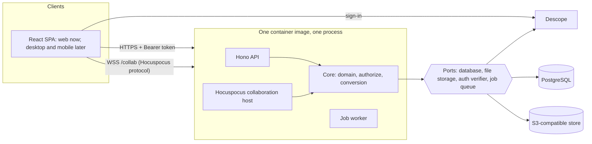

# Grimoire specification (v1)

Status: specification for version 1, with an honest status on every requirement (see below). Decisions and their history are in [decisions.md](decisions.md).

This specification builds on the [brief](brief.md) and the [design direction](design.md). Every requirement states Grimoire's own behaviour and the reason for it.

## How to read this

Every requirement has an id (R4.12 means section 4, item 12) and exactly one status. Ids are stable: a removed requirement keeps its id and is marked Withdrawn.

| Status | Meaning |
|---|---|
| **Built** | Exists in the code and a named test file or code path proves it. The cell names it, for example `Built (test: apps/server/test/collab/limits.int.test.ts)`. |
| **Built, not covered by a test** | The code exists, but no automated test would fail if it were removed. These are test gaps. The cell names the code path. |
| **Partly built** | Some of it exists. The cell says what exists and what is still planned. |
| **Planned** | A decided or proposed design. Nothing of it exists in code yet. |
| **Rule** | A scope statement, policy or standing project rule that needs no code of its own, or whose enforcement is a review practice. |
| **Withdrawn** | A requirement removed by a later decision. Its number stays so references do not break. |

Tests are run locally, in continuous integration (`.github/workflows/ci.yml`) and, for the container, with Docker Compose. A test that ran only against a local emulator or an in-process fake is described as such; nothing in this document has been run on a real cloud host. Where sources conflicted, the later decision wins (see [decisions.md](decisions.md)). Open questions are in section 15.

Terms used throughout:

- **Yjs**: a library that keeps a shared document as a set of small changes ("updates") that can be applied in any order and any number of times and still give the same result. A Yjs document is called a **ydoc**.
- **Collaboration host**: Grimoire's server for live editing: Hocuspocus running inside the application. It keeps the pages being edited in memory, forwards updates between people and saves pages to PostgreSQL.
- **Awareness / presence**: who is on the page and where their cursor is. Sent through the collaboration host, never stored.
- **Compaction**: merging many stored updates into one.
- **Ports and adapters**: a port is an interface owned by the core; an adapter implements it for one host or product (section 2.2).
- **Collection**: a top-level group of pages.

## 1. Scope and non-goals; users and scale

| Id | Requirement | Status | Basis |
|---|---|---|---|
| R1.1 | Grimoire is an internal documentation tool for one organisation. Pages are written in a WYSIWYG editor and stored as Markdown. People edit a page together in real time. | Partly built (live editing, Markdown conversion and saving exist in the server; the web client does not, `apps/web` is a placeholder) | [brief](brief.md) |
| R1.2 | In v1: nested page tree, rename, move, delete to trash; WYSIWYG editing; live co-editing with visible cursors; page history; full-text search; semantic search; image and file attachments; a one-off importer for Markdown and CSV exports; Descope sign-in. | Partly built (live co-editing, token verification and access rules exist; the page tree, history, search, attachments, import and the client are planned) | [brief](brief.md) |
| R1.3 | Not in scope: AI product features, database features (tables as data, boards, kanban, relations, formulas), calendar, mail. The application may still use a database server internally. | Rule | |
| R1.4 | Scale target: 100 to 1,000 people, one organisation. Design for tens of simultaneous editors in total and at most 100 on one page. | Partly built (the 100-connections-per-page cap is a configurable limit, default 100: test `apps/server/test/collab/limits.int.test.ts`; the scale target itself is untested) | The 100-editor cap is R4.15 |
| R1.5 | Also out of v1: external guests, public pages and share links, canvases and whiteboards, native apps, PDF or DOCX export, end-user scripts or plugins, comments, page templates, drafts. The first four are assumptions of the brief that have not been confirmed. | Rule | |
| R1.6 | Deployment is one container on one machine with Docker Compose, with managed PostgreSQL and S3-API storage on Google Cloud. The core stays independent of the host (R2.17, R2.47). | Planned (the Compose setup for local use exists, R1.7) | [decisions.md](decisions.md) |
| R1.7 | Everything that is built runs fully locally in Docker Compose, with no call to a cloud provider. | Built, not covered by a test (code path: `compose.yaml`; the no-route-out check is `compose.offline.yaml`, R2.14) | |
| R1.8 | **Withdrawn.** Open design questions are settled by a recorded decision, not by following another project. | Withdrawn | |
| R1.9 | Package and repository naming: the repository is `tektum/grimoire`; npm packages use the scope `@tektum` with a `grimoire-` prefix (for example `@tektum/grimoire-web`), because the name `grimoire` is taken on npm. | Built (test: `packages/core/test/boundaries/layout.test.ts`, "names every package with the @tektum/grimoire- scope"; code path: `name` fields in the `package.json` files) | Section 15.2 |
| R1.10 | The first version is the web client only. Desktop and mobile clients are planned for and not built (section 11.4). | Planned | |

## 2. Architecture

Live editing runs in one always-on container running Hocuspocus, inside the application. The design is hosting-agnostic: a backend and a front end that are split, nothing rendered on the server, so that web, desktop and mobile clients can share one app. The backend is one codebase whose core depends on no hosting provider and talks to the outside world through a small set of named interfaces ("ports"). The planned deployment is one container image on one machine with Docker Compose, with managed PostgreSQL and S3-API storage on Google Cloud. Flavours for other hosts may come later. See [decisions.md](decisions.md) and [research 11](research/11-frameworks.md).

### 2.1 The stack

| Part | Choice |
|---|---|
| HTTP API | Hono |
| API contract | OpenAPI document with a generated typed client |
| Client | React and Vite single-page app, no server-side rendering |
| Database | PostgreSQL |
| Files | The S3 API (any S3-compatible store) |
| Background jobs | A small job interface; a PostgreSQL-backed implementation first |
| Live editing | Hocuspocus |
| Editor | Milkdown |
| Sign-in | Descope |

### 2.2 Ports

A **port** is an interface owned by the core. An **adapter** implements a port for one host or product. The core contains the domain: pages, collections, permissions (`authorize`), revisions, search queries, attachments, imports, Markdown conversion. It never imports a provider SDK and never reads a provider-specific environment variable. Ratings for other hosts come from [research 11](research/11-frameworks.md) ("Proposed interfaces") and are estimates: nothing was run on Lambda or Workers. Built today: the database, auth verifier, collaboration host, clock, config, logger, user store, access store and Markdown converter ports (`packages/core/src/ports/`). The HTTP runtime is a Hono app served by `@hono/node-server` without a separate port interface. The file storage and job queue ports are planned.

| Port | Contract (short) | v1 implementation (container flavour) | Lambda flavour | Cloudflare Workers flavour |
|---|---|---|---|---|
| **HTTP runtime** | The API is a Hono app: a function from a web `Request` to a `Response`. The port starts it and gives it a shutdown hook. | `@hono/node-server` | Hono Lambda adapter. Easy. | Native. Easy. |
| **Database** | A typed query interface plus `transaction(fn)` and a migration runner, over PostgreSQL only. No abstraction beyond PostgreSQL. | Kysely over `pg`, `GRIMOIRE_DATABASE_URL` | Same code; needs a connection pooler. Moderate. | Hyperdrive plus `pg`. Moderate. |
| **File storage** | A full contract in R2.35: `head`, `get` (stream and byte range), `put`, `delete`, `list`, `signUpload`, `signDownload`, typed errors. Two endpoint settings (R2.36). No S3 operation name outside the adapter (R2.38). | S3-API adapter (AWS SDK for JavaScript v3, Apache-2.0) against a configured endpoint; SeaweedFS locally | S3. Easy. | R2 through its S3 API. Easy. |
| **Auth verifier** | `verify(token)` returns the minimum: user id and expiry, or "invalid token", or "service unavailable" (R4.9). Email and name come from a separate method (R8.18). | Descope adapter: the official Descope Node SDK on the server, with Grimoire's own token policy on top (R8.5). Token verification calls the SDK's `validateJwt` (R8.5) | Same. Easy. | Workers compatibility of the Descope Node SDK not confirmed. Moderate. |
| **Job queue** | `enqueue(name, payload, options, tx?)` (can join the caller's transaction, R5.20), `schedule(name, cron)`, `work(name, handler)`; at-least-once; handlers are idempotent. Contract and conformance suite: R2.40. | pg-boss over PostgreSQL, with its tables created only by `grimoire migrate` (R2.24, R5.18); fallback: our own `jobs` table (R5.19) | SQS. Moderate. | Cloudflare Queues. Moderate. |
| **Collaboration host** | `start(deps)` where deps are `authorize`, the page store, the auth verifier and the limits; `closeConnections(filter)`; `shutdown()`. The client protocol is the Hocuspocus protocol. | Hocuspocus 4.x | **Separate implementation**, not an adapter: a custom server with its own wire protocol. | **Separate implementation**: Durable Objects (y-partyserver or y-durableobjects), or Hocuspocus if it proves out. |
| **Clock, Config, Logger** | `now()`; typed configuration validated at start; structured JSON log lines. | System clock; `GRIMOIRE_*` environment values read in one place; JSON to stdout | Same | Same |

| Id | Requirement | Status | Basis |
|---|---|---|---|
| R2.1 | The stack is: Hono for the HTTP API; an OpenAPI contract with a generated typed client; a React and Vite single-page app with no server-side rendering; PostgreSQL; files through the S3 API; background jobs behind a small job interface with a PostgreSQL-backed implementation first; Hocuspocus for live editing; Milkdown; Descope. | Partly built (Hono in `apps/server/src/app.ts`, PostgreSQL through Kysely, Hocuspocus, Milkdown packages and Descope token verification exist; the generated client, the React app, the S3 adapter and jobs are planned) | |
| R2.2 | Live editing is one always-on container running Hocuspocus 4.x. | Built (test: `apps/server/test/collab/collab.int.test.ts`; `@hocuspocus/server` 4.8.0 is pinned in `packages/adapters/collab-hocuspocus/package.json`) | |
| R2.3 | **Withdrawn.** An earlier design with a custom serverless live-editing server (its own tables, a managed WebSocket gateway and a custom wire protocol) was dropped in favour of R2.2. Lessons that do not depend on the transport are carried into section 4. | Withdrawn | |
| R2.4 | Reason for R2.2: a single container removes custom synchronisation code. | Rule | |
| R2.5 | The API and the collaboration server use the same permission rules, one shared function (R8.8, R4.10). | Partly built (the collaboration host calls the core `authorize`: tests `apps/server/test/wiring/collapsed-authorizer.test.ts` (no code outside the authoriser module decides access), `packages/adapters/collab-hocuspocus/test/host/auth.test.ts`; the API routes do not exist yet) | |
| R2.6 | The collaboration server is Hocuspocus with small separate extensions for authentication, persistence, connection limits, presence, the periodic access re-check and lifecycle, plus an upgrade guard that admits or refuses WebSocket upgrades (origin, per-address rate, unauthenticated sockets). | Built (code path: `packages/adapters/collab-hocuspocus/src/extensions/`, `src/upgrade-guard.ts`; tests `packages/adapters/collab-hocuspocus/test/host/host.int.test.ts`, `packages/adapters/collab-hocuspocus/test/upgrade/upgrade.int.test.ts`) | |
| R2.7 | Persistence: the page row in PostgreSQL holds the Yjs state next to canonical Markdown and search text. | Built (migrations `db/migrations/0001_pages.ts` and `0002_page_markdown.ts`; test `apps/server/test/collab/save-columns.int.test.ts`) | |
| R2.8 | **Withdrawn.** A requirement specific to one managed database service was removed. | Withdrawn | |
| R2.9 | **Withdrawn.** The VPC, public-subnet and security-group layout is removed from the body; see Deployment (2.4). | Withdrawn | |
| R2.10 | **Withdrawn.** The serverless authorizer and NAT design is removed; the API validates tokens itself through the auth verifier port (R8.16). | Withdrawn | |
| R2.11 | There is one container. A deploy or restart drops every live connection and clients reconnect (R4.30). One container is a single point of failure (R14.2). | Planned (the server side of a restart is tested, R4.30; the reconnecting client is planned) | |
| R2.12 | Local environment: Docker Compose runs the app container (API and collaboration server), PostgreSQL and an S3-compatible store (SeaweedFS, R13.4). Everything that is built runs fully locally. No cloud emulator and no infrastructure-as-code tool is part of v1. | Built, not covered by a test (code path: `compose.yaml`, `Dockerfile`, `Makefile`) | [decisions.md](decisions.md) |
| R2.13 | **Withdrawn.** Earlier infrastructure and test scripts for the custom serverless design are not part of the product. | Withdrawn | |
| R2.14 | The local environment makes no call to any cloud provider: dummy credentials, local endpoints, no cloud profile. | Built, not covered by a test (code path: `compose.offline.yaml` puts every service on a network with no route out; used with `COMPOSE_FILE=compose.yaml:compose.offline.yaml make up`) | |
| R2.15 | The client is a set of static files that any static host or CDN can serve. The container does not have to serve them. | Planned | Split front end, no server-side rendering |
| R2.16 | Hocuspocus is pinned to an exact 4.x version (4.8.0). | Built (test: `packages/core/test/boundaries/layout.test.ts`, "pins every dependency of every package.json to an exact version"; code path: `packages/adapters/collab-hocuspocus/package.json`; exercised by the collaboration integration tests, for example `apps/server/test/collab/collab.int.test.ts`) | |
| R2.17 | Backend and front end are split and nothing is rendered on the server, so that web, desktop and mobile clients can share one app. The design is hosting-agnostic: simple code, clean interfaces, flavours for other hosts later. | Rule | |
| R2.18 | The ports are those in the table above: HTTP runtime, database, file storage, auth verifier, job queue, collaboration host, and clock, config and logger. Each has an interface in the core, one v1 adapter, and an in-memory fake used by unit tests. | Partly built (interfaces in `packages/core/src/ports/` and fakes in `packages/core/src/testing/` exist for database, clock, config, logger, user store, access store, page store and Markdown converter, and the auth verifier fake is `FakeAuthVerifier` in `packages/adapters/auth-fake/src/index.ts`; there is no in-memory collaboration host fake; file storage, job queue and an HTTP runtime port are planned) | [research 11](research/11-frameworks.md) "Proposed interfaces" |
| R2.19 | **Rule:** nothing outside an adapter may import a provider SDK or read a provider-specific environment variable. A lint rule (import restrictions) and a test that scans the core for forbidden imports and environment names enforce it in CI. | Built (test: `packages/core/test/boundaries/adapter-imports.test.ts`; `apps/server/test/server/source-rules.test.ts` for the server) | |
| R2.20 | Live editing is not portable by adapter. v1 builds the container flavour only (Hocuspocus). A Lambda or Cloudflare flavour would be a separate implementation behind the collaboration port, and clients would need a provider switch if its wire protocol differs. | Rule | [research 11](research/11-frameworks.md) section 3 |
| R2.21 | One container image runs the API and the collaboration server **in one process**, sharing one HTTP port (WebSocket upgrades on `/collab`), one `authorize`, one health endpoint and one shutdown path. The processes share the application's database settings but use separate connection pools: the API pool (10 connections, the library default), the page store's pool (at most 4, with a database timeout of its own) and the sign-in lookup pool (at most 4); the last two exist only in a process that serves collaboration (`GRIMOIRE_ROLE` `all` or `collab`). Reasons: the simplest deployment; the conversion step that costs CPU already runs in a worker thread (R7.6); two processes in one image would need a process supervisor and a more complicated graceful shutdown. Risk: heavy API load can slow the sockets; see R13.23. | Built (test: `apps/server/test/collab/collab.int.test.ts` ("one process, one port"); code path: `apps/server/src/collab/index.ts`, `apps/server/src/composition.ts`) | |
| R2.22 | A `GRIMOIRE_ROLE` setting (`all` by default, `api` or `collab`) selects what starts, so the same image can later run as two containers without code changes. The duties of each role are in R2.41. | Partly built (setting and the rule that `api` does not attach the collaboration host: `packages/adapters/config-env/src/schema.ts`, `apps/server/src/composition.ts`; the job side of the roles is planned) | |
| R2.23 | Database library: **Kysely** (MIT) over `pg`, with TypeScript migrations run by Kysely's Migrator (R5.13). Reason: the data model uses a trigger-maintained `tsvector` column, partial GIN and B-tree indexes, a deferrable composite foreign key, `citext` and recursive queries, which are easiest to write as SQL; Kysely types the queries without hiding the SQL. | Partly built (Kysely, `pg` and migrations 0001 to 0004 exist: `packages/adapters/db-kysely/`, `db/migrations/`; the search column, trigger and most indexes are planned) | [research 11](research/11-frameworks.md) section 4 |
| R2.24 | Background jobs: pg-boss 12.x (MIT) behind the job port in v1, pinned to an exact version. Its tables are created and upgraded only by the `grimoire migrate` deploy step (R5.18). At runtime the app starts it with `migrate: false` and its database user has no schema-change rights. Jobs: import, trash purge, expired-upload cleanup, revision catch-up. Handlers are idempotent. | Planned | |
| R2.25 | OpenAPI tooling: `@hono/zod-openapi` to describe routes and emit the document; `openapi-typescript` to generate the client types and `openapi-fetch` as the typed client at runtime (all MIT). The contract and generated client are decided. | Planned (`@tektum/grimoire-api-client` exists as a package name only) | [research 11](research/11-frameworks.md) section 2 |
| R2.26 | Desktop (Tauri 2 or Electron) and mobile (Tauri 2 or Capacitor) clients are planned for, wrapping the same app. They are not in the first version. | Planned | |

### 2.3 Diagram

### 2.4 Deployment

What the container needs from any host. Nothing here names a provider.

| Id | Requirement | Status | Basis |
|---|---|---|---|
| R2.27 | The container is configured only by environment values with the `GRIMOIRE_` prefix, read in one place and validated at start (the app refuses to start on a missing or malformed value): a PostgreSQL URL; the S3-compatible file store: the internal endpoint, the browser-reachable public endpoint (R2.36), bucket, access key, secret key, region and addressing style; the Descope project id; the public base URLs of the API and the collaboration endpoint; the allowed browser origins (R12.32); the first-admin email list (R5.16); the trusted proxy setting `GRIMOIRE_TRUSTED_PROXY` (which proxy hops may supply the forwarded client address, R4.19, R12.28); limits. Secrets arrive as environment values. | Built (test: `packages/adapters/config-env/test/config.test.ts`; schema in `packages/adapters/config-env/src/schema.ts`; the S3 values are parsed and validated but not yet used) |  |
| R2.28 | A public HTTPS endpoint and a public secure WebSocket endpoint reach the container: TLS ends at the host's proxy or load balancer; the container speaks plain HTTP and WebSocket on one port. | Planned (the container serves plain HTTP and WebSocket on one port, `GRIMOIRE_PORT`; TLS termination belongs to the host) |  |
| R2.29 | Health endpoints on the same port: `/healthz` (liveness: the process is up) and `/readyz` (readiness: PostgreSQL answers, the schema is at the migration version the code expects, and the server is not draining, R2.42). A readiness probe never waits longer than 2 seconds, concurrent probes share one database check, and the answer is remembered for 2 seconds when ready and 1 second when not. They reveal nothing else. | Built (test: `apps/server/test/server/server.int.test.ts`, "readiness against PostgreSQL") |  |
| R2.30 | Graceful shutdown on `SIGTERM`: stop accepting connections, save every open page, close the Markdown conversion pool and the database pools, exit (R4.25). The host must give a stop grace period of at least the server's overall shutdown backstop plus 5 seconds (64 seconds for the default 45-second save deadline: the save phase keeps its full configured time, the other phases together are allowed 12 seconds, the backstop adds 2 seconds, and the grace period 5 more); `apps/server/src/lifecycle/budget.ts` derives all of them. Finishing or releasing jobs is planned with the job queue. | Built (test: `apps/server/test/server/server.int.test.ts`, "shutdown of the real entry point"; `compose.yaml` sets `stop_grace_period: 64s` and `make check-compose` checks it against the budget; the save deadline is `GRIMOIRE_SHUTDOWN_SAVE_DEADLINE_MS`, default 45000) |  |
| R2.31 | The container is stateless apart from open pages in memory: no local disk is needed, and a restart loses nothing a client still holds (R4.30). | Partly built (the server keeps state only in PostgreSQL and open pages in memory: test `apps/server/test/collab/collab.int.test.ts`, "persistence"; `compose.yaml` runs the app container with a read-only root filesystem) |  |
| R2.32 | Logs go to standard output as one JSON line per event, with no tokens or query strings (R4.41). The logger is `pino` plus a small hand-written secret scrubber applied to every value before it reaches pino, because pino's path-based redaction alone misses nested keys, URL query strings and connection strings in messages and stacks. The scrubber is a best-effort safety net: code never logs a secret and named fields are redacted by name; it recognises URLs with credentials, query strings and fragments, secret-looking `key=value` and `"key":"value"` pairs, bearer and basic credentials and tokens, and it fails closed. Known limits, pinned by tests named "known limit" (`packages/adapters/logger-json/test/redaction.test.ts`): an unquoted value ends at a semicolon, and credentials without a scheme are not recognised. | Built (code path: `packages/adapters/logger-json/`; tests in `packages/adapters/logger-json/test/`) |  |
| R2.33 | Migrations are a separate command in the same image, run as an explicit deploy step before the new version starts (R5.14). | Built (code path: `apps/server/src/cli.ts` `migrate` command and the `migrate` service in `compose.yaml`; test: `apps/server/test/migrations/migration-0004.int.test.ts`) |  |
| R2.34 | **Withdrawn.** An optional deployment note was removed. | Withdrawn | |
| R2.35 | **File storage port contract.** Inputs, outputs and errors: `head(key)` returns size, content type, entity tag and modified time, or `NotFound`. `get(key, {range?})` returns a readable stream plus size and content type; `range` is `{start, end}` in bytes (end inclusive); errors `NotFound`, `RangeNotSatisfiable`. The caller never has to hold a whole object in memory (imports read zips of hundreds of MB, R12.30). `put(key, body, {contentType, size})` takes a stream or bytes and returns the entity tag. `delete(key)` never fails when the key is absent. `list(prefix, {cursor, limit})` returns keys with size and modified time and a `nextCursor`. `signUpload(key, {size, contentType, ttlSeconds})` returns everything the browser needs: `{method, url, headers, fields?, expiresAt}`, where `headers` and `fields` are exactly those the browser must send; the store must reject an upload whose size or content type differs from what was signed (a signed length and type for a PUT; a policy for a form POST). An adapter whose store cannot enforce both fails the conformance suite. `signDownload(key, {ttlSeconds, disposition, fileName?, contentType?})` returns `{url, expiresAt}`; the URL makes the store answer with the given `Content-Disposition` and `Content-Type`. Common errors: `Unavailable` (transient, retryable), `InvalidKey`, `Unsupported`. A valid key is 1 to 512 bytes, has no leading slash, no `..` segment and no control characters. | Planned |  |
| R2.36 | Two file-store endpoint settings: an **internal** one the backend uses, and a **public** one the browser can reach. Every signed URL uses the public endpoint, so the signature matches the host the browser calls. If only one is set, both are the same. In Compose the internal endpoint is `http://seaweedfs:8333` (the service name) and the public one is empty by default, so both are the same until `GRIMOIRE_S3_PUBLIC_ENDPOINT` is set (for example to `http://localhost:8333`). | Partly built (the settings `GRIMOIRE_S3_ENDPOINT` and `GRIMOIRE_S3_PUBLIC_ENDPOINT` are parsed and validated in `packages/adapters/config-env/src/schema.ts`; signing is planned) |  |
| R2.37 | **Conformance suite.** One suite of tests, `file-storage-conformance`, is run against the in-memory fake and every adapter, and all must pass. Cases: put, head, get; range read of the first 512 bytes and of a middle range; streaming read of a 200 MB object without buffering it (memory stays flat); delete of an absent key; list paging; `signUpload` accepts the exact size and type and the store rejects a different size and a different type; an expired upload URL is rejected; `signDownload` sets disposition and content type; signed URLs contain the public host; a browser preflight from an allowed origin passes and from another origin fails (R2.39); key validation. | Planned |  |
| R2.38 | No S3 operation name (such as `HeadObject`) appears outside the adapter, in the API, the core or this spec's requirements. Requirements say `head`, `get`, `signUpload`. | Planned |  |
| R2.39 | The file store is configured to allow the allowed browser origins (R12.32) to `PUT`, `POST` and `GET` signed URLs from a browser (CORS). The deployment checks it; the conformance suite tests it where the store supports it. | Planned |  |
| R2.40 | **Job port contract and conformance.** `enqueue(name, payload, {delaySeconds?, singletonKey?, retryLimit?}, tx?)` returns a job id, or the existing id when `singletonKey` matches a queued job; `work(name, handler, {concurrency})`; `schedule(name, cron)`; a handler that throws is retried up to `retryLimit` with backoff and then marked failed; jobs run at least once. A `job-queue-conformance` suite runs against the in-memory fake and the adapter: enqueue, delay, retry, singleton, scheduling, a crash mid-job (the job runs again), and enqueue inside a transaction that rolls back (no job exists). | Planned |  |
| R2.41 | **Duties by role.** `GRIMOIRE_ROLE=all`: everything below. `api`: HTTP routes, `/healthz`, `/readyz`, job workers, scheduled jobs (purge, cleanup), the import worker. `collab`: the `/collab` socket host, the one-minute re-check (R4.48), the save and revision timers (R4.20, R9.2), the Markdown conversion worker thread. `api` never opens sockets; `collab` never runs jobs. If the collaboration host cannot share the API's HTTP server (R2.21), it listens on a second port in the same process (`GRIMOIRE_COLLAB_PORT`). | Partly built (roles, `/collab` on the shared port or on `GRIMOIRE_COLLAB_PORT`, the one-minute re-check and the conversion worker thread exist: test `apps/server/test/collab/collab.int.test.ts`; jobs, imports and revision timers are planned) |  |
| R2.42 | Draining: on `SIGTERM` `/readyz` fails immediately, so the proxy stops sending new connections, before the shutdown order of R4.25 starts. | Built (test: `apps/server/test/server/server.int.test.ts`: `/readyz` is 503 within 1 s of `SIGTERM`) |  |
| R2.43 | Startup refuses to run in two unsafe combinations: local mode (development tokens) together with a Descope project id; and non-local mode without a Descope project id. The message says which. In local mode the development token secret must be set (16 to 128 letters, digits, `_` or `-`), and the server binds a loopback address unless `GRIMOIRE_LOCAL_ALLOW_NON_LOOPBACK=1`. A Descope project id that is not 1 to 128 letters and digits is refused at startup, and the message never repeats the value. | Built (test: `packages/adapters/config-env/test/config.test.ts`, "startup refusals (R2.43)") | R12.22 |
| R2.44 | Hocuspocus 4.x stays the collaboration host. If it ever fails the proof, the fallbacks are, in order: the `y-websocket` server (MIT; it "can't be scaled easily", which is acceptable for one container), or our own server on the Yjs protocol libraries (`y-protocols`, MIT). The collaboration port (R2.18) is why this stays possible; the Hocuspocus-specific requirements in section 4 would change. | Rule | [research 11](research/11-frameworks.md) section 3 |
| R2.45 | **Embedding ports.** `Embedder` (text to vectors, with its model name, version and dimension) and `EmbeddingStore` (chunk rows and the permission-filtered similarity query) are ports in the core; the model runtime (`onnxruntime-node`, `@huggingface/tokenizers`) lives only in the adapter `embedder-onnx` and the SQL only in the database adapter, so the core stays free of runtime libraries and of hosting. An in-memory fake of each backs the unit tests. | Planned | [research 13](research/13-semantic-search.md); R2.18 |
| R2.46 | **The database image includes pgvector.** The Compose database service is `pgvector/pgvector:pg17` pinned by digest (pgvector 0.8.x on PostgreSQL 17), and the production database must offer pgvector 0.8 or later; the extension is created in `db/init` by the database owner, as `citext` and `pg_trgm` are. | Planned (the Compose database service is `postgres:17` today; `db/init/02-extensions.sql` creates the extensions it needs) | [research 13](research/13-semantic-search.md); R12.25 |
| R2.47 | **Provider neutrality**: the core and the adapters name no hosting provider. Anything specific to Google Cloud (or any other host) is a setting or lives in the `deploy/` directory (for example `deploy/gcp/`). The files adapter's create-only precondition header is a setting, not a provider switch. | Rule |  |

## 3. Document model

### 3.1 Stored form

| Where | Field | Content | Role |
|---|---|---|---|
| PostgreSQL `pages` | `markdown` | Canonical Markdown | Durable readable form. Export, history and import use it. |
| PostgreSQL `pages` | `text_content` | Plain text of the page | Source of the search index |
| PostgreSQL `pages` | `ydoc` | Yjs state of the whole page (binary) | Live-editing state, loaded by the collaboration server. 1.1 to 13.6 times the Markdown size depending on shape (R3.3). |

| Id | Requirement | Status | Basis |
|---|---|---|---|
| R3.1 | Markdown is the durable, portable form of a page. | Built (test: `apps/server/test/collab/save-columns.int.test.ts`) | [decisions.md](decisions.md); [brief](brief.md) success test: an exported page reads correctly in any Markdown tool |
| R3.2 | Editing state is a Yjs document made with Milkdown's collab plugin. The content lives in one named Y.XmlFragment, `prosemirror`; its name is fixed once and shared by client and server. | Built (test: `packages/editor-schema/test/fragment-name.test.ts`) |  |
| R3.3 | The Yjs state is 1.1 to 13.6 times the Markdown size depending on shape (prose 1.6x, code 1.1x, mixed about 5x, lists 10.5x, tables 13.6x; [proof note](proof/m2-schema-fixes.md), "State size against Markdown size") and how it grows with edit history is not measured (R3.19). | Built (test: `packages/editor-schema/test/benchmark/size-ratio.test.ts` checks the ratios against the recorded values) |  |
| R3.4 | When a page is opened and its `ydoc` is empty (new, imported or reset), the collaboration server reads the row, converts its Markdown to a Yjs document with no transaction open (a heavy page must not hold the row lock while it waits for the converter), and then takes a short row lock, re-checks that the row still has no state, the same Markdown and the same epoch, and writes the state; if the row changed meanwhile the result is discarded and the row read again (up to 3 attempts). Only one opener can seed it. | Built (test: `apps/server/test/collab/seed.int.test.ts`; code path: `packages/adapters/db-kysely/src/page-store.ts`) | Markdown to Yjs under Milkdown: R7.3 |
| R3.5 | A page's `markdown` and `text_content` can lag the live document by the save delay (about 3 s, at most 10 s apart while editing continues). Search, history and export use the saved Markdown. | Partly built (built and tested: saved after the 3 s debounce, at most 10 s apart while typing continues, `apps/server/test/collab/collab.int.test.ts`, "persistence"; not built: search, history and export, which do not exist yet, so none of them reads the saved Markdown yet) | Follows from R4.20 |

### 3.2 Canonical Markdown

The editor owns the formatting style. A file is rewritten into that style on first save and is stable afterwards.

| Id | Requirement | Status | Basis |
|---|---|---|---|
| R3.6 | Stored Markdown is exactly what Milkdown 7.23.0 (commonmark and gfm presets, plus the heading change in R3.12) serialises. Character-for-character preservation of imported files is not a goal. | Built (tests: `packages/adapters/markdown-milkdown/test/convert/round-trip.test.ts`, `packages/adapters/markdown-milkdown/test/corpus/corpus.test.ts`) | Milkdown 7.23.0 is pinned in `packages/editor-schema/package.json` |
| R3.7 | The canonical style includes: `*` for bullets, `***` for a horizontal rule, a backslash for a hard line break, tables re-padded, reference links turned into inline links, `**[x](url)**` written as `[**x**](url)` (a link is always the outermost mark). | Built (tests: `packages/adapters/markdown-milkdown/test/golden/golden.test.ts`; the corpus entry `cm-28-link-marks` in `packages/adapters/markdown-milkdown/test/corpus/corpus.test.ts` for the link order) |  |
| R3.8 | Milkdown and plugin versions are pinned to exact versions (`@milkdown/*` and `@milkdown/plugin-collab` 7.23.0, `yjs` 13.6.33). A version change needs a round-trip regression run first, because it can change the canonical output. | Built (code path: exact versions in `packages/editor-schema/package.json` and `packages/adapters/markdown-milkdown/package.json`; test: `packages/adapters/markdown-milkdown/test/versions.test.ts` (fails on any other `@milkdown/core` version or yjs version), `packages/editor-schema/test/preset-tripwire.test.ts` (checks the schema against the preset)) |  |
| R3.9 | A regression corpus (GFM documents and our own CommonMark-style cases; the official CommonMark examples are not used, because their licence is not allowed) runs as a test: every supported construct keeps its meaning and is stable on a second save, except the accepted exceptions the corpus records by name (for example nested emphasis such as `*a **b *c* d** e*`, whose inner italics are lost; see the known limitations, R14.4). | Built (test: `packages/adapters/markdown-milkdown/test/corpus/corpus.test.ts`) |  |

### 3.3 Supported constructs

| Construct | v1 | Status | Basis |
|---|---|---|---|
| Headings, paragraphs, bold, italic, strikethrough, inline code, links | Yes | Built (tests: `packages/adapters/markdown-milkdown/test/golden/golden.test.ts`, `packages/adapters/markdown-milkdown/test/corpus/corpus.test.ts`) | |
| Bullet, numbered and task lists, nested | Yes | Built (tests: `packages/adapters/markdown-milkdown/test/golden/golden.test.ts`, `packages/adapters/markdown-milkdown/test/corpus/corpus.test.ts`) | |
| Tables with alignment | Yes | Built (tests: `packages/adapters/markdown-milkdown/test/golden/golden.test.ts`, `packages/adapters/markdown-milkdown/test/corpus/corpus.test.ts`) | See R14.4 |
| Code blocks with language, quotes, horizontal rules, line breaks | Yes | Built (tests: `packages/adapters/markdown-milkdown/test/golden/golden.test.ts`, `packages/adapters/markdown-milkdown/test/corpus/corpus.test.ts`) | |
| Images and file attachments | Yes | Planned (the editor UI and storage are not built) | |
| Raw HTML in Markdown | Kept, shown as a non-editable block with an "edit source" action; rendering is sanitised (R12.9, planned with the web client) | Partly built (the verbatim round trip of raw HTML is tested: `packages/editor-schema/test/html-blocks.test.ts`; `packages/adapters/markdown-milkdown/test/convert/sanitise.test.ts` covers only the removal of NUL characters and lone surrogates; the rendering sanitisation and the block UI are planned, see [design](design.md)) | |
| Callouts | A dedicated block. The storage syntax is decided when a sample export is available. | Planned | The source tool writes callouts as HTML ([brief](brief.md)) |
| Footnotes | Not supported in v1; the text survives | Built (test: `packages/adapters/markdown-milkdown/test/convert/known-limits.test.ts`) | |
| Front matter, maths, diagrams | Not supported in v1. Front matter is mangled by the default presets, so import must strip or convert it. | Planned (import-time handling; maths and footnotes staying plain text is tested in `packages/adapters/markdown-milkdown/test/convert/known-limits.test.ts`) | |

### 3.4 Headings as paragraphs

| Id | Requirement | Status | Basis |
|---|---|---|---|
| R3.10 | A heading is a paragraph block with a `level` attribute (0 = plain paragraph), not a separate block type. | Built (test: `packages/editor-schema/test/headings.test.ts`) |  |
| R3.11 | Changing a paragraph to a heading, or a heading's level, never recreates the block, so another person's typing in it is kept. Cause: the Yjs binding matches blocks by type name, and an attribute change does not recreate the element. | Built (tests: `packages/editor-schema/test/heading-interleavings.test.ts`, `packages/editor-schema/test/two-editors.test.ts`) |  |
| R3.12 | The heading commands, keyboard shortcuts and the `#` typing shortcut are rewritten to set the `level` attribute. | Partly built (built and tested: the heading commands and the `#` typing shortcut set the `level` attribute, `packages/editor-schema/test/commands.test.ts`; the keyboard shortcuts (Mod-Alt-1 to 6, Mod-Alt-0, Backspace) are in the code but no test covers them) |  |
| R3.13 | Markdown output writes a paragraph with level 1 to 6 as `#` to `######` and level 0 as plain text; reading Markdown does the reverse. | Built (tests: `packages/editor-schema/test/headings.test.ts`, `packages/editor-schema/test/round-trip-property.test.ts`) | Known exceptions: R14.4 |

### 3.5 Soft lock for other conversions

Turning a paragraph into a bullet, quote or code block recreates the block, and concurrent typing in it is lost. Grimoire protects against this with a soft lock.

| Id | Requirement | Status | Basis |
|---|---|---|---|
| R3.14 | Each client publishes the block its cursor is in through awareness. A client refuses to convert a block that another person's cursor is in, and shows who is there. | Planned (clients do not exist yet) |  |
| R3.15 | The soft lock protects only connected people. Two people editing offline, or a sub-second race between connected clients, can still lose typing. This is a stated limitation (R3.26, R3.27); the structure lock (R3.25) narrows it for connected people. | Rule |  |
| R3.16 | The lock depends on presence being correct, so the collaboration server must stop one user forging or clearing another connection's presence (R4.12). It cannot stop a user putting a false display name or colour in their own record. Presence shows the server-verified user of each connection; a collaborator with write access can already create document operations under any client id (inherent in the editing protocol), so a client id is not an identity: the server guarantees the user label, not the client id. | Built (tests: `apps/server/test/collab/limits-abuse.int.test.ts`, "presence replay goes through the presence checks"; `packages/adapters/collab-hocuspocus/test/presence/presence.int.test.ts`; `packages/adapters/collab-hocuspocus/test/presence-squat.test.ts`) |  |
| R3.17 | Awareness state for the lock is `{ user: { id, name, color }, cursor, blockId }`. The block id is a stable id of the Yjs element the cursor is in. | Planned | The collaboration host only requires `user.id` |

### 3.6 Size caps

| Id | Requirement | Status | Basis |
|---|---|---|---|
| R3.18 | The Yjs state of one page is capped at 1,000,000 bytes, the default of `GRIMOIRE_COLLAB_MAX_STATE_BYTES` (decision 162). Over the cap the collaboration server refuses further updates with a clear message; the page stays readable (R4.16). At the measured ratios this is about 73 KB of table-heavy, about 94 KB of list-heavy, and several hundred KB of prose or code Markdown ([proof note](proof/m2-schema-fixes.md)). The cap is to be confirmed against real pages. | Built (test: `apps/server/test/collab/limits.int.test.ts`; code path: `packages/adapters/collab-hocuspocus/src/extensions/limits.ts`) |  |
| R3.19 | Whether the saved state shrinks after deletions (Yjs keeps markers for deleted content) is not measured. A page can reach the cap with little visible text. | Planned (not measured) |  |
| R3.20 | A page whose real state is over the cap cannot be fixed by editing. The recovery is an admin action "reset state from Markdown" (R6.21). | Planned |  |
| R3.21 | Title: 1 to 255 characters. Markdown that a person or the importer supplies for a page (a seed: creating a page from Markdown, R6.22; replacing it, R6.21; the import, R10): at most 131,072 bytes (128 KiB, `GRIMOIRE_SEED_MAX_MARKDOWN_BYTES`), 8,000 lines, 50 quote or list markers on one line, and 10 seconds of conversion (`GRIMOIRE_SEED_TIMEOUT_MS`) (decision 163); a text over a limit is refused with a message that names the limit and its value. Markdown that editing stores (the converter's output) may be up to 1 MiB (1,048,576 bytes); a save whose Markdown would be larger is refused as too large, so that anything stored can be rebuilt by the system (R7.3). The Markdown converter also refuses documents nested deeper than 100 levels or with more than 50,000 blocks. | Partly built (the 255-character title limit is a check constraint in `db/migrations/0004_permissions.ts`; the seed limits, the stored-Markdown cap and the converter limits are in `packages/adapters/markdown-milkdown/src/limits.ts`, test `packages/adapters/markdown-milkdown/test/convert/seed-limits.test.ts`; the tree-depth limit and the lower bound of one character are planned) |  |
| R3.22 | Attachment upload size limit: 25 MiB per file by default, set by configuration. | Planned |  |
| R3.23 | **Remote cursors are always visible**: every other connected person's caret and selection are drawn in that person's colour with their directory name label, shown on arrival and for 3 seconds after each move, and the caret has at least a 3:1 contrast against the page background. Concurrent structural edits are the one case where the editor library can lose or duplicate text (R3.26); seeing where others are is the first defence. | Planned | Evidence in R3.26 |
| R3.24 | **A reconnect after offline work does not merge blindly into a restructured block**: when a client reconnects after making edits offline and the server's changes since it left include a structural change (a block split, joined, deleted or wrapped) in the same document, the client first keeps a Markdown copy of its own document as the user last saw it and, after the merge, offers it. The check is conservative: it may offer a copy when nothing was lost. | Planned (after the first version, decision 147) | The same mechanism as R4.33 |
| R3.25 | **Structure lock**: while another person's cursor is in the same block (their awareness `blockId`, R3.17), the editor holds back Enter that splits the block, Backspace or Delete that joins it with a neighbour, and list wrapping, lifting and sinking, and shows a brief hint ("<name> is in this paragraph"); the action works as soon as that person leaves or disconnects. It extends the soft lock of R3.14. The gap that remains is one network round trip: two people who act within the time the other's cursor takes to arrive can still produce the cases of R3.26. | Planned (after the first version, decision 147) | |
| R3.26 | **The limit is documented to users**: the help text states that two people changing the structure of the same paragraph at the same moment (splitting it, joining it with its neighbour, wrapping it in a list) can still lose or duplicate a few words, that those two guard rails and the known-limit pin tests are planned after the first version (decision 147); in the first version users are told to keep a separate copy of offline edits before reconnecting to a document that was restructured meanwhile. The collaboration library (`y-prosemirror` 1.3.7, the latest) loses or duplicates text in these cases and does not diverge: with two real editors and 500 seeded runs per case, typing in a block while the other user joins it with the block above lost the typing in 500 of 500, wrapping it in a list lost it in 500 of 500, and splitting it moved the typed character in 218 to 346 of 500; two splits or a split and a join duplicated text in 417 to 500 of 500. | Planned (the help text; the measurements are recorded in [proof/m2-live-save.md](proof/m2-live-save.md)) | |
| R3.27 | **Known limit: simultaneous typing at the same spot can scramble words**: when two people type several characters at exactly the same position at the same moment (before each sees the other's text), their letters can end up mixed together, for example `iXYttte` instead of `iXtYtte`; nothing is lost or repeated and both screens end identical, but the words may need retyping. Single characters, typing at different places and typing in different paragraphs are not affected. The known-limit pin test is planned after the first version (decision 147); the plain-words limit itself is stated in the first version. The cause is in `y-prosemirror` 1.3.7, which derives the insert position from a text difference. Measured with two real editors and 500 pairs per case: runs of 2 to 8 characters at the same spot interleaved in 141 of 500 (206 of 500 with a marker prefix); single characters, different spots and different paragraphs were clean (500 of 500). Only single-keystroke transactions were tested: paste and input-method composition are untested. No patch is planned. | Planned (the plain-words statement in the help text; no patch) | |

## 4. Live editing

Live editing runs in one Hocuspocus server in one container (R2.2). Hocuspocus is a Node WebSocket server for Yjs. It keeps each open page in memory, applies and echoes every update, and calls hooks (small functions an extension can register) at each step: connect, authenticate, load, change, store, disconnect.

**How statuses are used in this section.** The collaboration host is built and is exercised by integration tests that start the real server and connect real Hocuspocus provider clients (`apps/server/test/collab/`), by unit and integration tests of the adapter (`packages/adapters/collab-hocuspocus/test/`) and by end-to-end scenarios run with `make test-m1` and the other `make test-*` targets (`apps/server/test-e2e/`). The client side of the protocol (the web client) is not built, so requirements about browser behaviour are Planned.

Hooks and defaults changed between Hocuspocus major versions; the behaviour in this section is the behaviour of Hocuspocus 4.8.0, as exercised by the tests named in each row.

For every requirement the table below says whether Hocuspocus provides the mechanism or Grimoire writes an extension.

### 4.1 Server and protocol

| Id | Requirement | Status | Basis |
|---|---|---|---|
| R4.1 | The collaboration server is Hocuspocus 4.x run with `@hocuspocus/server` in one Node process, started in a container image built from the repository. A page is one Hocuspocus "document"; its name is the page id in lowercase canonical UUID form. A name that is not a valid lowercase UUID is refused before any database call. This also stops a differently written copy of a page id escaping the re-check. | Built (tests: `packages/adapters/collab-hocuspocus/test/host/auth.test.ts`, "a canonical lowercase UUID passes onConnect"; `apps/server/test/collab/auth.int.test.ts`; code path: `packages/adapters/collab-hocuspocus/src/extensions/auth.ts`, `DOCUMENT_NAME`) | Canonical document name check |
| R4.2 | The wire protocol is Hocuspocus's own: binary WebSocket messages (Yjs sync, awareness, authentication, stateless). The client uses the Hocuspocus provider. Grimoire defines no frame format of its own. | Partly built (built: the server side: every integration test in `apps/server/test/collab/` connects with `@hocuspocus/provider`, for example `collab.int.test.ts`; the web client is planned and not built) |  |
| R4.3 | The session token travels in Hocuspocus's authentication message after the socket opens, not in the URL. | Built (code path: `packages/adapters/collab-hocuspocus/src/extensions/auth.ts` reads the token only from the authentication message; every test in `apps/server/test/collab/auth.int.test.ts` sends it that way; no test asserts that a token in the URL is ignored) | The Hocuspocus `token` option and the `onAuthenticate` hook |
| R4.4 | The server is built from extensions, one concern each: authentication and permission; persistence; connection and rate limits; presence identity; access re-check (closing connections); upgrade admission (origin, rate); logging. An editor-version gate is planned (R4.32). | Built, not covered by a test (the structure; each concern is tested under its own requirement; code path: `packages/adapters/collab-hocuspocus/src/extensions/` (`auth.ts`, `persistence.ts`, `limits.ts`, `presence.ts`, `recheck.ts`, `lifecycle.ts`) and `src/upgrade-guard.ts`; metrics are not a separate extension, R4.41) |  |
| R4.5 | TLS ends at the host's proxy or load balancer (R2.28). The container listens on plain HTTP and WebSocket on one port, reachable only through that proxy. | Rule | R2.28 |
| R4.6 | Hocuspocus and the extension packages are pinned to exact versions, with a lockfile. | Built (tests: `packages/core/test/boundaries/layout.test.ts`, "pins every dependency of every package.json to an exact version" and "locks with bun.lock only"; code path: exact versions in `packages/adapters/collab-hocuspocus/package.json` and the lockfile) | Same rule as R3.8 |

### 4.2 What Hocuspocus provides and what we write

| Concern | Hocuspocus provides | Grimoire writes |
|---|---|---|
| Authenticate and set read-only | `onAuthenticate` hook; a connection can be marked read-only (`connectionConfig.readOnly`, `server/src/Connection.ts`, `ClientConnection.ts`) | The token check, the permission lookup, the read-only decision |
| Reject an inbound message | `beforeHandleMessage`: a rejection stops the message (`server/src/types.ts` comment on `afterHandleMessage`) | Size, rate and validity rules |
| Check presence | `beforeHandleAwareness` hook with the decoded states; throwing rejects | Identity and client-id ownership rules |
| Close connections | `closeConnections(documentName)` closes all connections of one document with the reset close event (`server/src/Hocuspocus.ts`) | Closing for one user and for expired sessions, driven by the one-minute re-check (R4.14, R4.48) |
| Frame size cap | `websocketOptions` pass to the `ws` library, e.g. `maxPayload`; a `MessageTooBig` close event exists (`server/src/Server.ts`, `common/src/CloseEvents.ts`) | Choosing the number (R4.16) |
| Save timing | `debounce` and `maxDebounce` options; defaults in 4.8.0 are 2,000 and 10,000 ms (`server/src/Hocuspocus.ts`) | Setting 3,000 and 10,000 |
| Store and load | `onLoadDocument` and `onStoreDocument` hooks; a `Database` extension (`extension-database`) | The PostgreSQL code (R4.23) |
| Per-IP connect limit | The `extension-throttle` package exists (attempts per period, then a ban in minutes; defaults 15 attempts, 5-minute ban) but is **not used**: it trusts client-supplied forwarding headers and puts every client without a header in one bucket (R4.19) | `rate-limiter-flexible` keyed by the real client address our upgrade handler takes from the trusted-proxy setting (R4.19) |
| Connection limit | Document connection counts are available in memory | The limit itself |
| Editor version | A hook point at connect | The extension |
| Many servers | `Redis` extension (`extension-redis`) | Out of v1 (R14.3) |
| Logging | `Logger` extension (`extension-logger`) | Structured JSON to stdout |

### 4.3 Identity and access

| Id | Requirement | Status | Basis |
|---|---|---|---|
| R4.7 | At connect the token is validated with the Descope Node SDK (`validateJwt`). The user, their mode and the session expiry are kept in the connection's in-memory context. | Built (the adapter in `packages/adapters/auth-descope/` calls the official Descope Node SDK's `validateJwt` with Grimoire's own token policy on top; tests `packages/adapters/auth-descope/test/verify.test.ts`, `packages/adapters/auth-descope/test/keyset.test.ts`, `packages/adapters/auth-descope/test/contract.test.ts`, `packages/adapters/auth-descope/test/sdk.test.ts` and `apps/server/test/collab/descope-host.int.test.ts`) |  |
| R4.8 | A session token is never stored: not in PostgreSQL, in logs, in S3, or in any file. Memory holds user id, mode and expiry only. A test scans stored data and logs for the token. | Built (test: `apps/server/test/collab/auth.int.test.ts`, "token scan (R4.8, R12.6)": a canary token is in no log line, no database dump and no temporary file) |  |
| R4.9 | A failure to reach or start the Descope validator is reported to the client as "try again" and logged as an error, never as "invalid token". Existing connections are never closed because of a validator failure. A key-service outage is never counted against the client's address. | Built (test: `apps/server/test/collab/descope-host.int.test.ts`, "key service down (keys never fetched): try-again, more often than the attempt limit, and never a ban") | [decisions.md](decisions.md) |
| R4.10 | One function `authorize(user, page)` decides access, in the core, used by every HTTP route and by the collaboration host at connect and at each re-check. No other code decides permission. | Partly built (built and tested: `packages/core/test/authorize/decide.test.ts`, `apps/server/test/collab/auth.int.test.ts`; code path: `packages/core/src/authorize/`); not built: the HTTP routes that will call it (none exist yet) |  |
| R4.11 | A user without write access gets a read-only connection and the server drops their updates. A suspended user is refused at connect. | Built (tests: `packages/adapters/collab-hocuspocus/test/host/read-only.test.ts`, `packages/adapters/collab-hocuspocus/test/host/suspended.test.ts`; `apps/server/test/collab/descope-host.int.test.ts`: "read entry -> read-only and its writes are dropped") |  |
| R4.12 | Presence identity: each presence state must carry `user.id` equal to the signed-in user, and a connection may publish only for the Yjs client id it owns: the one of its first document update, which wins over an earlier presence claim of another socket (the squatter's claim is voided), or, while it has made no update, the first one it publishes. A presence state over 4,096 bytes is dropped, and an unauthenticated socket publishes nothing, and a read-only socket can never bind a client id through a document update, but its presence claim for an id nobody has bound stands until an editor writes with that id (pinned by `presence-squat.test.ts`). A state for another client id, a removal of another client's state, or a client id owned by another connection is dropped, and the sender is told. A display name or colour is not checked. | Built (tests: `packages/adapters/collab-hocuspocus/test/presence/presence.int.test.ts`, `packages/adapters/collab-hocuspocus/test/presence-squat.test.ts`, `apps/server/test/collab/limits-abuse.int.test.ts`, "presence replay goes through the presence checks"; code path: `packages/adapters/collab-hocuspocus/src/extensions/presence.ts`) | Hook: `beforeHandleAwareness` |
| R4.13 | Connections close when access ends. The collaboration server re-checks every open connection against PostgreSQL once a minute (R4.48). A connection whose user is suspended, or who no longer has the page's permission (removed from a collection or group, role changed, page or collection moved out of reach, or deleted; archiving is planned with the page lifecycle and is not checked yet), is closed. The closed client reconnects and is re-authorised or refused. **Consequence: access removal takes effect on live connections within about one minute, not at once.** A sign-out is not detectable by the server, because the token is not kept: that connection ends at session expiry (R8.7). Closing at once on every kind of change is deliberately not built; a once-a-minute query is simpler for 100 to 1,000 users (section 14). | Built (tests: `packages/adapters/collab-hocuspocus/test/recheck/recheck.int.test.ts`, `packages/adapters/collab-hocuspocus/test/recheck/recheck.test.ts`) |  |
| R4.14 | A sweep once a minute closes connections whose session expired. The client then reconnects with a fresh token. The maximum session length is set short (see R8.7). The same sweep carries the re-check of R4.48. | Built (tests: `apps/server/test/collab/expiry.int.test.ts`, `packages/adapters/collab-hocuspocus/test/recheck/recheck.int.test.ts`) |  |

### 4.4 Limits

| Id | Requirement | Status | Basis |
|---|---|---|---|
| R4.15 | A page accepts at most 100 live connections (default; configurable). The count is kept in memory and raised when the document arrives (the end of the auth extension's `onAuthenticate`, before the client is told it is authenticated and before the page loads), where it is decided again, so clients connecting at the same instant cannot exceed it; the same holds for the container-wide cap (R4.45) and the per-user caps on sockets and documents, and the document that is over a cap is the one that arrived last, never an older one that was already told it was in. The per-user caps are 20 sockets and 50 documents by default (`GRIMOIRE_COLLAB_MAX_SOCKETS_PER_USER`, `GRIMOIRE_COLLAB_MAX_DOCUMENTS_PER_USER`), refused with the reason `full-for-you` (close code 4503). A refusal closes only the refused document's connection; the socket is closed 250 ms later only when it holds no connected document and no document still opening, and that check repeats every 250 ms. An open that reaches `connected` without a live reservation (it was slower than the expiry below) is checked against the same caps there and refused with the usual reason if over them. An expired reservation is logged as `collab.admission_expired`. A place is held for a document from its arrival until its connection ends; if the library drops an open without telling the server (two sockets opening one page that is not loaded yet, and the load fails), the place is held for at most 44 seconds by default (the conversion gate's wait, the larger conversion limit and two store timeouts) and is freed the next time the counts are consulted. The refused client sees a clear message (permission denied with the reason `page-full`). | Built (test: `apps/server/test/collab/limits.int.test.ts`; setting `GRIMOIRE_COLLAB_MAX_CONNECTIONS_PER_PAGE`, default 100) |  |
| R4.16 | Size: a page's stored Yjs state is capped at 1,000,000 bytes, the default of `GRIMOIRE_COLLAB_MAX_STATE_BYTES` (decision 162). `maxPayload` (the largest WebSocket message, so the largest single update) is set separately to 1,048,576 bytes (`GRIMOIRE_COLLAB_MAX_PAYLOAD_BYTES`). A message over `maxPayload` closes the connection with the message-too-big code (1009). An update that would take the state over the cap is refused (R4.47). | Built (tests: `apps/server/test/collab/limits.int.test.ts`, `apps/server/test/collab/limits-config.int.test.ts`, `apps/server/test/collab/byte-budget.int.test.ts`; code path: `packages/adapters/collab-hocuspocus/src/extensions/limits.ts`) |  |
| R4.17 | Every update is checked before it can be stored: bytes that are not a well-formed Yjs update never reach the document. A malformed update is caught, the message is refused and the connection is closed with code 4422. | Built (tests: `apps/server/test/collab/limits.int.test.ts`, "malformed updates (R4.17)"; `packages/adapters/collab-hocuspocus/test/limits/limits.test.ts` (close code 4422); code path: `packages/adapters/collab-hocuspocus/src/extensions/limits.ts`, `SESSION_CLOSE_CODES`) |  |
| R4.18 | Per-connection message limit: at most 300 messages per 10 seconds (`GRIMOIRE_COLLAB_MESSAGES_PER_WINDOW`, `GRIMOIRE_COLLAB_RATE_WINDOW_SECONDS`), counted in memory in a `beforeHandleMessage` extension with `rate-limiter-flexible`. Over the limit the message is refused, the client is told, and the client backs off (close code 4429). **The 300 apply to document messages (everything that is not awareness)**: presence (awareness) messages have their own budget of 3 updates per 100 ms, about 30 a second, per socket; over it an update is dropped, not relayed, and never closes the connection, and the newest dropped update is replayed when the window ends ([proof note](proof/m1-limits-findings.md), "Two budgets"). Counting every frame closed a client typing 15 characters a second about every 10 seconds. The document budget is keyed by user and page, so reconnecting does not renew it, and in the first 6 seconds of a connection a reconnecting client may draw 5,000 messages once per 60 seconds (a provider sends every offline edit as its own message); the allowance is for those updates only, so a sync request or an awareness query is held to the normal budget. A user also has a byte budget across all their connections (`GRIMOIRE_COLLAB_BYTES_PER_SECOND_PER_USER`, 2,097,152 by default); over it the client is told with a stateless message before the connection is closed (4429). Hocuspocus's stock `Throttle` limits connection attempts, not messages. | Built (tests: `apps/server/test/collab/limits.int.test.ts`, "message rate (R4.18)"; `apps/server/test/collab/limits-rates.int.test.ts`; `apps/server/test/collab/limits-abuse.int.test.ts`, "the reconnect allowance cannot be farmed") | The numbers are settings and starting points to be tuned from measurement |
| R4.19 | Per-IP connect limit: 50 attempts per 60 seconds, then a 5-minute ban (`GRIMOIRE_COLLAB_CONNECT_ATTEMPTS_PER_WINDOW`, `GRIMOIRE_COLLAB_CONNECT_WINDOW_SECONDS`, `GRIMOIRE_COLLAB_BAN_SECONDS`). **Only attempts that do not authenticate count**: a socket that ends without authenticating costs its address one point, taken when the attempt fails and not refunded; a signed-in user is never counted, so many users behind one office address are not locked out ([proof note](proof/m1-presence-findings.md), "Final rule"; measured: 300 sockets from 100 users behind one address all synced, where counting every upgrade locked out 250 of them). A refused Origin (R12.15) is a 403 and is not counted; at most 10 sockets per address may be unauthenticated at once (`GRIMOIRE_COLLAB_MAX_UNAUTH_SOCKETS_PER_ADDRESS`; R12.28, 429 with `Retry-After: 2`, not counted), so an office of 100 behind one address is admitted in waves of 10 as the clients retry, and at most 500 in total (`GRIMOIRE_COLLAB_MAX_UNAUTH_SOCKETS`, 503 with `Retry-After: 5`); an unauthenticated socket is closed after 5 seconds by default (`GRIMOIRE_COLLAB_PREAUTH_TIMEOUT_SECONDS`, 1 to 60). Behind a proxy every connection appears to come from the proxy unless the client address is read from a forwarded-address header, trusted only from the configured proxy. The limit is `rate-limiter-flexible` keyed by the address our own upgrade handler takes from the trusted-proxy setting (R2.27); the stock `@hocuspocus/extension-throttle` is not used, because it trusts client-supplied forwarding headers and puts every client without a header in one bucket. | Built (tests: `apps/server/test/collab/upgrade.int.test.ts` ("per-address attempts that do not authenticate"), `apps/server/test/collab/preauth-slots.int.test.ts`, `packages/adapters/collab-hocuspocus/test/upgrade/upgrade-guard.test.ts`; the trusted-proxy handling is `GRIMOIRE_TRUSTED_PROXY` in `packages/adapters/config-env/src/schema.ts`) |  |

### 4.5 Loading and saving

| Id | Requirement | Status | Basis |
|---|---|---|---|
| R4.20 | A page is saved about 3 seconds after the last change, and at most 10 seconds apart while editing continues. | Built (test: `apps/server/test/collab/collab.int.test.ts`, "persistence": a page edited once is stored within 10 s; continuous typing is saved before second 11; settings `GRIMOIRE_COLLAB_DEBOUNCE_MS` 3000 and `GRIMOIRE_COLLAB_MAX_DEBOUNCE_MS` 10000) | Hocuspocus options `debounce` and `maxDebounce` |
| R4.21 | An unchanged save writes nothing: the new title, Markdown and state are compared with the stored ones (the Markdown hash is the SHA-256 of the title, a NUL byte and the Markdown) and equal content skips the write. When only the state differs (an edit the Markdown cannot show, such as text typed and deleted again), the state is written and the Markdown columns are kept. | Built (tests: `apps/server/test/collab/page-store-title.int.test.ts`, `packages/adapters/collab-hocuspocus/test/persistence/save.test.ts`, `packages/adapters/collab-hocuspocus/test/persistence/fixes.test.ts`) |  |
| R4.22 | The editor is recorded when the change arrives, not when it is saved: the server keeps, per open page, the set of users who changed it and the latest one, taken from the connection that sent each update. A later edit cannot rename an earlier save. | Built (tests: `packages/adapters/collab-hocuspocus/test/persistence/save.test.ts`, "editors (R4.22)"; `apps/server/test/collab/save-columns.int.test.ts`) | The in-memory record is lost if the server crashes before a save; the change itself is not lost if a client still has it |
| R4.23 | Loading: if the page row has `ydoc`, apply it. If not, build the Yjs document from the Markdown as R3.4 describes (convert first, then a short row lock with a 15 s lock timeout and a re-check). A stored Markdown that the converter refuses (too large, or invalid) refuses the page with `seed-failed` (close 4501, which the client does not retry) and is remembered by its hash; any other conversion failure (a crashed or timed-out worker, a closing pool, the database) answers `try-again` (4503) and is not remembered. Saving: in one transaction with a row lock, write `ydoc`, `markdown`, `text_content`, `markdown_hash`, `last_edited_by`, `last_edited_at`. A copy of the live document is taken first so edits during the write go to the next save. Creating a revision when R9.2 says so is planned. | Partly built (loading, seeding and saving: tests `apps/server/test/collab/seed.int.test.ts`, `apps/server/test/collab/save-columns.int.test.ts`, code path `packages/adapters/db-kysely/src/page-store.ts`; revisions are planned) | Conversions: section 7 |
| R4.24 | The "changed" flag is cleared before writing and restored on failure, so edits that arrive during a write schedule another save. After 5 failed saves in a row the server raises an alarm (`collab.store_alarm`) instead of stopping silently. | Built (tests: `packages/adapters/collab-hocuspocus/test/host/persistence.test.ts` ("the alarm is logged exactly once, after 5 failures"; "an edit arriving during an in-flight store keeps the page unsaved"), `packages/adapters/collab-hocuspocus/test/persistence/save.test.ts`, `apps/server/test/collab/limits-log.int.test.ts`; code path: `packages/adapters/collab-hocuspocus/src/extensions/persistence.ts`, `STORE_ALARM_AFTER`) |  |
| R4.25 | On `SIGTERM` the server runs this order: stop accepting connections; stop the re-check loop; save every open page (in parallel, within a 45-second deadline, `GRIMOIRE_SHUTDOWN_SAVE_DEADLINE_MS`); release jobs (a phase with no jobs registered yet); close the Markdown conversion pool and the database pools; exit. Every connected socket is sent close 1001 "going away", and a socket whose client does not answer is terminated after 1 second. The host must give a stop grace period of at least the overall shutdown backstop plus 5 seconds: 64 seconds for the default save deadline (R2.30). | Built (tests: `apps/server/test/collab/pool-shutdown.int.test.ts`, `apps/server/test/server/shutdown.test.ts`, `apps/server/test-e2e/scenarios/sigterm-flush.ts`; code path: `apps/server/src/lifecycle/shutdown.ts`) |  |

### 4.6 Client behaviour

| Id | Requirement | Status | Basis |
|---|---|---|---|
| R4.26 | The client uses the Hocuspocus provider (`@hocuspocus/provider`) with the Milkdown collab plugin. The initial load and the sync go through the provider: it connects, authenticates, and exchanges state with the server. There is no separate HTTP state load. While the provider connects, the client shows the saved Markdown read-only from `GET /v1/pages/{id}/markdown`. | Planned (the server accepts the provider: `@hocuspocus/provider` 4.8.0 is used by the integration tests; the web client is planned) |  |
| R4.27 | The client keeps the unsent edits of an open page in the open tab only, and counts the page ready when the server has synced; edits made while offline are sent on reconnect (decision 105). A local copy that survives closing the tab (IndexedDB) is not in version 1. | Planned |  |
| R4.28 | Reconnect after any close is automatic, with growing delay and jitter. The provider has options for delay, factor, jitter, minimum and maximum delay and attempts. After an auth failure the client fetches a fresh session token and retries. | Planned |  |
| R4.29 | There is no periodic resync and no large-paste splitting: a long-lived server echoes every update. Large pastes are limited only by `maxPayload` (R4.16); a paste larger than that is refused with a clear message. If measurement shows missed updates, the provider's `forceSyncInterval` option (default off) is the tool. | Planned (the refusal of an oversized frame is built, R4.16; the client behaviour is planned) |  |
| R4.30 | A server restart or deploy closes every connection. Clients reconnect, re-sync, and resend anything the server missed; local edits are kept in the open tab meanwhile. The status shows "Offline: changes kept in this tab" (design). | Partly built (the server side is tested: `apps/server/test/collab/collab.int.test.ts` "after all clients leave the row holds the state, and a restarted server serves it"; scenario `apps/server/test-e2e/scenarios/restart.ts`; the client behaviour is planned) | Follows from R2.11 and the Yjs sync |
| R4.31 | A hidden tab disconnects after 10 minutes and reconnects when shown. | Planned |  |
| R4.32 | A client older than the minimum editor version is refused at connect. It stops reconnecting and asks the user to reload. | Planned |  |
| R4.33 | Each page has an integer `state_epoch`, bumped by "reset state" (R6.21). The client's in-tab copy of the page is held under page id and epoch (decision 120). The client sends the epoch with its token, and the server refuses a connect with an old epoch; the client offers the user a copy of its unsent edits (a Markdown download and a copy to the clipboard, decision 120), then drops its copy and reloads. This stops stale offline history merging back into a reset page. | Partly built (the `state_epoch` column, the epoch recorded when a page is loaded and the conditional save that refuses a stale epoch are built: tests `packages/adapters/collab-hocuspocus/test/epoch/epoch.test.ts`, `apps/server/test/collab/epoch.int.test.ts`; not built: the client sending its epoch, the refusal of a connect with an old epoch, the reset action and the client's local copy) |  |
| R4.34 | Presence is throttled on the client to 4 updates per second, plus Yjs's own heartbeat. | Planned |  |

### 4.7 Running one container

| Id | Requirement | Status | Basis |
|---|---|---|---|
| R4.35 | One container instance. Start with about 1 GB of memory (the default `GRIMOIRE_COLLAB_MEMORY_LIMIT_BYTES` is 1 GiB) and about half a CPU; hundreds of sockets plus the API on less is doubtful. Size is set from load measurement (R13.23). | Planned |  |
| R4.36 | WebSocket upgrades work through the host's proxy. The proxy's idle timeout (commonly 60 seconds by default) must be longer than the server's ping interval, and the server and provider must exchange traffic (WebSocket ping or sync messages) more often than that. Hocuspocus's default `timeout` is 60,000 ms and its connection check runs at the lower of `timeout` and `authenticationTimeout`. | Planned (the deployment host is not yet set up; Hocuspocus's default `timeout` is 60,000 ms) | Set the proxy timeout explicitly and test |
| R4.37 | The health endpoints of R2.29 are served on the shared port. A host that supports health checks calls `/readyz`; a failing container is replaced. | Partly built (built and tested: the health endpoints are served on the shared port; test: `apps/server/test/server/server.int.test.ts`, "readiness against PostgreSQL"; the `compose.yaml` container healthcheck calls `/healthz`; not built: a host that calls `/readyz` and replaces a failing container, nothing in the repository does that) |  |
| R4.38 | Deploys: a short maintenance window of at most 5 minutes, announced and outside working hours: the operator confirms a recent database backup exists (backups are the operator's, not a feature of the product), stops the old container with the stop grace period that lets it finish saving (R4.25), migrates, starts the new container and waits for `/readyz`. Two containers never run against the database at once, because two collaboration servers would each hold the same page. Connections are closed at the stop; clients reconnect to the new container. A rolling replacement (start the new container, wait, then stop the old) is not used. | Planned |  |
| R4.39 | **Withdrawn.** A requirement for a cloud task role was removed. Least-privilege credentials are stated host-neutrally in R12.19. | Withdrawn | |
| R4.40 | Scaling beyond one container is out of v1. It needs Hocuspocus's Redis extension (a managed Redis, a new fixed service); sticky behaviour is not required once Redis is in. | Rule | Stated as a limitation, R14.3 |
| R4.41 | The container logs one JSON line per event to standard output: connects, refusals with reason, saves with size and duration, errors. The token and the query string are never logged. Events that a client without credentials or a flooder can trigger again and again are throttled: the first of each kind in a 10-second window is logged at once and one `collab.log_suppressed` line gives the count at the end of the window (the first 10 `collab.connected` lines per window are logged; save failures and alarms are never throttled). Counters (connections, open pages, save duration, refusals) are logged periodically and exposed through the logger port, so any host can collect them. | Partly built (one JSON line per event with no token or query string: tests in `packages/adapters/logger-json/test/`, `apps/server/test/collab/limits-log.int.test.ts`; periodic counters are planned) |  |
| R4.42 | Alerts: container not running, `/readyz` failing, save failures in a row (R4.24), memory over 80%, connections near the ceiling of R4.45. | Planned |  |
| R4.43 | **Withdrawn.** The PostgreSQL `LISTEN`/`NOTIFY` control channel was removed. Replaced by the one-minute re-check, R4.13, R4.14 and R4.48. | Withdrawn | |
| R4.44 | Any API path that changes page content other than the editor (reset state, restore, import seeding) must not leave the server holding a stale document. Reset bumps `state_epoch`. The collaboration server saves only with a conditional update (`WHERE state_epoch = <the epoch it loaded>`), refuses a save that fails the condition, and closes the page's connections at its next re-check (R4.48); clients then reload and drop their local copy (R4.33). Import seeding happens only while `ydoc` is null and nobody has the page open. | Partly built (the epoch column, the conditional save and the re-check that closes a page's connections after an epoch change are built: tests `packages/adapters/collab-hocuspocus/test/epoch/epoch.test.ts`, `apps/server/test/collab/epoch.int.test.ts`, `packages/adapters/collab-hocuspocus/test/recheck/recheck.int.test.ts`; the reset, restore and import paths that need it are planned) | Simpler than pushing API writes into live sessions; it may take up to a minute |
| R4.45 | A container-wide cap on open connections (default 500, `GRIMOIRE_COLLAB_MAX_CONNECTIONS`) protects a container of about 1 GB. Over it, a connect is refused with a clear message. The number is a starting point to be set from the load measurement (R13.23). The per-page cap stays 100 (R4.15). | Built (test: `apps/server/test/collab/limits.int.test.ts`) |  |
| R4.46 | **Withdrawn.** A permanent-connection rule written for a database that pauses when idle is not a requirement now. | Withdrawn | |
| R4.47 | An update that would take a page's state over the cap is refused with a message to the user, the page stays readable, and the edit is not silently lost into a failed save. At 80% of the cap (800,000 bytes at the default) the editors get a warning. | Built (tests: `apps/server/test/collab/limits.int.test.ts`, "state cap and warning (R4.16, R4.47, R3.18)"; `apps/server/test/collab/limits-config.int.test.ts`; warning at `GRIMOIRE_COLLAB_STATE_WARN_PERCENT`, default 80) |  |
| R4.48 | **Re-check.** Once a minute, and only while a connection is open, one query per up to 1,000 open documents reads for all open connections (2,500 documents take three queries): user suspended or deleted; the user's permission on the page (same `authorize` rules, R8.15); the page deleted or moved; the page's `state_epoch` against the epoch the connection loaded. A failing connection is closed with the reset close event (4205). If PostgreSQL cannot be reached, or does not answer within 5 seconds, the round is skipped and nobody whose session is still valid is closed; after `max(3, 120 / interval)` such rounds in a row (about 3 minutes at the default interval of 60 seconds) the server fails closed: every remaining connection is closed with `try-again` (4503) and its client reconnects; a round still running when the next one is due is skipped, never stacked. A token presented on an open connection has 3 seconds to be verified, at most 5 are accepted per connection per 60 seconds, and one over 16 KiB counts as an invalid token and closes the connection (`invalid-token`). Expired sessions are closed first, before the database is asked, so an outage does not keep an expired session open. | Built (tests: `packages/adapters/collab-hocuspocus/test/recheck/recheck.int.test.ts`, `packages/adapters/collab-hocuspocus/test/recheck/recheck.test.ts`, `packages/adapters/collab-hocuspocus/test/recheck/peers.test.ts`; setting `GRIMOIRE_COLLAB_RECHECK_SECONDS`, default 60; code path: `packages/adapters/collab-hocuspocus/src/extensions/recheck.ts`) |  |
| R4.49 | Memory guard, beside the connection cap of R4.45: at most 200 open documents per process (`GRIMOIRE_COLLAB_MAX_OPEN_DOCUMENTS`). A connect to a page that is not open is refused with a clear message while 200 are open or while the V8 heap in use (not the whole process: native buffers and the conversion workers are not counted) is above 80% (`GRIMOIRE_COLLAB_MEMORY_GUARD_PERCENT`) of the configured limit (`GRIMOIRE_COLLAB_MEMORY_LIMIT_BYTES`, 1 GiB). Open documents with no connection are unloaded after 60 seconds (`GRIMOIRE_COLLAB_IDLE_UNLOAD_SECONDS`, after their save). | Built (tests: `apps/server/test/collab/limits.int.test.ts`, `apps/server/test/collab/limits-config.int.test.ts` (open-document cap and memory guard), `packages/adapters/collab-hocuspocus/test/limits/limits.int.test.ts` (idle unload)) | The numbers are starting points for the load measurement |
| R4.50 | **Sizing with semantic search on.** The embedding model's memory (0.4 to 0.9 GB, measured) counts toward the process memory guard of R4.49. The starting size with semantic search on is 1 vCPU and 3 GiB for `multilingual-e5-base` and 2 GiB for `multilingual-e5-small`, to be set from the load measurement (R13.23); the half CPU and 1 GB of R4.35 apply only with semantic search off. Embedding is capped at a number of chunks a minute (default 600) and runs in its own worker thread, never on the main thread. | Planned | [research 13](research/13-semantic-search.md) |

### 4.8 Scenarios the collaboration host is tested against

Each scenario below is a test that starts the real server and connects real clients.

| Test | Scenario | Requirement |
|---|---|---|
| `apps/server/test-e2e/scenarios/convergence.ts`, `apps/server/test/collab/collab.int.test.ts` | Clients converge, a late joiner receives the state | R13.4 |
| `apps/server/test-e2e/scenarios/read-only.ts`, `packages/adapters/collab-hocuspocus/test/host/read-only.test.ts` | A read-only client's update is not applied or forwarded | R4.11 |
| `apps/server/test-e2e/scenarios/connection-cap.ts`, `apps/server/test/collab/limits.int.test.ts` | The 101st connection is refused; the slot is freed | R4.15 |
| `packages/editor-schema/test/two-editors.test.ts`, `packages/editor-schema/test/heading-interleavings.test.ts` | Two Milkdown editors: paragraph to heading plus typing both survive | R3.11 |
| `apps/server/test-e2e/scenarios/bad-input.ts`, `apps/server/test/collab/limits.int.test.ts` | Garbage and oversize input never reaches stored state | R4.16, R4.17 |
| `apps/server/test/collab/auth.int.test.ts`, `apps/server/test/collab/descope-host.int.test.ts`, `apps/server/test-e2e/scenarios/auth-retry.ts` | One authorize; an outage is not an invalid token; no token stored; a suspended user is cut off | R4.8 to R4.14 |
| `apps/server/test/collab/limits.int.test.ts` | Cap, 80% warning, an over-cap page stays readable | R4.16, R4.47 |
| `packages/adapters/collab-hocuspocus/test/presence/presence.int.test.ts`, `apps/server/test-e2e/scenarios/presence.ts` | Forged client id and removal | R4.12 |
| `apps/server/test/collab/limits-rates.int.test.ts` | A burst is limited, recovers, nothing is lost | R4.18 |
Measured save latency is in the benchmark `apps/server/test/benchmark/save-latency.test.ts`; load figures for a real host are not measured.

## 5. Data model

**Status of this section.** Part of the data model is built: migrations `0001_pages`, `0002_page_markdown`, `0003_schema_version` and `0004_permissions` in `db/migrations/` create the pages table with Yjs state, Markdown, search text and tree columns, and the users, groups, collections and collection access tables. Revisions, attachments, jobs, search and import tables are planned. Each requirement below says which. Collections hold the tree of pages through a parent id and a position string on each page, because that is simple to query and to move.

### 5.1 Conventions

| Id | Requirement | Status | Basis |
|---|---|---|---|
| R5.1 | Primary keys are UUIDs (v7 if the library is available, otherwise `gen_random_uuid()`), except the append-only tables `import_items` and `audit_events`, whose primary key is a `bigserial`. Times are `timestamptz`. Case-insensitive text uses the `citext` extension. | Partly built (built and tested: `citext`, `apps/server/test/migrations/migration-0004.int.test.ts` ("citext" comparison); in the migration but with no test asserting the column types: UUID primary keys with `gen_random_uuid()` and `timestamptz`, `db/migrations/0004_permissions.ts`; UUID v7 is not used) |  |
| R5.2 | Deletion of pages and collections is soft (`deleted_at`). Permanent removal happens only in the purge job (R9.20). | Partly built (`deleted_at` on pages and collections: `db/migrations/0004_permissions.ts`; the purge job is planned) | Deleted items are kept for 30 days before permanent removal (R9.20) |
| R5.3 | Page ids are used as the Hocuspocus document name, in lowercase canonical form (R4.1). | Built (test: `packages/adapters/collab-hocuspocus/test/host/auth.test.ts`, "a canonical lowercase UUID passes onConnect") |  |
| R5.4 | Migrations: see R5.13 to R5.17. | Partly built (see R5.13 to R5.17; R5.13 is partly built) |  |

### 5.2 PostgreSQL tables

**`users`**

| Column | Type | Notes |
|---|---|---|
| `id` | uuid PK | |
| `descope_user_id` | text, unique, not null | The Descope user id from the session token (`sub`) |
| `email` | citext, unique, not null | |
| `name` | text, not null | |
| `avatar_url` | text | |
| `role` | text, not null, default `member` | check in (`admin`, `member`, `viewer`) |
| `suspended_at` | timestamptz | Null = active |
| `last_seen_at` | timestamptz | |
| `created_at`, `updated_at` | timestamptz, not null | |

**`groups`**: `id` uuid PK; `name` citext unique not null; `created_at`, `updated_at`. **`group_members`**: `group_id` uuid FK, `user_id` uuid FK, `created_at`; PK (`group_id`, `user_id`); index on `user_id`.

**`collections`**

| Column | Type | Notes |
|---|---|---|
| `id` | uuid PK | |
| `name` | text, not null | 1 to 100 characters |
| `description` | text | |
| `icon`, `color` | text | |
| `position` | text collate "C", not null | Fractional index among collections |
| `default_permission` | text | Null = private (only listed users and groups). `read` or `read_write` = everyone in the workspace (viewers capped at read). |
| `created_by` | uuid FK users | |
| `created_at`, `updated_at`, `deleted_at` | timestamptz | |

**`collection_access`**

| Column | Type | Notes |
|---|---|---|
| `id` | uuid PK | |
| `collection_id` | uuid FK collections, on delete cascade | |
| `user_id` | uuid FK users, null | |
| `group_id` | uuid FK groups, null | |
| `permission` | text, not null | `read` or `read_write` |
| `created_at` | timestamptz | |

Constraints: exactly one of `user_id` and `group_id` is set; unique (`collection_id`, `user_id`) where `user_id` is not null; unique (`collection_id`, `group_id`) where `group_id` is not null.

**`pages`**

| Column | Type | Notes |
|---|---|---|
| `id` | uuid PK | Also the Hocuspocus document name (R4.1) |
| `url_id` | text, unique, not null | 10 random base-62 characters; used in the URL, never changes |
| `collection_id` | uuid FK collections, not null | |
| `parent_id` | uuid, null | Null = top level in the collection |
| `position` | text collate "C", not null | Fractional index among siblings |
| `title` | text, not null, default '' | At most 255 characters |
| `icon` | text | |
| `ydoc` | bytea | Yjs state of the page. Null = not built yet (new, imported, reset); the collaboration server builds it from `markdown` on first open (R3.4). |
| `ydoc_size` | integer | Byte length of `ydoc`; checked against the cap (R4.16) |
| `markdown` | text, null until the first save | Canonical Markdown as last saved |
| `text_content` | text, null until the first save | Plain text of the page as last saved |
| `tsv` | tsvector, trigger-maintained (planned; no migration creates it yet) | `setweight(to_tsvector('simple', title), 'A') \|\| setweight(to_tsvector('simple', <body as far as it fits>), 'B')`; the `search_partial` flag marks a page indexed by a prefix; the configuration is fixed at `simple` (R9.11) |
| `markdown_hash` | bytea, 32 bytes | SHA-256 of `title`, a NUL byte and `markdown`; used to skip identical saves and revisions |
| `state_epoch` | integer, not null, default 0 | Bumped by "reset state" (R6.21); see R4.33 |
| `saved_at` | timestamptz | When the collaboration server last saved (planned; today `updated_at` and `last_edited_at` are kept) |
| `markdown_stale_since` | timestamptz | Set when the saved state could not be converted to Markdown; cleared when the Markdown catches up. Partial index on the non-null values. |
| `last_edited_by` | uuid FK users | Recorded at change time (R4.22) |
| `last_edited_at` | timestamptz | |
| `created_by` | uuid FK users, not null | |
| `created_at`, `updated_at` | timestamptz, not null | |
| `deleted_at` | timestamptz | Null = live |
| `deleted_by` | uuid FK users | |
| `deleted_batch` | uuid | Same value on every page deleted by one action, so restore restores that set |
**Built:** every column above except `tsv` and `saved_at`, the unique (`id`, `collection_id`), the deferrable composite foreign key and the index on `markdown_stale_since` (`db/migrations/0001_pages.ts` to `0004_permissions.ts`; tests `apps/server/test/migrations/migration-0004.int.test.ts`, `apps/server/test/collab/migration-0002.int.test.ts`). **Planned:** `tsv`, `saved_at` and the other indexes listed next.
Constraints and indexes:

- Unique (`id`, `collection_id`) and a foreign key (`parent_id`, `collection_id`) to it, **deferrable initially deferred**, so a parent is always in the same collection and a subtree can change collection in one statement.
- Index (`collection_id`, `parent_id`, `position`) where `deleted_at` is null: the tree.
- GIN index on `tsv` where `deleted_at` is null: search.
- Index (`deleted_at`) where `deleted_at` is not null: trash and purge.
- Index (`parent_id`).

**`revisions`**

| Column | Type | Notes |
|---|---|---|
| `id` | uuid PK | |
| `page_id` | uuid FK pages, on delete cascade | |
| `title` | text, not null | |
| `markdown` | text, not null | History stays readable without Grimoire |
| `markdown_hash` | bytea, not null | |
| `author_ids` | uuid[] | Everyone who contributed since the previous revision (from R4.22) |
| `last_author_id` | uuid FK users | |
| `reason` | text, not null | `idle`, `last_editor_left`, `before_restore`, `manual`, `import` |
| `created_at` | timestamptz, not null | The time of the last edit, not of the save |

Index (`page_id`, `created_at` desc, `id`).

**`attachments`**

| Column | Type | Notes |
|---|---|---|
| `id` | uuid PK | |
| `page_id` | uuid FK pages, on delete cascade | Access to the file follows access to this page |
| `uploader_id` | uuid FK users | |
| `file_name` | text, not null | As given, for display only |
| `content_type` | text, not null | Checked against the allowed list (R9.14) |
| `size` | bigint, not null | The size signed into the upload URL |
| `s3_key` | text, not null | `attachments/<page_id>/<id>/<sanitised name>` |
| `status` | text, not null | `pending` or `ready` |
| `expires_at` | timestamptz | For `pending`: when the cleanup job removes it |
| `created_at`, `ready_at`, `deleted_at` | timestamptz | |

Index (`page_id`); index (`expires_at`) where `status = 'pending'`.

**`imports`**: `id` uuid PK; `created_by` uuid FK; `target_collection_id` uuid FK; `source` text (`markdown_csv_export`); `status` text (`created`, `uploaded`, `running`, `done`, `failed`, `cancelled`); `s3_key` text; `bytes` bigint; `counts` jsonb; `report_s3_key` text; `error` text; `created_at`, `started_at`, `finished_at`. **`import_items`**: `id` bigserial PK; `import_id` uuid FK on delete cascade; `path` text (path inside the zip); `kind` text (`page`, `attachment`, `database_csv`, `other`); `page_id` uuid null; `status` text (`ok`, `skipped`, `failed`); `message` text; index (`import_id`, `id`).

**`audit_events`**: `id` bigserial PK; `actor_id` uuid; `action` text; `target_type` text; `target_id` text; `detail` jsonb; `created_at`. Written for role changes, suspensions, access changes, permanent deletes, state resets and imports.

| Id | Requirement | Status | Basis |
|---|---|---|---|
| R5.5 | The tables, columns, types and indexes above. | Partly built (users, groups, group members, collections, collection access and pages: `db/migrations/0004_permissions.ts`; revisions, attachments, imports, import items and audit events are planned) |  |
| R5.6 | A page's position is a fractional-index string, so moving a page changes one row. Positions are unique among live siblings (a unique index per parent, top-level pages per collection); a conflicting insert or move is retried with a new key. Collisions between siblings are not allowed, because the measured library gives identical neighbours identical keys, so allowing collisions would leave sibling order ambiguous. A suitable algorithm is the `fractional-indexing` approach; its licence is to be checked before use. | Partly built (the `position` column with `collate "C"`; the unique index and the key generator are planned) | Decision 97 in [decisions.md](decisions.md) |
| R5.7 | Moving a page that would put it under itself or one of its descendants is refused (409 `would_create_cycle`), checked with a recursive query inside the move transaction. | Planned |  |
| R5.8 | Pages in the tree are fetched as one flat list per collection and assembled in the client. The list is bounded at 10,000 pages per collection in v1; an import that would exceed it is refused with a count (R10.15). | Planned |  |
| R5.9 | Effective access to a page is computed from its collection only (R8.8). There is no per-page permission table. | Built (code path: `packages/core/src/authorize/decide.ts`, which reads the collection and no per-page table; test: `packages/core/test/authorize/decide.test.ts`) | Collection-level access |

### 5.3 No other data store

PostgreSQL is the only database. The product has no key-value or document database table and no snapshot bucket for live editing.

### 5.4 File store layout

| Bucket | Key | Content |
|---|---|---|
| File store, one bucket (name from configuration) | `attachments/<pageId>/<attachmentId>/<name>` | Uploaded files |
| Same bucket | `imports/<importId>/source.zip`, `imports/<importId>/report.json` | Import input and report |

| Id | Requirement | Status | Basis |
|---|---|---|---|
| R5.10 | The file store has no public read access and encrypts objects at rest where the host offers it. All access is through the file storage port and signed URLs. | Planned |  |
| R5.11 | A cleanup job (R9.13) removes `pending` uploads older than the upload expiry and abandoned multipart uploads. | Planned |  |
| R5.12 | **Withdrawn.** There is no control channel and no table for control messages (see R4.43). | Withdrawn | |
| R5.13 | Migrations are forward-only (R5.15) modules `db/migrations/NNNN_description.ts` that run SQL, applied in order by Kysely's built-in `Migrator` (MIT, already a dependency; it provides the migration lock) and recorded in Kysely's own table. `grimoire migrate` runs the `Migrator` and then the pg-boss migration (R5.18). | Partly built (the `Migrator` run and migrations 0001 to 0004: tests `apps/server/test/migrations/migration-0004.int.test.ts`, `apps/server/test/lifecycle/start-failure.int.test.ts`; code path: `apps/server/src/cli.ts`; the pg-boss step is planned) |  |
| R5.14 | Migrations run as an explicit deploy step before the new application version starts, never at application start: a separate command in the same image (`grimoire migrate`) that the deployment runs once. Locally, `make migrate` runs it. An unknown option or a missing value is a usage error (exit code 2); a failed migration exits with 1. | Built (code path: the `migrate` command in `apps/server/src/cli.ts` and the `migrate` service in `compose.yaml`; `make migrate` runs it locally; the server refuses readiness on an unmigrated database: test `apps/server/test/server/server.int.test.ts`) |  |
| R5.15 | Migrations are forward-only. A change that must be undone is a new migration. Schema changes are made in two steps (add, then remove) so that the previous application image still works against the migrated schema, which is what a rollback to it after a migration needs (deploys are not rolling: two containers never run against the database at once, R4.38). | Rule |  |
| R5.16 | First administrators come from a configuration list of email addresses (`GRIMOIRE_FIRST_ADMIN_EMAILS`, a comma-separated environment value). The list is applied only when a user row is created at first sign-in (R8.4): a listed email gets role `admin`. It never demotes anyone later. A listed person who signs in with a different email address is an ordinary member until an admin promotes them. If there is no admin at all, the list can be changed and the next first sign-in applies it. | Built (test: `packages/core/test/users/provisioner.test.ts`; code path: `packages/core/src/users/provisioner.ts`; setting in `packages/adapters/config-env/src/schema.ts`) |  |
| R5.17 | Local seed data for the local environment (`bun run seed`, after `bun run build`): three users (an admin, a member and a viewer, matching the local development tokens), two collections (one open to everyone, one private) and two pages, one nested under the other, with some Markdown content. It is never run outside local mode and running it twice changes nothing, and running it after signing in locally as one of the three users builds on that user's row instead of failing. The two pages are stored as Markdown without editor state and are built on first open. | Built (test: `apps/server/test/seed/seed.int.test.ts`; code path: `apps/server/src/seed/`) |  |
| R5.18 | **Job tables.** The pg-boss tables live in their own schema (default name `pgboss`). They are created and upgraded only by `grimoire migrate`, which runs pg-boss's own migration with the migration database user. The running app starts pg-boss with `migrate: false`, and its database user has no schema-change rights (R12.37). The pg-boss version is pinned; an upgrade is a normal deploy with `grimoire migrate`. | Planned |  |
| R5.19 | **Fallback if pg-boss fails R2.40 or cannot run with `migrate: false`:** a table of our own, `jobs` (id uuid primary key; queue text; payload jsonb; state text in `queued`, `active`, `done`, `failed`; run_at timestamptz; attempts int; max_attempts int; singleton_key text with a unique partial index where state is `queued` or `active`; locked_at timestamptz; locked_by text; last_error text; created_at; finished_at), created by a normal migration. A worker claims one job with `UPDATE jobs SET state='active', locked_at=now(), locked_by=$1, attempts=attempts+1 WHERE id = (SELECT id FROM jobs WHERE state='queued' AND run_at <= now() ORDER BY run_at FOR UPDATE SKIP LOCKED LIMIT 1) RETURNING *`. A job `active` for longer than its timeout returns to `queued`. Scheduling uses a `job_schedules` table (name, cron, last_run_at) read by one worker. | Planned |  |
| R5.20 | Enqueueing can join the caller's database transaction: starting an import writes its row and enqueues its job in one transaction, so a crash cannot leave a `running` import without a job. pg-boss supports creating jobs in an existing transaction and lists a Kysely adapter. | Planned | A sweep re-enqueues stuck imports (R10.16) |

## 6. HTTP API

**Status of this section.** Paths use the prefix `/v1`. The only routes built are `GET /healthz` and `GET /readyz` (R2.29), which are outside the prefix; every other route in this section is planned. Each requirement says which.

### 6.1 Conventions

| Id | Requirement | Status | Basis |
|---|---|---|---|
| R6.1 | Every route except the static client needs `Authorization: Bearer <Descope session token>`. Validation is R8.5. | Planned |  |
| R6.2 | Bodies are JSON (`application/json`), except Markdown export (`text/markdown`). Ids are lowercase UUIDs, except `urlId`. | Planned |  |
| R6.3 | Error body: `{"error": {"code": <string>, "message": <string>}}`. Codes: `unauthenticated` 401, `forbidden` 403, `not_found` 404, `conflict` 409 (specific codes below), `too_large` 413, `invalid` 422, `rate_limited` 429, `unavailable` 503. Every route may also answer 503 `unavailable` when the sign-in service or the database cannot be reached, as R12.7 already requires ("A sign-in service outage returns 503 or a try-again close"; R4.9 "try again"); the per-route error columns below list only the route's own errors. | Planned |  |
| R6.4 | A resource the caller cannot read returns 404, not 403, so ids do not leak what exists. A caller who can read but not write gets 403. | Planned |  |
| R6.5 | Lists use `?limit=` (default 50, max 100) and an opaque `?cursor=`; responses carry `nextCursor` (null at the end). | Planned |  |
| R6.6 | CORS allows exactly the origins in the configured allow-list (R12.32), with the `Authorization` header, and no cookies are used for API authentication. | Planned |  |
| R6.7 | Mutating calls that create a resource accept an optional `Idempotency-Key` header (kept 24 h). | Planned |  |
| R6.8 | A request body is at most 1 MiB. | Built (test: `apps/server/test/server/middleware.test.ts`, "refuses a body above the body-limit with 413"; code path: `apps/server/src/app.ts`, `DEFAULT_BODY_LIMIT_BYTES`) |  |

Permission words used below: **signed-in** = valid session and an active account; **read(C)** / **write(C)** = effective permission on collection C of the page or collection concerned (R8.8); **admin** = workspace role admin.

### 6.2 Session and live editing

| Id | Endpoint | Who | Request | Response | Errors | Status |
|---|---|---|---|---|---|---|
| R6.9 | `GET /v1/me` | Signed-in | none | 200 `{id, email, name, role}`. The first call creates the user (R8.4). | 401; 403 `account_suspended`; 403 `not_allowed` (sign-in not permitted by R8.4) | Planned |
| R6.10 | `GET /v1/config` | Signed-in | none | 200 `{collabUrl, minClientVersion}`: the WebSocket URL of the collaboration server and the lowest client version it accepts (R4.32) | 401 | Planned |
| R6.11 | `GET /v1/pages/{id}/state` | (none) | | **No such endpoint.** Editing state is loaded through the Hocuspocus provider (R4.26). | | Rule |
### 6.3 Collections

| Id | Endpoint | Who | Request | Response | Errors | Status |
|---|---|---|---|---|---|---|
| R6.12 | `GET /v1/collections` | Signed-in | none | 200 `{items: [{id, name, description, icon, color, defaultPermission, myPermission}]}` for collections the caller can read, in `position` order | 401 | Planned |
| R6.13 | `POST /v1/collections` | admin | `{name, description?, icon?, color?, defaultPermission?}` | 201 collection | 401; 403; 422 | Planned |
| R6.14 | `GET /v1/collections/{id}` | read(C) | none | 200 collection | 401; 404 | Planned |
| R6.15 | `PATCH /v1/collections/{id}` | admin | any of `name, description, icon, color, defaultPermission, position` | 200 collection. Changing `defaultPermission` runs R8.10. | 401; 403; 404; 422 | Planned |
| R6.16 | `DELETE /v1/collections/{id}` | admin | none | 204. Soft-deletes the collection and every page in it as one trash batch; runs R8.10. | 401; 403; 404 | Planned |
| R6.17 | `GET /v1/collections/{id}/tree` | read(C) | none | 200 `{pages: [{id, urlId, parentId, position, title, icon}]}`, flat, live pages only | 401; 404; 413 over 10,000 pages (cannot happen, R6.54) | Planned |
| R6.18 | `GET /v1/collections/{id}/access` | admin | none | 200 `{defaultPermission, entries: [{id, principalType, principalId, name, permission}]}` | 401; 403; 404 | Planned |
| R6.19 | `PUT /v1/collections/{id}/access` | admin | `{principalType: "user"\|"group", principalId, permission: "read"\|"read_write"}` | 200 entry (insert or update). Runs R8.10. | 401; 403; 404; 422 | Planned |
| R6.20 | `DELETE /v1/collections/{id}/access/{entryId}` | admin | none | 204. Runs R8.10. | 401; 403; 404 | Planned |

### 6.4 Pages, trash, history

| Id | Endpoint | Who | Request | Response | Errors | Status |
|---|---|---|---|---|---|---|
| R6.21 | `POST /v1/pages/{id}/reset-state` | admin | `{markdown?}` (default: the saved Markdown) | 200 `{stateEpoch}`. Sets `ydoc` to null (the collaboration server rebuilds it from the Markdown on next open, R3.4), optionally replaces `markdown` (a replacement is user-supplied and obeys R3.21; the default, the saved Markdown, is rebuilt with the system limits, R7.3), bumps `state_epoch`, and the collaboration server closes the page's connections at its next re-check (R4.48). Needed because an over-cap page may not shrink by editing (R3.20). | 401; 403; 404; 422 Markdown too large; 503 | Planned |
| R6.22 | `POST /v1/pages` | write(C) of the target collection | `{collectionId, parentId?, title?, afterId?, markdown?}` | 201 page meta. `afterId` places it after that sibling; default is last. `markdown` obeys R3.21; over a limit it is refused with the limit named. | 401; 404 parent or collection; 409 `too_deep`; 422 (including a Markdown limit, named) | Planned |
| R6.23 | `GET /v1/pages/{id}` | read(page) | none | 200 `{id, urlId, collectionId, parentId, title, icon, createdBy, lastEditedBy, lastEditedAt, savedAt, stateEpoch, myPermission, breadcrumb: [{id, title}]}`. No content. | 401; 404 | Planned |
| R6.24 | `PATCH /v1/pages/{id}` | write(page) | `{title?, icon?}` | 200 page meta. The title is not part of the editing state (see R14.6). | 401; 403; 404; 422 | Planned |
| R6.25 | `POST /v1/pages/{id}/move` | write on the source and on the target collection | `{collectionId?, parentId: <uuid>\|null, afterId?: <uuid>\|null}` | 200 page meta. Moves the subtree. Computes the new position between neighbours. If the collection changes, runs R8.10 for the subtree. | 401; 403; 404; 409 `would_create_cycle`, `too_deep` | Planned |
| R6.26 | `DELETE /v1/pages/{id}` | write(page) | none | 204. Soft-deletes the page and its descendants as one batch and runs R8.10 for them. | 401; 403; 404 | Planned |
| R6.27 | `GET /v1/pages/{id}/markdown` | read(page) | none | 200 `text/markdown` of the last saved version; header `x-saved-at`. Attachment links are relative paths `attachments/<id>/<name>`. | 401; 404 | Planned |
| R6.28 | `GET /v1/trash` | Signed-in | `?collectionId=` | 200 `{items: [{id, title, collectionId, deletedAt, deletedBy, daysLeft}]}`: the root page of each deleted batch the caller can write(C); admin sees all | 401 | Planned |
| R6.29 | `POST /v1/trash/{id}/restore` | write(C) | none | 200 page meta. Restores the whole batch. If the parent is gone or deleted, the page returns at the top of its collection; if the collection is deleted, 409 `collection_deleted`. | 401; 403; 404; 409 | Planned |
| R6.30 | `DELETE /v1/trash/{id}` | admin | none | 204. Permanent: runs the purge steps of R9.20 now. | 401; 403; 404 | Planned |
| R6.31 | `GET /v1/pages/{id}/revisions` | read(page) | `?limit&cursor` | 200 `{items: [{id, createdAt, title, lastAuthor, authors, reason}], nextCursor}`, newest first | 401; 404 | Planned |
| R6.32 | `GET /v1/pages/{id}/revisions/{rid}` | read(page) | none | 200 the item plus `markdown` | 401; 404 | Planned |
| R6.33 | `POST /v1/pages/{id}/revisions/{rid}/restore` | write(page) | none | 200 `{title, markdown, safetyRevisionId}`. The server records the last saved state (up to 10 s behind the live page) as a `before_restore` revision. It does not change the live document: the client applies the returned Markdown as ordinary edits (R9.6). | 401; 403; 404; 409 `save_failed` | Planned |

### 6.5 Search

| Id | Endpoint | Who | Request | Response | Errors | Status |
|---|---|---|---|---|---|---|
| R6.34 | `GET /v1/search` | Signed-in | `?q=` (1 to 200 characters) `&collectionId=` `&limit` `&cursor` | 200 `{items: [{pageId, urlId, title, snippet, passage?, collectionId, rank, updatedAt}], semantic, nextCursor}`; `semantic` is false when search fell back to full text (R9.30) and `passage` is the plain-text matched passage of a semantic result (R9.32). Only pages the caller can read. `snippet` is plain text with `<mark>` tags around matches and all other markup escaped. | 401; 422 | Planned |

### 6.6 Attachments

| Id | Endpoint | Who | Request | Response | Errors | Status |
|---|---|---|---|---|---|---|
| R6.35 | `POST /v1/attachments` | write(page) | `{pageId, fileName, contentType, size}` | 201 `{id, upload: {method: "PUT", url, headers, expiresAt}, markdownPath}`. The upload URL is valid 10 minutes and signs the exact size and content type. | 401; 404; 413 `too_large`; 422 `type_not_allowed` | Planned |
| R6.36 | `POST /v1/attachments/{id}/complete` | The uploader | none | 200 `{id, status: "ready"}` after a `head` check of size and type (R2.35) | 401; 404; 409 `upload_missing`, `size_mismatch` | Planned |
| R6.37 | `GET /v1/attachments/{id}` | read(page of the attachment) | `?download=1` | 200 `{url, expiresAt}`: a signed download URL from the file storage port valid 300 s, with `Content-Disposition: attachment` when `download=1` or when the type is not on the inline list. The client then opens the URL directly; a link click cannot send the bearer header, so it never calls this endpoint itself. | 401; 404 | Planned |
| R6.38 | `POST /v1/attachments/urls` | Signed-in | `{ids: [up to 50]}` | 200 `{urls: {<id>: {url, expiresAt}}}` for the attachments the caller can read. Used for images, because an `img` element cannot send an `Authorization` header. | 401; 422 | Planned |

### 6.7 Import

| Id | Endpoint | Who | Request | Response | Errors | Status |
|---|---|---|---|---|---|---|
| R6.39 | `POST /v1/imports` | write(target collection) | `{collectionId, fileName, size}` | 201 `{id, upload: {method: "PUT", url, headers, expiresAt}}` for the zip | 401; 404; 413 over the import size limit; 422 | Planned |
| R6.40 | `POST /v1/imports/{id}/start`| The creator | none | 202 `{status: "running"}`; the zip is checked first (R10.3) | 401; 404; 409 `upload_missing`, `already_started`; 422 `not_a_zip` | Planned |
| R6.41 | `GET /v1/imports/{id}` | The creator, or admin | none | 200 `{status, counts: {pagesTotal, pagesDone, attachments, skipped, failed}, startedAt, finishedAt, error}` | 401; 404 | Planned |
| R6.42 | `GET /v1/imports/{id}/items` | The creator, or admin | `?status=&limit&cursor` | 200 `{items: [{path, kind, pageId, status, message}], nextCursor}`: the per-file report | 401; 404 | Planned |
| R6.43 | `POST /v1/imports/{id}/cancel` | The creator, or admin | none | 200. The pages already created are moved to the trash as one batch (R9.19), restorable for 30 days. | 401; 404; 409 `not_running` | Planned |

### 6.8 Administration

| Id | Endpoint | Who | Request | Response | Errors | Status |
|---|---|---|---|---|---|---|
| R6.44 | `GET /v1/users` | admin | `?q&limit&cursor` | 200 users with role and suspended state | 401; 403 | Planned |
| R6.45 | `PATCH /v1/users/{id}` | admin | `{role?, suspended?}` | 200 user. Suspending sets `users.suspended_at`: `authorize` refuses the user at once for new connections and HTTP calls, and the collaboration server closes the user's live connections at its next re-check (about a minute, R4.13). A role change takes effect the same way (R8.10). | 401; 403; 404; 409 `last_admin` (cannot demote or suspend the only admin) | Planned |
| R6.46 | `GET /v1/groups`, `POST /v1/groups` | admin | `{name}` for POST | 200 list; 201 group | 401; 403; 409 `name_taken`; 422 | Planned |
| R6.47 | `PATCH /v1/groups/{id}`, `DELETE /v1/groups/{id}` | admin | `{name}` for PATCH | 200; 204. Delete runs R8.10 for the group's members. | 401; 403; 404 | Planned |
| R6.48 | `GET /v1/groups/{id}/members`, `PUT /v1/groups/{id}/members/{userId}`, `DELETE /v1/groups/{id}/members/{userId}` | admin | none | 200 list; 204; 204. PUT and DELETE run R8.10 for that user. | 401; 403; 404 | Planned |

| Id | Requirement | Status | Basis |
|---|---|---|---|
| R6.49 | HTTP limits per user: 1,000 requests per 60 s overall; 25 per minute on `POST /v1/attachments`; 10 per hour on `POST /v1/imports`; 5 per minute on `reset-state`. Exceeding returns 429 with `Retry-After`. Counters are in memory in the single container, keyed by user id; with more than one container they move to PostgreSQL. | Planned |  |
| R6.50 | **Withdrawn.** A gateway-level backstop specific to one cloud service was removed. A host or proxy may add its own limits; the application limits are R6.49. | Withdrawn | |
| R6.51 | The OpenAPI document is the source of truth for the API. It is produced from the Hono routes: each route is declared with its request and response schemas (zod) through `@hono/zod-openapi`, and a build step writes `openapi.json`. The typed client is generated from that file with `openapi-typescript` and used through `openapi-fetch`. CI fails if the committed document or the generated client is out of date. | Planned | [research 11](research/11-frameworks.md) section 2 |
| R6.52 | Every endpoint must work against any host: file upload and download use signed URLs from the file storage port, never a provider-specific call; no route reads a provider environment value (R2.19). | Planned |  |
| R6.53 | The API base URL is a client setting (R11.23). The API sets no cookies and does not assume the client is on its origin (R12.32). | Planned |  |
| R6.54 | Creating, moving or restoring a page is refused with 409 `collection_full` when it would take a collection above 10,000 pages, so the tree endpoint's 413 (R6.17) cannot happen in practice. | Planned |  |
| R6.55 | A per-address limit applies before token validation (default 60 requests a minute per client address, from the forwarded address of the trusted proxy), so an unauthenticated flood does not reach Descope. | Planned |  |
